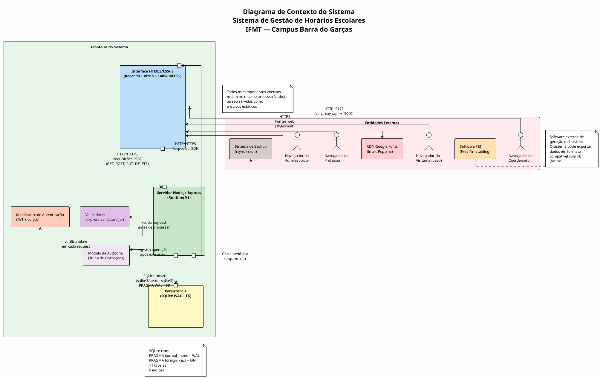
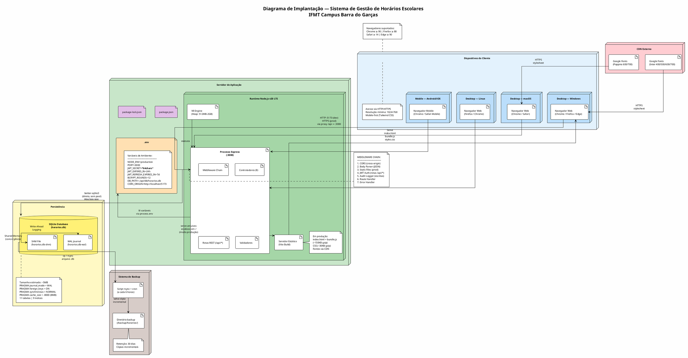

# Escopo do Projeto — Sistema de Gestão de Horários Escolares

**Instituição:** Instituto Federal de Mato Grosso — Campus Barra do Garças
**Versão:** 1.0.0
**Data:** 10/09/2026
**Normas de Referência:** PMBOK 7ª Edição · OMG UML 2.5.1
**Status:** Aprovado para Distribuição

---

## Índice

1. [Justificativa de Engenharia e Objetivos SMART](#1-justificativa-de-engenharia-e-objetivos-smart)
2. [Delimitação das Fronteiras do Sistema (System Boundary)](#2-delimitação-das-fronteiras-do-sistema-system-boundary)
3. [Escopo do Produto](#3-escopo-do-produto)
4. [Diagrama de Componentes UML 2.5.1](#4-diagrama-de-componentes-uml-251)
5. [Diagrama de Implantação (Deployment Diagram)](#5-diagrama-de-implantação-deployment-diagram)
6. [Estrutura Analítica do Projeto (EAP / WBS)](#6-estrutura-analítica-do-projeto-eap--wbs)
7. [Limites Explícitos do Projeto](#7-limites-explícitos-do-projeto)
8. [Matrizes de Gestão](#8-matrizes-de-gestão)
9. [Governança e Processo de Controle de Mudanças de Escopo](#9-governança-e-processo-de-controle-de-mudanças-de-escopo)

---

## 1. Justificativa de Engenharia e Objetivos SMART

### 1.1 Justificativa da Escolha da Stack

A definição da stack tecnológica **Node.js + HTML5** para o Sistema de Gestão de Horários Escolares do IFMT Campus Barra do Garças fundamenta-se nos seguintes critérios de engenharia de software:

#### 1.1.1 Motivação Principal

O campus atualmente utiliza planilhas eletrônicas e o software FET para geração de horários, processos manuais que consomem entre 40 e 80 horas-semester por coordenação. A migração para um sistema web integrado elimina redundâncias, reduz erros de alocação manual e centraliza dados em uma única fonte confiável.

#### 1.1.2 Justificativa Técnica para Node.js + Express.js

| Critério | Justificativa |
|---|---|
| **Migração do backend** | O backend inicial foi prototipado em Python/FastAPI. A migração para Node.js + Express.js unifica o ecossistema de desenvolvimento (JavaScript/TypeScript em todas as camadas), eliminando a necessidade de manter dois runtimes e reduzindo a complexidade de build e deploy. |
| **Performance I/O** | O modelo event-driven non-blocking do Node.js é ideal para aplicações web que realizam múltiplas operações de leitura/escrita concorrentes no banco de dados SQLite, como consultas simultâneas de professores verificando seus horários. |
| **Ecossistema npm** | Acesso a mais de 2 milhões de pacotes para autenticação (jsonwebtoken, bcryptjs), validação (joi, express-validator), testes (jest, supertest) e build (vite). |
| **Compatibilidade com Frontend** | Compartilhamento de modelos de dados e tipos entre frontend e backend via JavaScript, facilitando a manutenção e reduzindo erros de interface. |
| **Comunidade e Suporte** | Node.js possui uma das maiores comunidades open-source, garantindo resolução rápida de vulnerabilidades e disponibilidade de documentação. |
| **Requisito de Portabilidade** | O Node.js roda em praticamente qualquer sistema operacional com V8 runtime, atendendo ao ambiente heterêneo do IFMT. |

#### 1.1.3 Justificativa para HTML5 + React 18 + Vite 5 + Tailwind CSS

| Critério | Justificativa |
|---|---|
| **HTML5 Semântico** | Utilização de tags semânticas (`<header>`, `<nav>`, `<main>`, `<section>`, `<article>`, `<footer>`) para acessibilidade, SEO e manutenção do código. |
| **React 18** | Componentização da interface com hooks (useState, useEffect, useCallback, useContext) para estados reativos, reutilização de componentes e separação clara de responsabilidades. |
| **Vite 5** | Build tool com Hot Module Replacement (HMR) submilissegundo, tree-shaking nativo e suporte a ES Modules, resultando em tempos de build 10-100x superiores ao Webpack em projetos de média escala. Servidor de desenvolvimento na porta 5173 com proxy reverso de `/api` para `localhost:3000`. |
| **Tailwind CSS** | Framework utility-first que elimina a necessidade de criar uma biblioteca de componentes CSS custom, acelerando o desenvolvimento e garantindo consistência visual via design tokens. Suporte nativo a glassmorphism (backdrop-filter, blur, transparência). |
| **Responsividade** | A abordagem mobile-first do Tailwind CSS atende aos requisitos de acesso via dispositivos móveis em laboratórios do campus e redes educacionais. |

#### 1.1.4 Justificativa para SQLite

| Critério | Justificativa |
|---|---|
| **Zero-config** | Não requer servidor dedicado, instalação ou administração de banco de dados relacional separado. |
| **WAL Mode** | O modo Write-Ahead Logging permite leituras concorrentes enquanto uma escrita está em processo, atendendo ao cenário de múltiplos usuários simultâneos. |
| **Foreign Keys** | Chaves estrangeiras habilitadas por pragma (`PRAGMA foreign_keys = ON`) garantem integridade referencial entre as 11 tabelas. |
| **Portabilidade** | O arquivo `.db` pode ser copiado, versionado e restaurado facilmente para fins de backup e auditoria. |
| **Migração Futura** | A arquitetura de camada de persistência foi projetada para permitir migração futura para PostgreSQL sem alteração dos controladores. |

#### 1.1.5 Comparativo de Alternativas Avaliadas

| Stack Alternativa | Motivo da Rejeição |
|---|---|
| Django + PostgreSQL | Sobrecarga de framework full-stack; Python não compartilha linguagem com frontend. |
| PHP + Laravel | Ecossistema em declínio em novos projetos educacionais; sintaxe menos moderna. |
| Java + Spring Boot | Over-engineering para um sistema de escopo regional; tempo de startup elevado. |
| Angular + .NET | Licenciamento proprietário; curva de aprendizado elevada para equipe acadêmica. |
| Mobile nativo (React Native) | Requisito primário é acesso via navegador web em desktops de laboratório. |

### 1.2 Objetivos SMART

| ID | Objetivo | Específico (S) | Mensurável (M) | Atingível (A) | Relevante (R) | Temporal (T) |
|---|---|---|---|---|---|---|
| **SMART-01** | Implementar o módulo de captura de leads | Criar formulário funcional com validação client-side e server-side, armazenamento em SQLite e notificação por toast | ≥ 95% das submissões válidas persistem no banco; tempo de resposta < 2s; 0 erros de validação não capturados | Equipe de 2 desenvolvedores com experiência em React; infraestrutura existente | Reduzir o ciclo de qualificação de interessados de 5 dias para 1 dia útil | Entrega em 2 semanas (Sprint 1-2) até 24/09/2026 |
| **SMART-02** | Implementar autenticação JWT | Sistema de login com bcrypt para hash de senhas, JWT para sessões, middleware de verificação em todas as rotas protegidas | 100% das rotas CRUD protegidas; taxa de falsos negativos < 1%; tokens expiram em ≤ 24h | Bibliotecas maduras (jsonwebtoken, bcryptjs) amplamente documentadas | Garantir que dados acadêmicos sensíveis (notas, horários) sejam acessíveis apenas por autorizados | Entrega em 1 semana (Sprint 3) até 01/10/2026 |
| **SMART-03** | Implementar CRUD completo de Cursos | Criação, leitura, atualização e exclusão de cursos com validação de campos obrigatórios (nome, carga_horaria, turnos) | 100% dos endpoints CRUD operacionais; cobertura de testes ≥ 80%; tempo de resposta < 500ms | API REST padrão com controladores modulares já estruturados | Módulo base para todas as demais entidades acadêmicas do sistema | Entrega em 1 semana (Sprint 4) até 08/10/2026 |
| **SMART-04** | Implementar o módulo de Alocação de Horários | Sistema de alocação de horários_aula em salas com verificação automática de conflitos (professor, sala, turma) | ≥ 99% de detecção de conflitos; 0 alocações simultâneas na mesma sala/professor/turma; interface drag-and-drop funcional | Algoritmo de verificação de sobreposição com consulta SQL otimizada via índices | Módulo crítico — razão de existir do sistema | Entrega em 3 semanas (Sprint 5-7) até 29/10/2026 |
| **SMART-05** | Reduzir tempo de montagem de grade horária | Comparar tempo médio de montagem antes (manual/FET) e depois (sistema web) | Redução ≥ 60% no tempo médio de montagem (de ~60h para ≤ 24h) | Funcionalidades de CRUD + alocação automatizada + verificação de conflitos | Impacto direto na produtividade da coordenação pedagógica | Mensuração após 1 semestre de uso (30/03/2027) |
| **SMART-06** | Documentar toda a API REST | Gerar documentação OpenAPI 3.0/Swagger para todos os endpoints, incluindo schemas de request/response e exemplos | 100% dos endpoints documentados; ≥ 3 exemplos de request por endpoint; documento validado pelo time | Swagger UI integrado ao Express via swagger-jsdoc e swagger-ui-express | Facilitar manutenção, integração futura e onboarding de novos desenvolvedores | Entrega contínua; snapshot completo até 15/11/2026 |
| **SMART-07** | Implementar trilha de auditoria | Registro automático de todas as operações CRUD (INSERT, UPDATE, DELETE) em tabela dedicada com timestamp, usuário e dados antes/depois | 100% das operações de escrita registradas; retenção de logs ≥ 1 ano; query de auditoria funcional | Middleware Express interceptador de requisições; tabela `auditoria` no SQLite | Atender a requisitos de conformidade institucional e rastreabilidade de dados | Entrega em 2 semanas (Sprint 8-9) até 12/11/2026 |
| **SMART-08** | Landing page com captação de leads | Página inicial responsiva com hero, benefícios, formulário e modal de leads, estilizada com glassmorphism | Lighthouse Performance ≥ 90; Lighthouse Accessibility ≥ 95; tempo de carregamento < 3s em 3G; taxa de conversão de leads ≥ 5% | React 18 + Tailwind CSS; otimizações de build via Vite | Primeiro ponto de contato com potenciais usuários do sistema | Entrega em 2 semanas (Sprint 1-2) até 24/09/2026 |

---

## 2. Delimitação das Fronteiras do Sistema (System Boundary)

### 2.1 Diagrama de Contexto do Sistema (PlantUML)



### 2.2 Descrição das Fronteiras

| Fronteira | Tipo | Descrição |
|---|---|---|
| **Navegador → Frontend** | HTTP | O usuário acessa `http://localhost:5173` ou o domínio de produção. O Vite dev server serve os bundles React com HMR. Em produção, arquivos estáticos são servidos pelo Express. |
| **Frontend → Backend** | HTTP/REST | O Vite configura proxy reverso: qualquer requisição a `/api/*` é encaminhada para `http://localhost:3000`. Em produção, o Express serve os arquivos estáticos do React e a API sob o mesmo domínio. |
| **Backend → Database** | Driver SQLite | O Node.js utiliza o driver `better-sqlite3` (síncrono) ou `sqlite3` (assíncrono) para executar queries SQL diretamente no arquivo `.db`. Não há servidor de banco de dados dedicado. |
| **Backend → Auth** | Interno | Middleware de autenticação intercepta requisições em rotas protegidas, valida o token JWT e anexa o payload do usuário ao objeto `req.user`. |
| **Backend → Validators** | Interno | Validaadores verificam o schema do body/params/query antes de o controlador processar a requisição. Retornam 400 com mensagens de erro detalhadas em caso de falha. |
| **Backend → Audit** | Interno | Após cada operação de escrita (INSERT, UPDATE, DELETE), o controlador invoca o módulo de auditoria que registra a operação na tabela `auditoria` com timestamp, ID do usuário, entidade afetada e dados antes/depois. |
| **Frontend → CDN** | HTTPS | O HTML5 inclui `<link>` para Google Fonts (Inter, Poppins) carregados via CDN. Em caso de indisponibilidade, o fallback `sans-serif` é aplicado via CSS. |
| **Database → Backup** | Arquivo | Script cron executa `rsync` do arquivo `.db` para diretório de backup a cada 6 horas. Backup incremental com retenção de 30 dias. |
| **Sistema → FET** | Exportação (futuro) | Módulo futuro de exportação de dados no formato `.xml` compatível com o software FET para geração de horários via algoritmos de timetable optimization. |

---

## 3. Escopo do Produto

### 3.1 Módulo — Landing Page

**Responsabilidade:** Apresentação institucional do sistema, demonstração de benefícios e conversão de visitantes em leads qualificados.

| Entregável | Arquivo | Descrição |
|---|---|---|
| Página principal | `frontend/src/App.jsx` | Componente raiz que orquestra a renderização condicional entre Landing Page e rotas autenticadas. Gerencia estado global de autenticação via `useState` e `useEffect`. |
| Componente Header | `frontend/src/components/Header.jsx` | Barra de navegação responsiva com logo do IFMT, links de âncora (Benefícios, Como Funciona, Contato), botão de Login e indicador de status de conexão com a API. Implementa menu hamburger em viewports < 768px. |
| Componente Hero | `frontend/src/components/Hero.jsx` | Seção hero com título impactante, subtítulo descritivo, CTA (Call to Action) para formulário de leads e animação CSS de gradiente animado. Utiliza `<section>` semântico com `role="banner"`. |
| Componente Benefícios | `frontend/src/components/Beneficios.jsx` | Grid responsiva de cards com ícones SVG, títulos e descrições dos principais benefícios do sistema. Implementa animação de scroll-reveal via Intersection Observer API. Layout em `grid-cols-1 md:grid-cols-2 lg:grid-cols-3`. |
| Estilos globais | `frontend/tailwind.config.js` | Configuração do Tailwind com tema customizado: cores institucionais IFMT (verde #006B3F, dourado #DAA520), fontes (Inter para corpo, Poppins para títulos), extendendo `backdrop-blur` para glassmorphism. |
| Configuração de build | `frontend/vite.config.js` | Configuração Vite com proxy `/api` → `localhost:3000`, plugin React, alias de caminhos relativos e otimização de chunks. |
| Template HTML | `frontend/index.html` | Documento HTML5 semântico com meta tags Open Graph, viewport responsivo, favicon e preload de fontes críticas. |

### 3.2 Módulo — Captura de Leads

**Responsabilidade:** Coleta, validação, armazenamento e exibição de informações de contato de potenciais usuários interessados no sistema.

| Entregável | Arquivo | Descrição |
|---|---|---|
| Componente Formulário | `frontend/src/components/FormularioLead.jsx` | Formulário React com campos: nome completo, e-mail institucional, instituição/unidade, cargo/função, telefone opcional. Validação client-side em tempo real (onChange) com indicadores visuais (borda verde/vermelha). Debounce de 300ms para evitar submissões múltiplas. Submissão via `fetch()` POST para `/api/leads`. |
| Componente Toast | `frontend/src/components/Toast.jsx` | Sistema de notificações flutuantes (toast) com 4 variantes: sucesso (verde), erro (vermelho), aviso (amarelo), informação (azul). Auto-dismiss após 5 segundos. Animação de entrada/saída CSS (`translateX` + `opacity`). Posicionamento fixo no canto inferior direito. Empilhamento de múltiplos toasts. |
| Componente Modal | `frontend/src/components/ModalLeads.jsx` | Modal acessível (focus trap, ESC para fechar, click outside para fechar) que exibe a lista de leads cadastrados em formato de tabela. Acessível apenas para usuários autenticados com perfil admin. Inclui campos: data de cadastro, nome, e-mail, instituição, status (novo/contatado/convertido). Busca por texto e filtro por status. |
| Rota API Leads | `api/src/rotas/leads.js` | Rotas REST: `POST /api/leads` (pública), `GET /api/leads` (protegida, admin), `PUT /api/leads/:id/status` (protegida, admin), `DELETE /api/leads/:id` (protegida, admin). |
| Controlador Leads | `api/src/controladores/leadController.js` | Funções: `criarLead()`, `listarLeads()`, `atualizarStatusLead()`, `excluirLead()`. Validação server-side de e-mail institucional via regex. Verificação de duplicatas por e-mail antes de inserir. |
| Tabela SQLite | Script SQL de criação: tabela `leads` | Colunas: `id INTEGER PRIMARY KEY AUTOINCREMENT`, `nome TEXT NOT NULL`, `email TEXT NOT NULL UNIQUE`, `instituicao TEXT`, `cargo TEXT`, `telefone TEXT`, `status TEXT DEFAULT 'novo' CHECK(status IN ('novo','contatado','convertido','descartado'))`, `created_at DATETIME DEFAULT CURRENT_TIMESTAMP`, `updated_at DATETIME DEFAULT CURRENT_TIMESTAMP`. |
| Índice | Script SQL: índice `idx_leads_email` | `CREATE UNIQUE INDEX idx_leads_email ON leads(email);` — acelera buscas por e-mail e garante unicidade. |

### 3.3 Módulo — Autenticação

**Responsabilidade:** Controle de acesso ao sistema com autenticação baseada em JWT (JSON Web Token) e hash de senhas com bcrypt.

| Entregável | Arquivo | Descrição |
|---|---|---|
| Componente Login | `frontend/src/components/Login.jsx` | Formulário de login com campos: e-mail e senha. Botão de submit com estado de loading (spinner). Mensagem de erro inline. Redirecionamento automático para `/dashboard` após sucesso. Salvamento do token JWT em `localStorage` com verificação de expiração. |
| Rota API Autenticação | `api/src/rotas/auth.js` | Rotas: `POST /api/auth/login` (pública), `POST /api/auth/register` (protegida, admin), `POST /api/auth/refresh` (protegida), `GET /api/auth/me` (protegida). |
| Controlador Auth | `api/src/controladores/authController.js` | Funções: `login()`, `registrar()`, `refreshToken()`, `perfilAtual()`. Geração de JWT com payload: `{ id, email, role, iat, exp }`. Expiração: access token 24h, refresh token 7 dias. |
| Middleware JWT | `api/src/middlewares/auth.js` | Middleware `autenticar` que: (1) extrai token do header `Authorization: Bearer <token>`, (2) verifica assinatura com `jwt.verify()`, (3) anexa payload a `req.user`, (4) retorna 401 em caso de token inválido/expirado. |
| Middleware Roles | `api/src/middlewares/roles.js` | Middleware `autorizar(...roles)` que verifica se `req.user.role` está na lista de papéis permitidos. Retorna 403 se não autorizado. |
| Bibliotecas Backend | `package.json` (dependências) | `jsonwebtoken` (geração/verificação JWT), `bcryptjs` (hash de senhas com salt rounds = 12), `dotenv` (variáveis de ambiente). |
| Variáveis de Ambiente | `.env` | `JWT_SECRET=<string_aleatoria_64chars>`, `JWT_EXPIRES_IN=24h`, `JWT_REFRESH_EXPIRES_IN=7d`, `BCRYPT_ROUNDS=12`, `NODE_ENV=development\|production`. |
| Tabela SQLite | Script SQL: tabela `usuarios` | Colunas: `id INTEGER PRIMARY KEY AUTOINCREMENT`, `email TEXT NOT NULL UNIQUE`, `senha_hash TEXT NOT NULL`, `nome TEXT NOT NULL`, `role TEXT DEFAULT 'user' CHECK(role IN ('admin','user','viewer'))`, `ativo INTEGER DEFAULT 1`, `created_at DATETIME DEFAULT CURRENT_TIMESTAMP`, `updated_at DATETIME DEFAULT CURRENT_TIMESTAMP`. |
| Índice | Script SQL: índice `idx_usuarios_email` | `CREATE UNIQUE INDEX idx_usuarios_email ON usuarios(email);` |

### 3.4 Módulo — Gestão de Cursos

**Responsabilidade:** Cadastro, consulta, atualização e exclusão de cursos oferecidos pelo campus.

| Entregável | Arquivo | Descrição |
|---|---|---|
| Rota API Cursos | `api/src/rotas/cursos.js` | `GET /api/cursos` (listar todas), `GET /api/cursos/:id` (buscar por ID), `POST /api/cursos` (criar — admin), `PUT /api/cursos/:id` (atualizar — admin), `DELETE /api/cursos/:id` (excluir — admin). |
| Controlador Cursos | `api/src/controladores/cursoController.js` | Funções: `listarCursos()`, `buscarCursoPorId()`, `criarCurso()`, `atualizarCurso()`, `excluirCurso()`. Verificação de integridade antes de exclusão (verifica se há turmas vinculadas). Paginação com `?page=1&limit=20`. Busca por nome com `?search=`. |
| Validações | `api/src/utilitarios/validadores.js` | Schema de validação para curso: `nome` (string, 3-100 chars, required), `carga_horaria` (integer, 800-6000, required), `turnos` (array de strings: 'manhã', 'tarde', 'noite', min 1), `modalidade` (string: 'presencial', 'EAD', 'híbrido'). |
| Tabela SQLite | Script SQL: tabela `cursos` | Colunas: `id INTEGER PRIMARY KEY AUTOINCREMENT`, `nome TEXT NOT NULL UNIQUE`, `carga_horaria INTEGER NOT NULL CHECK(carga_horaria > 0)`, `turnos TEXT NOT NULL`, `modalidade TEXT DEFAULT 'presencial'`, `created_at DATETIME DEFAULT CURRENT_TIMESTAMP`, `updated_at DATETIME DEFAULT CURRENT_TIMESTAMP`. |
| Índice | Script SQL: índice `idx_cursos_nome` | `CREATE INDEX idx_cursos_nome ON cursos(nome);` |

### 3.5 Módulo — Gestão de Turmas

**Responsabilidade:** Cadastro e gestão das turmas (divisões de alunos) vinculadas a cursos e períodos letivos.

| Entregável | Arquivo | Descrição |
|---|---|---|
| Rota API Turmas | `api/src/rotas/turmas.js` | `GET /api/turmas` (listar), `GET /api/turmas/:id` (buscar), `POST /api/turmas` (criar — admin), `PUT /api/turmas/:id` (atualizar — admin), `DELETE /api/turmas/:id` (excluir — admin). Filtros: `?curso_id=`, `?periodo=`, `?turno=`. |
| Controlador Turmas | `api/src/controladores/turmaController.js` | Funções: `listarTurmas()`, `buscarTurmaPorId()`, `criarTurma()`, `atualizarTurma()`, `excluirTurma()`. JOIN com tabela `cursos` para retornar nome do curso. Verificação de vínculos com `turma_materia` antes de exclusão. |
| Tabela SQLite | Script SQL: tabela `turmas` | Colunas: `id INTEGER PRIMARY KEY AUTOINCREMENT`, `nome TEXT NOT NULL`, `curso_id INTEGER NOT NULL`, `periodo TEXT NOT NULL`, `turno TEXT NOT NULL CHECK(turno IN ('manhã','tarde','noite'))`, `quantidade_alunos INTEGER DEFAULT 0`, `created_at DATETIME DEFAULT CURRENT_TIMESTAMP`, `updated_at DATETIME DEFAULT CURRENT_TIMESTAMP`, `FOREIGN KEY (curso_id) REFERENCES cursos(id) ON DELETE RESTRICT`. |
| Índice | Script SQL: índice `idx_turmas_curso_id` | `CREATE INDEX idx_turmas_curso_id ON turmas(curso_id);` |

### 3.6 Módulo — Gestão de Professores

**Responsabilidade:** Cadastro e gestão dos professores do campus, incluindo dados pessoais, vínculo com disciplinas e restrições individuais.

| Entregável | Arquivo | Descrição |
|---|---|---|
| Rota API Professores | `api/src/rotas/professores.js` | `GET /api/professores` (listar), `GET /api/professores/:id` (buscar), `POST /api/professores` (criar — admin), `PUT /api/professores/:id` (atualizar — admin), `DELETE /api/professores/:id` (excluir — admin). Filtros: `?disponivel=`, `?materia_id=`. |
| Controlador Professores | `api/src/controladores/professorController.js` | Funções: `listarProfessores()`, `buscarProfessorPorId()`, `criarProfessor()`, `atualizarProfessor()`, `excluirProfessor()`. JOIN com `professor_materia` para listar disciplinas vinculadas. |
| Tabela SQLite | Script SQL: tabela `professores` | Colunas: `id INTEGER PRIMARY KEY AUTOINCREMENT`, `nome TEXT NOT NULL`, `email TEXT UNIQUE`, `siape TEXT UNIQUE`, `telefone TEXT`, `disponivel INTEGER DEFAULT 1`, `carga_horaria_semanal INTEGER DEFAULT 40`, `created_at DATETIME DEFAULT CURRENT_TIMESTAMP`, `updated_at DATETIME DEFAULT CURRENT_TIMESTAMP`. |
| Tabela SQLite | Script SQL: tabela `professor_materia` | Colunas: `id INTEGER PRIMARY KEY AUTOINCREMENT`, `professor_id INTEGER NOT NULL`, `materia_id INTEGER NOT NULL`, `created_at DATETIME DEFAULT CURRENT_TIMESTAMP`, `FOREIGN KEY (professor_id) REFERENCES professores(id) ON DELETE CASCADE`, `FOREIGN KEY (materia_id) REFERENCES materias(id) ON DELETE CASCADE`, `UNIQUE(professor_id, materia_id)`. |
| Índice | Script SQL: índice `idx_professor_materia_professor` | `CREATE INDEX idx_professor_materia_professor ON professor_materia(professor_id);` |
| Índice | Script SQL: índice `idx_professor_materia_materia` | `CREATE INDEX idx_professor_materia_materia ON professor_materia(materia_id);` |

### 3.7 Módulo — Gestão de Matérias (Disciplinas)

**Responsabilidade:** Cadastro e gestão das disciplinas ministradas nos cursos, incluindo carga horária, período de oferta e pré-requisitos.

| Entregável | Arquivo | Descrição |
|---|---|---|
| Rota API Matérias | `api/src/rotas/materias.js` | `GET /api/materias` (listar), `GET /api/materias/:id` (buscar), `POST /api/materias` (criar — admin), `PUT /api/materias/:id` (atualizar — admin), `DELETE /api/materias/:id` (excluir — admin). Filtros: `?curso_id=`, `?periodo=`, `?carga_horaria_min=`, `?carga_horaria_max=`. |
| Controlador Matérias | `api/src/controladores/materiaController.js` | Funções: `listarMaterias()`, `buscarMateriaPorId()`, `criarMateria()`, `atualizarMateria()`, `excluirMateria()`. Verificação de vínculos com `professor_materia` e `turma_materia` antes de exclusão. |
| Tabela SQLite | Script SQL: tabela `materias` | Colunas: `id INTEGER PRIMARY KEY AUTOINCREMENT`, `nome TEXT NOT NULL`, `codigo TEXT UNIQUE`, `carga_horaria INTEGER NOT NULL CHECK(carga_horaria > 0)`, `curso_id INTEGER NOT NULL`, `periodo INTEGER CHECK(periodo BETWEEN 1 AND 10)`, `created_at DATETIME DEFAULT CURRENT_TIMESTAMP`, `updated_at DATETIME DEFAULT CURRENT_TIMESTAMP`, `FOREIGN KEY (curso_id) REFERENCES cursos(id) ON DELETE RESTRICT`. |
| Índice | Script SQL: índice `idx_materias_curso_id` | `CREATE INDEX idx_materias_curso_id ON materias(curso_id);` |

### 3.8 Módulo — Gestão de Salas

**Responsabilidade:** Cadastro e gestão dos espaços físicos disponíveis para aulas, incluindo capacidade, recursos (projetor, lab, etc.) e pavimento.

| Entregável | Arquivo | Descrição |
|---|---|---|
| Rota API Salas | `api/src/rotas/salas.js` | `GET /api/salas` (listar), `GET /api/salas/:id` (buscar), `POST /api/salas` (criar — admin), `PUT /api/salas/:id` (atualizar — admin), `DELETE /api/salas/:id` (excluir — admin). Filtros: `?tipo=`, `?capacidade_min=`, `?recurso=`. |
| Controlador Salas | `api/src/controladores/salaController.js` | Funções: `listarSalas()`, `buscarSalaPorId()`, `criarSala()`, `atualizarSala()`, `excluirSala()`. Verificação de conflitos com `horarios_alocados` antes de exclusão. |
| Tabela SQLite | Script SQL: tabela `salas` | Colunas: `id INTEGER PRIMARY KEY AUTOINCREMENT`, `nome TEXT NOT NULL UNIQUE`, `bloco TEXT`, `pavimento INTEGER`, `capacidade INTEGER NOT NULL CHECK(capacidade > 0)`, `tipo TEXT NOT NULL CHECK(tipo IN ('sala','laboratório','auditório','quadra','gabinete'))`, `recursos TEXT DEFAULT '[]',` `created_at DATETIME DEFAULT CURRENT_TIMESTAMP`, `updated_at DATETIME DEFAULT CURRENT_TIMESTAMP`. |

### 3.9 Módulo — Gestão de Horários

**Responsabilidade:** Definição dos slots de tempo disponíveis (horários aula) e alocação/destino de disciplinas a turmas e horários específicos, com verificação automática de conflitos.

| Entregável | Arquivo | Descrição |
|---|---|---|
| Rota API Horários | `api/src/rotas/horarios.js` | `GET /api/horarios` (listar slots), `POST /api/horarios` (criar slot — admin), `DELETE /api/horarios/:id` (remover slot — admin). |
| Rota API Alocações | `api/src/rotas/horariosAlocados.js` | `GET /api/horarios-alocados` (listar alocações), `GET /api/horarios-alocados?turma_id=` (filtrar por turma), `GET /api/horarios-alocados?professor_id=` (filtrar por professor), `GET /api/horarios-alocados?sala_id=` (filtrar por sala), `POST /api/horarios-alocados` (criar alocação — admin), `PUT /api/horarios-alocados/:id` (atualizar — admin), `DELETE /api/horarios-alocados/:id` (remover — admin). |
| Controlador Horários | `api/src/controladores/horarioController.js` | Funções: `listarHorarios()`, `criarHorario()`, `excluirHorario()`. Validação de formato: hora_inicio < hora_fim, dia_semana ∈ {segunda, terça, quarta, quinta, sexta, sábado}. |
| Controlador Alocações | `api/src/controladores/alocacaoController.js` | Funções: `listarAlocacoes()`, `criarAlocacao()`, `atualizarAlocacao()`, `excluirAlocacao()`, `verificarConflitos()`. **Lógica crítica de verificação de conflitos:** Antes de criar/atualizar uma alocação, o sistema verifica se há sobreposição para (1) o mesmo professor no mesmo horário, (2) a mesma sala no mesmo horário, (3) a mesma turma no mesmo horário. Retorna lista de conflitos encontrados. |
| Rota API Turma-Matéria | `api/src/rotas/turmaMateria.js` | `GET /api/turma-materia` (listar vínculos), `POST /api/turma-materia` (criar vínculo — admin), `DELETE /api/turma-materia/:id` (remover vínculo — admin). |
| Controlador Turma-Matéria | `api/src/controladores/turmaMateriaController.js` | Funções: `listarVinculos()`, `criarVinculo()`, `removerVinculo()`. Verificação de duplicatas. |
| Tabela SQLite | Script SQL: tabela `horarios` | Colunas: `id INTEGER PRIMARY KEY AUTOINCREMENT`, `dia_semana TEXT NOT NULL CHECK(dia_semana IN ('segunda','terça','quarta','quinta','sexta','sábado'))`, `hora_inicio TEXT NOT NULL`, `hora_fim TEXT NOT NULL`, `created_at DATETIME DEFAULT CURRENT_TIMESTAMP`. |
| Tabela SQLite | Script SQL: tabela `horarios_alocados` | Colunas: `id INTEGER PRIMARY KEY AUTOINCREMENT`, `turma_materia_id INTEGER NOT NULL`, `horario_id INTEGER NOT NULL`, `sala_id INTEGER NOT NULL`, `created_at DATETIME DEFAULT CURRENT_TIMESTAMP`, `updated_at DATETIME DEFAULT CURRENT_TIMESTAMP`, `FOREIGN KEY (turma_materia_id) REFERENCES turma_materia(id) ON DELETE CASCADE`, `FOREIGN KEY (horario_id) REFERENCES horarios(id) ON DELETE CASCADE`, `FOREIGN KEY (sala_id) REFERENCES salas(id) ON DELETE RESTRICT`, `UNIQUE(horario_id, sala_id)`, `UNIQUE(turma_materia_id, horario_id)`. |
| Tabela SQLite | Script SQL: tabela `turma_materia` | Colunas: `id INTEGER PRIMARY KEY AUTOINCREMENT`, `turma_id INTEGER NOT NULL`, `materia_id INTEGER NOT NULL`, `created_at DATETIME DEFAULT CURRENT_TIMESTAMP`, `FOREIGN KEY (turma_id) REFERENCES turmas(id) ON DELETE CASCADE`, `FOREIGN KEY (materia_id) REFERENCES materias(id) ON DELETE CASCADE`, `UNIQUE(turma_id, materia_id)`. |

### 3.10 Módulo — Restrições

**Responsabilidade:** Definição e armazenamento de restrições de alocação horária (indisponibilidades de professores, preferências de turno, conflitos de espaço).

| Entregável | Arquivo | Descrição |
|---|---|---|
| Rota API Restrições | `api/src/rotas/restricoes.js` | `GET /api/restricoes` (listar), `GET /api/restricoes?professor_id=` (filtrar), `POST /api/restricoes` (criar — admin), `PUT /api/restricoes/:id` (atualizar — admin), `DELETE /api/restricoes/:id` (remover — admin). |
| Controlador Restrições | `api/src/controladores/restricaoController.js` | Funções: `listarRestricoes()`, `criarRestricao()`, `atualizarRestricao()`, `excluirRestricao()`. Tipos de restrição suportados: `horario_indisponivel` (professor não pode ministrar em tal horário), `turno_indisponivel`, `dia_indisponivel`, `sala_indisponivel`, `conflito_professor` (dois professores não podem ter aulas simultâneas em mesma turma). |
| Tabela SQLite | Script SQL: tabela `restricoes` | Colunas: `id INTEGER PRIMARY KEY AUTOINCREMENT`, `professor_id INTEGER,` `tipo TEXT NOT NULL CHECK(tipo IN ('horario_indisponivel','turno_indisponivel','dia_indisponivel','sala_indisponivel','conflito_professor'))`, `valor TEXT NOT NULL,` `descricao TEXT`, `prioridade INTEGER DEFAULT 1 CHECK(prioridade BETWEEN 1 AND 5)`, `created_at DATETIME DEFAULT CURRENT_TIMESTAMP`, `updated_at DATETIME DEFAULT CURRENT_TIMESTAMP`, `FOREIGN KEY (professor_id) REFERENCES professores(id) ON DELETE CASCADE`. |

### 3.11 Módulo — Auditoria

**Responsabilidade:** Registro imutável de todas as operações de escrita realizadas no sistema, para rastreabilidade, conformidade e resolução de conflitos.

| Entregável | Arquivo | Descrição |
|---|---|---|
| Middleware de Auditoria | `api/src/middlewares/auditoria.js` | Middleware Express que: (1) intercepta métodos POST, PUT, DELETE, (2) captura `req.body` antes da operação, (3) após a operação, registra na tabela `auditoria`: timestamp, `req.user.id`, método HTTP, rota, entidade afetada, dados anteriores (para UPDATE/DELETE), dados novos (para INSERT/UPDATE), IP do cliente (`req.ip`). |
| Rota API Auditoria | `api/src/rotas/auditoria.js` | `GET /api/auditoria` (listar registros — apenas admin), `GET /api/auditoria?entidade=` (filtrar por entidade), `GET /api/auditoria?usuario_id=` (filtrar por usuário), `GET /api/auditoria?data_inicio=&data_fim=` (filtrar por período). Paginação obrigatória (max 100 registros por request). |
| Controlador Auditoria | `api/src/controladores/auditoriaController.js` | Funções: `listarRegistros()`, `buscarPorId()`. Apenas operações de leitura — a escrita é realizada exclusivamente pelo middleware. |
| Tabela SQLite | Script SQL: tabela `auditoria` | Colunas: `id INTEGER PRIMARY KEY AUTOINCREMENT`, `usuario_id INTEGER`, `metodo_http TEXT NOT NULL`, `rota TEXT NOT NULL`, `entidade TEXT NOT NULL`, `entidade_id INTEGER`, `dados_anteriores TEXT,` `dados_novos TEXT`, `ip_address TEXT`, `user_agent TEXT`, `created_at DATETIME DEFAULT CURRENT_TIMESTAMP`, `FOREIGN KEY (usuario_id) REFERENCES usuarios(id) ON DELETE SET NULL`. |
| Índice | Script SQL: índice `idx_auditoria_created_at` | `CREATE INDEX idx_auditoria_created_at ON auditoria(created_at);` |

### 3.12 Resumo de Componentes Frontend

| Componente | Arquivo | Responsabilidade Principal | Rotas Onde Aparece |
|---|---|---|---|
| Header | `frontend/src/components/Header.jsx` | Navegação, logo IFMT, links, botão login/logout | Todas |
| Hero | `frontend/src/components/Hero.jsx` | Apresentação principal, CTA para leads | Landing Page |
| Benefícios | `frontend/src/components/Beneficios.jsx` | Grid de cards com benefícios do sistema | Landing Page |
| FormulárioLead | `frontend/src/components/FormularioLead.jsx` | Formulário de captação de leads | Landing Page |
| ModalLeads | `frontend/src/components/ModalLeads.jsx` | Lista e gestão de leads cadastrados | Dashboard (admin) |
| Login | `frontend/src/components/Login.jsx` | Formulário de autenticação | `/login` |
| Toast | `frontend/src/components/Toast.jsx` | Notificações temporárias | Todas (global) |
| Footer | `frontend/src/components/Footer.jsx` | Informações institucionais, links, copyright | Todas |

### 3.13 Resumo de Tabelas do Banco de Dados

| # | Tabela | Tamanho Estimado | Descrição |
|---|---|---|---|
| 1 | `cursos` | ~20 registros | Cursos oferecidos pelo campus |
| 2 | `turmas` | ~100 registros | Turmas (divisões de alunos) |
| 3 | `professores` | ~80 registros | Corpo docente |
| 4 | `materias` | ~150 registros | Disciplinas/minérias |
| 5 | `professor_materia` | ~200 registros | Vínculo professor-disciplina (N:N) |
| 6 | `salas` | ~40 registros | Espaços físicos |
| 7 | `horarios` | ~50 registros | Slots de tempo (dias + horários) |
| 8 | `turma_materia` | ~300 registros | Vínculo turma-disciplina (N:N) |
| 9 | `horarios_alocados` | ~500 registros | Alocações de aulas em horários/salas |
| 10 | `restricoes` | ~60 registros | Restrições de alocação |
| 11 | `leads` | ~100 registros | Leads de marketing |

### 3.14 Resumo de Índices

| # | Nome do Índice | Tabela | Coluna(s) | Tipo | Objetivo |
|---|---|---|---|---|---|
| 1 | `idx_cursos_nome` | cursos | nome | NORMAL | Busca por nome de curso |
| 2 | `idx_turmas_curso_id` | turmas | curso_id | NORMAL | Turmas por curso |
| 3 | `idx_materias_curso_id` | materias | curso_id | NORMAL | Matérias por curso |
| 4 | `idx_professor_materia_professor` | professor_materia | professor_id | NORMAL | Matérias de um professor |
| 5 | `idx_professor_materia_materia` | professor_materia | materia_id | NORMAL | Professores de uma matéria |
| 6 | `idx_leads_email` | leads | email | UNIQUE | Unicidade e busca por e-mail |
| 7 | `idx_usuarios_email` | usuarios | email | UNIQUE | Unicidade e busca por e-mail |
| 8 | `idx_auditoria_created_at` | auditoria | created_at | NORMAL | Filtro por período |
| 9 | UNIQUE implicito | horarios_alocados | (horario_id, sala_id) | UNIQUE | Previne sala duplicada no mesmo horário |

---

## 4. Diagrama de Componentes UML 2.5.1

```plantuml
@startuml ComponentDiagram
!theme plain
skinparam backgroundColor #FEFEFE
skinparam componentStyle rectangle
skinparam packageStyle rectangle
skinparam defaultFontName "Segoe UI"
skinparam defaultFontSize 11
skinparam linetype ortho
skinparam padding 10
skinparam nodesep 30
skinparam ranksep 40

title Diagrama de Componentes — Sistema de Gestão de Horários Escolares\nUML 2.5.1 | IFMT Campus Barra do Garças

package "Frontend (Client-Side)" as FrontendPkg #E3F2FD {

  component "App.jsx\n(Componente Raiz)" as App #BBDEFB {
    portin " " as App_In
    portout " " as App_Out
  }

  component "Header.jsx" as Header #E1F5FE
  component "Hero.jsx" as Hero #E1F5FE
  component "Beneficios.jsx" as Beneficios #E1F5FE
  component "FormularioLead.jsx" as FormLead #E1F5FE
  component "ModalLeads.jsx" as ModalLeads #E1F5FE
  component "Login.jsx" as LoginComp #E1F5FE
  component "Toast.jsx" as Toast #E1F5FE
  component "Footer.jsx" as Footer #E1F5FE

  App -right-> Header : "renderiza"
  App -right-> Hero : "renderiza"
  App -right-> Beneficios : "renderiza"
  App -right-> FormLead : "renderiza"
  App -right-> ModalLeads : "renderiza (admin)"
  App -right-> LoginComp : "renderiza (/login)"
  App -right-> Toast : "gerencia notificações"
  App -right-> Footer : "renderiza"
}

package "Backend (Server-Side)" as BackendPkg #C8E6C9 {

  component "Express Router\n(Rotas /api/*)" as Router #A5D6A7 {
    portin "HTTP Request" as Router_In
    portout "HTTP Response" as Router_Out
  }

  component "Middleware\nAuth (JWT + bcrypt)" as MwAuth #FFCCBC {
    portin " " as MwAuth_In
    portout " " as MwAuth_Out
  }

  component "Middleware\nAuditoria" as MwAudit #F3E5F5 {
    portin " " as MwAudit_In
    portout " " as MwAudit_Out
  }

  component "Controladores\n(8 módulos)" as Controllers #FFF9C4 {
    portout " " as Ctrl_Out
  }

  component "Validadores\n(express-validator)" as Validators #E1BEE7 {
    portin " " as Val_In
    portout " " as Val_Out
  }

  component "Utilitários\n Helpers)" as Utils #DCEDC8

  Router -right-> MwAuth : "<<required>>\nverificação\nde token"
  Router -down-> MwAudit : "<<required>>\nregistro de\noperação"
  Router -down-> Controllers : "encaminha\nrequisição"
  Controllers -right-> Validators : "<<required>>\nafter validation\nschema"
  Controllers -right-> Utils : "utiliza"
}

package "Persistência" as PersistPkg #FFF9C4 {

  component "SQLite Driver\n(better-sqlite3)" as SQLiteDriver #FFE0B2 {
    portin "SQL Query" as SQL_In
    portout "ResultSet" as SQL_Out
  }

  database "SQLite\n(archivo .db\nWAL Mode)" as SQLite #FFF176 {
    portin " " as DB_In
  }

  note bottom of SQLite
    PRAGMA journal_mode = WAL
    PRAGMA foreign_keys = ON
    11 tabelas
    9 índices
  end note
}

' --- Interfaces Fornecidas (Provided) - notação <<>> sem seta de entrada ---
' --- Interfaces Requeridas (Required) - notação <<>> com seta de saída ---

package "Interface HTML5/JS" as HTML5Interface #BBDEFB {

  interface " " as I_REST_API <<provided\nREST API\n(GET/POST/PUT/DELETE)>>
  interface " " as I_STATIC <<provided\nStatic Files\n(HTML/CSS/JS)>>
}

package "Servidor Node.js Express" as NodeInterface #C8E6C9 {

  interface " " as I_ROUTE_HANDLER <<provided\nRoute Handler\n(req, res, next)>>
  interface " " as I_AUTH <<provided\nJWT Verification\n(req.user)>>
  interface " " as I_AUDIT <<provided\nAudit Logging\n(operation log)>>
  interface " " as I_VALIDATION <<provided\nSchema Validation\n(joi/express-validator)>>
}

package "Camada de Persistência" as PersistInterface #FFF9C4 {

  interface " " as I_SQL <<provided\nSQL Queries\n(PRAGMA + DML)>>
  interface " " as I_TRANSACTION <<provided\nTransaction\nBEGIN/COMMIT/ROLLBACK)>>
}

' --- Conexões entre pacotes ---

App_In ..> I_STATIC : "<<required>>\nCarrega pacotes\nestáticos"
App_Out ..> I_REST_API : "<<required>>\nfetch() API calls\n(axios/fetch)"

I_REST_API ..> Router_In : "<<required>>\nHTTP dispatch"
Router_Out ..> I_REST_API : "<<provided>>\nJSON Response"

MwAuth_Out ..> I_AUTH : "<<required>>\nverifica JWT"
I_AUDIT ..> MwAudit_In : "<<provided>>\nregistra"

Controllers ..> I_ROUTE_HANDLER : "<<required>>\nprocessa request"
Controllers ..> I_VALIDATION : "<<required>>\nafter validation"

Controllers ..> I_SQL : "<<required>>\nexecuta queries"
I_SQL ..> SQL_In : "<<required>>\nsend query"
SQL_Out ..> I_SQL : "<<provided>>\nresult data"

I_TRANSACTION ..> SQLite : "<<required>>\nWAL writes"

' --- Portas ---

package "Frontend" as FP #E3F2FD {
  portin "Port 5173\n(Vite Dev Server)" as Port5173
}

package "Backend" as BP #C8E6C9 {
  portin "Port 3000\n(Express HTTP)" as Port3000
}

Port5173 ..> Port3000 : "<<required>>\nHTTP /api/*\n(Vite Proxy)"

note right of Port3000
  Em produção:
  Express serve
  arquivos estáticos
  + API na mesma porta
end note

@enduml
```



### 4.1 Descrição das Interfaces

| Interface | Tipo | Componente Provedor | Componente Receptor | Descrição |
|---|---|---|---|---|
| `REST API (GET/POST/PUT/DELETE)` | Provided | Servidor Express | Frontend React | Endpoints RESTful prefixados com `/api/`. Formato de dados: JSON. Códigos HTTP: 200, 201, 400, 401, 403, 404, 500. |
| `Static Files (HTML/CSS/JS)` | Provided | Vite Dev Server / Express (prod) | Navegador do Cliente | Arquivos estáticos do bundle React: `index.html`, JS chunks, CSS, imagens e fontes. |
| `Route Handler (req, res, next)` | Provided | Express Router | Controladores | Interface de requisição/resposta Express com métodos `req.body`, `req.params`, `req.query`, `req.user`, `res.json()`, `res.status()`. |
| `JWT Verification` | Provided | Middleware Auth | Controladores | Verificação do token JWT. Se válido, popula `req.user` com `{ id, email, role }`. Se inválido, retorna 401 e interrompe a chain. |
| `Audit Logging` | Provided | Middleware Auditoria | Tabela `auditoria` | Registro de operações de escrita com metadados: timestamp, usuário, método, rota, entidade, dados前后, IP. |
| `Schema Validation` | Provided | express-validator / joi | Controladores | Validação de `req.body`, `req.params`, `req.query` contra schemas predefinidos. Retorna array de erros em caso de falha. |
| `SQL Queries` | Provided | SQLite Driver | Controladores | Execução de queries SQL: `SELECT`, `INSERT`, `UPDATE`, `DELETE`, `CREATE INDEX`. Suporte a prepared statements e parâmetros vinculados. |
| `Transaction` | Provided | SQLite Driver | Camada de Persistência | Controle de transações: `BEGIN`, `COMMIT`, `ROLLBACK`. Utilizado em operações que afetam múltiplas tabelas. |

---

## 5. Diagrama de Implantação (Deployment Diagram)



### 5.1 Descrição dos Nós de Implantação

| Nó | Tipo | Tecnologia | Recursos | Observações |
|---|---|---|---|---|
| **Desktop Windows** | Dispositivo | Chrome/Edge ≥ 90 | 4GB RAM, 1Mbps | Computadores de laboratório do IFMT |
| **Desktop macOS** | Dispositivo | Chrome/Safari ≥ 14 | 4GB RAM, 1Mbps | Computadores da coordenação |
| **Desktop Linux** | Dispositivo | Firefox/Chrome ≥ 88 | 4GB RAM, 1Mbps | Computadores administrativos |
| **Mobile** | Dispositivo | Chrome Mobile / Safari Mobile | 2GB RAM, 3G/WiFi | Acesso pontual de professores |
| **Servidor** | Servidor | Node.js v20 LTS + Express | 2GB RAM, 2 vCPU, 10GB disco | Pode ser VM no datacenter do IFMT ou VPS |
| **SQLite** | Banco de Dados | SQLite 3.x com WAL | Arquivo ~5MB, 8MB cache | Embedded no processo Node.js |
| **CDN** | Serviço Externo | Google Fonts | Banda CDN global | Fallback local `sans-serif` |
| **Backup** | Infraestrutura | rsync + cron | 100MB/mês | Backup em disco local ou NAS |

### 5.2 Fluxo de Requisição em Produção

```
1. Navegador do usuário → HTTPS → Servidor Express (:3000)
2. Express serve index.html + bundle.js + styles.css (arquivos estáticos)
3. React renderiza a SPA (Single Page Application)
4. Usuário interage → React envia fetch() para /api/* (mesmo domínio)
5. Express rota → Middleware JWT → Controlador → SQLite Query → JSON Response
6. React atualiza estado → DOM re-renderizado via Virtual DOM
```

---

## 6. Estrutura Analítica do Projeto (EAP / WBS)

### 6.1 Árvore Hierárquica

```
1.0 Projeto de Horários Escolares
│
├── 1.1 Planejamento
│   ├── 1.1.1 Documento de Escopo (este documento)
│   ├── 1.1.2 Levantamento de Requisitos
│   │   ├── 1.1.2.1 Entrevistas com coordenação
│   │   ├── 1.1.2.2 Análise do processo atual (FET + planilhas)
│   │   └── 1.1.2.3 Matriz de requisitos funcionais e não-funcionais
│   ├── 1.1.3 Prototipação (Wireframes e Mockups)
│   │   ├── 1.1.3.1 Wireframe da Landing Page
│   │   ├── 1.1.3.2 Wireframe do Dashboard
│   │   ├── 1.1.3.3 Mockup do formulário de alocação
│   │   └── 1.1.3.4 Protótipo navegável (Figma / HTML estático)
│   ├── 1.1.4 Definição da Arquitetura Técnica
│   │   ├── 1.1.4.1 Diagrama de componentes (UML 2.5.1)
│   │   ├── 1.1.4.2 Diagrama de implantação
│   │   ├── 1.1.4.3 Diagrama de banco de dados (ER)
│   │   └── 1.1.4.4 Definição de padrões de código e commit
│   └── 1.1.5 Cronograma do Projeto
│       ├── 1.1.5.1 Definição de sprints (2 semanas)
│       ├── 1.1.5.2 Estimativa de esforço (Story Points)
│       └── 1.1.5.3 Definição de milestones
│
├── 1.2 Desenvolvimento Backend
│   ├── 1.2.1 Configuração do Ambiente
│   │   ├── 1.2.1.1 Inicialização do projeto Node.js (package.json)
│   │   ├── 1.2.1.2 Instalação de dependências (express, cors, dotenv, jsonwebtoken, bcryptjs)
│   │   ├── 1.2.1.3 Configuração do servidor Express (api/main.py → Node.js)
│   │   ├── 1.2.1.4 Configuração de CORS e proxy reverso
│   │   └── 1.2.1.5 Arquivo .env com variáveis de ambiente
│   ├── 1.2.2 Camada de Persistência
│   │   ├── 1.2.2.1 Configuração da conexão SQLite (api/src/config/db.js)
│   │   ├── 1.2.2.2 Script de criação de tabelas (11 tabelas)
│   │   ├── 1.2.2.3 Script de criação de índices (9 índices)
│   │   ├── 1.2.2.4 Habilitação de PRAGMA (WAL, foreign_keys)
│   │   └── 1.2.2.5 Script de seed (dados iniciais para teste)
│   ├── 1.2.3 Módulo de Autenticação
│   │   ├── 1.2.3.1 Controlador authController.js
│   │   ├── 1.2.3.2 Middleware auth.js (JWT verification)
│   │   ├── 1.2.3.3 Middleware roles.js (RBAC)
│   │   ├── 1.2.3.4 Rotas auth.js
│   │   └── 1.2.3.5 Tabela usuarios + índice
│   ├── 1.2.4 Módulo de Cursos
│   │   ├── 1.2.4.1 Controlador cursoController.js
│   │   ├── 1.2.4.2 Rotas cursos.js
│   │   └── 1.2.4.3 Validações (validadores.js)
│   ├── 1.2.5 Módulo de Turmas
│   │   ├── 1.2.5.1 Controlador turmaController.js
│   │   ├── 1.2.5.2 Rotas turmas.js
│   │   └── 1.2.5.3 Validações
│   ├── 1.2.6 Módulo de Professores
│   │   ├── 1.2.6.1 Controlador professorController.js
│   │   ├── 1.2.6.2 Rotas professores.js
│   │   └── 1.2.6.3 Validações
│   ├── 1.2.7 Módulo de Matérias
│   │   ├── 1.2.7.1 Controlador materiaController.js
│   │   ├── 1.2.7.2 Rotas materias.js
│   │   └── 1.2.7.3 Validações
│   ├── 1.2.8 Módulo de Salas
│   │   ├── 1.2.8.1 Controlador salaController.js
│   │   ├── 1.2.8.2 Rotas salas.js
│   │   └── 1.2.8.3 Validações
│   ├── 1.2.9 Módulo de Horários e Alocações
│   │   ├── 1.2.9.1 Controlador horarioController.js
│   │   ├── 1.2.9.2 Controlador alocacaoController.js
│   │   ├── 1.2.9.3 Controlador turmaMateriaController.js
│   │   ├── 1.2.9.4 Rotas horarios.js
│   │   ├── 1.2.9.5 Rotas horariosAlocados.js
│   │   ├── 1.2.9.6 Rotas turmaMateria.js
│   │   └── 1.2.9.7 Algoritmo de detecção de conflitos
│   ├── 1.2.10 Módulo de Restrições
│   │   ├── 1.2.10.1 Controlador restricaoController.js
│   │   ├── 1.2.10.2 Rotas restricoes.js
│   │   └── 1.2.10.3 Validações
│   ├── 1.2.11 Módulo de Leads
│   │   ├── 1.2.11.1 Controlador leadController.js
│   │   ├── 1.2.11.2 Rotas leads.js
│   │   └── 1.2.11.3 Validações
│   ├── 1.2.12 Módulo de Auditoria
│   │   ├── 1.2.12.1 Middleware auditoria.js
│   │   ├── 1.2.12.2 Controlador auditoriaController.js
│   │   ├── 1.2.12.3 Rotas auditoria.js
│   │   └── 1.2.12.4 Tabela auditoria + índice
│   └── 1.2.13 Documentação da API
│       ├── 1.2.13.1 Configuração do Swagger/OpenAPI 3.0
│       ├── 1.2.13.2 Descrição de todos os endpoints
│       └── 1.2.13.3 Exemplos de request/response
│
├── 1.3 Desenvolvimento Frontend
│   ├── 1.3.1 Configuração do Ambiente
│   │   ├── 1.3.1.1 Inicialização do projeto Vite 5 (frontend/)
│   │   ├── 1.3.1.2 Configuração do React 18
│   │   ├── 1.3.1.3 Instalação e configuração do Tailwind CSS
│   │   ├── 1.3.1.4 Configuração do vite.config.js (proxy /api)
│   │   └── 1.3.1.5 Configuração de Tailwind (tema, cores IFMT, fontes)
│   ├── 1.3.2 Componentes da Landing Page
│   │   ├── 1.3.2.1 Header.jsx (navegação responsiva)
│   │   ├── 1.3.2.2 Hero.jsx (seção principal com CTA)
│   │   ├── 1.3.2.3 Beneficios.jsx (grid de cards com scroll-reveal)
│   │   ├── 1.3.2.4 Footer.jsx (informações institucionais)
│   │   └── 1.3.2.5 Animações CSS (glassmorphism, gradients)
│   ├── 1.3.3 Componentes de Captação de Leads
│   │   ├── 1.3.3.1 FormularioLead.jsx (formulário validado)
│   │   ├── 1.3.3.2 Toast.jsx (sistema de notificações)
│   │   └── 1.3.3.3 ModalLeads.jsx (tabela de gestão de leads)
│   ├── 1.3.4 Componente de Autenticação
│   │   ├── 1.3.4.1 Login.jsx (formulário de login)
│   │   └── 1.3.4.2 Hook useAuth (gerenciamento de estado de auth)
│   ├── 1.3.5 Componentes do Dashboard (CRUD)
│   │   ├── 1.3.5.1 Dashboard.jsx (layout com sidebar)
│   │   ├── 1.3.5.2 Tabelas genéricas (reutilizáveis)
│   │   ├── 1.3.5.3 Formulários CRUD (criar/editar)
│   │   ├── 1.3.5.4 Modal de confirmação (exclusão)
│   │   └── 1.3.5.5 Paginação e busca
│   ├── 1.3.6 Módulo de Alocação Visual
│   │   ├── 1.3.6.1 GradeHorarios.jsx (tabela semanal)
│   │   ├── 1.3.6.2 Drag-and-drop (alocação de aulas)
│   │   └── 1.3.6.3 Indicadores visuais de conflito
│   ├── 1.3.7 App.jsx (Componente Raiz)
│   │   ├── 1.3.7.1 Roteamento (React Router)
│   │   ├── 1.3.7.2 Estado global (auth, leads, toast)
│   │   ├── 1.3.7.3 Proteção de rotas autenticadas
│   │   └── 1.3.7.4 Tratamento de erros globais
│   └── 1.3.8 Otimizações
│       ├── 1.3.8.1 Code splitting (lazy loading)
│       ├── 1.3.8.2 Minificação e gzip (Vite)
│       └── 1.3.8.3 Análise de bundle (rollup-plugin-visualizer)
│
├── 1.4 Banco de Dados
│   ├── 1.4.1 Projeto do Modelo de Dados
│   │   ├── 1.4.1.1 Diagrama Entidade-Relacionamento (ER)
│   │   ├── 1.4.1.2 Dicionário de Dados
│   │   └── 1.4.1.3 Regras de Integridade
│   ├── 1.4.2 Implementação
│   │   ├── 1.4.2.1 Script DDL (CREATE TABLE × 11)
│   │   ├── 1.4.2.2 Script de índices (CREATE INDEX × 9)
│   │   ├── 1.4.2.3 PRAGMA configurations
│   │   └── 1.4.2.4 Script de dados iniciais (seed)
│   ├── 1.4.3 Migrações
│   │   ├── 1.4.3.1 Sistema de versionamento de schema
│   │   └── 1.4.3.2 Scripts de migração incrementais
│   └── 1.4.4 Backup e Recuperação
│       ├── 1.4.4.1 Script de backup automatizado (rsync + cron)
│       ├── 1.4.4.2 Política de retenção (30 dias)
│       └── 1.4.4.3 Procedimento de restauração
│
├── 1.5 Testes
│   ├── 1.5.1 Testes Unitários
│   │   ├── 1.5.1.1 Testes de validadores (validadores.js)
│   │   ├── 1.5.1.2 Testes de utilitários
│   │   └── 1.5.1.3 Cobertura mínima ≥ 80%
│   ├── 1.5.2 Testes de Integração
│   │   ├── 1.5.2.1 Testes de rotas API (supertest)
│   │   ├── 1.5.2.2 Testes de controladores com DB
│   │   └── 1.5.2.3 Testes de middleware JWT
│   ├── 1.5.3 Testes de Conflitos de Horários
│   │   ├── 1.5.3.1 Teste: mesmo professor, mesmo horário
│   │   ├── 1.5.3.2 Teste: mesma sala, mesmo horário
│   │   ├── 1.5.3.3 Teste: mesma turma, mesmo horário
│   │   └── 1.5.3.4 Teste: múltiplos conflitos simultâneos
│   ├── 1.5.4 Testes de Performance
│   │   ├── 1.5.4.1 Carga com 100 usuários simultâneos
│   │   ├── 1.5.4.2 Tempo de resposta das queries (< 500ms)
│   │   └── 1.5.4.3 Stress test do Event Loop
│   └── 1.5.5 Testes de UI (Frontend)
│       ├── 1.5.5.1 Renderização de componentes
│       ├── 1.5.5.2 Acessibilidade (axe-core)
│       └── 1.5.5.3 Responsividade (viewports)
│
├── 1.6 Documentação
│   ├── 1.6.1 Documento de Escopo (este documento)
│   ├── 1.6.2 Documentação Técnica da API (Swagger/OpenAPI)
│   ├── 1.6.3 Guia de Instalação e Configuração
│   │   ├── 1.6.3.1 Pré-requisitos (Node.js, npm)
│   │   ├── 1.6.3.2 Passos de instalação
│   │   ├── 1.6.3.3 Configuração do .env
│   │   └── 1.6.3.4 Instruções de execução
│   ├── 1.6.4 Guia do Usuário
│   │   ├── 1.6.4.1 Manual de login
│   │   ├── 1.6.4.2 Manual de gestão de cursos/turmas/professores
│   │   ├── 1.6.4.3 Manual de alocação de horários
│   │   └── 1.6.4.4 Manual de visualização de restrições
│   └── 1.6.5 CHANGELOG e Versionamento
│       ├── 1.6.5.1 Semver (v1.0.0)
│       └── 1.6.5.2 Registro de alterações
│
└── 1.7 Implantação
    ├── 1.7.1 Ambiente de Desenvolvimento
    │   ├── 1.7.1.1 Configuração local (localhost)
    │   ├── 1.7.1.2 Hot Module Replacement (Vite)
    │   └── 1.7.1.3 Proxy /api (Vite → Express)
    ├── 1.7.2 Ambiente de Homologação
    │   ├── 1.7.2.1 Deploy em servidor de testes
    │   ├── 1.7.2.2 Validação com dados de teste
    │   └── 1.7.2.3 Aprovação do usuário final
    ├── 1.7.3 Ambiente de Produção
    │   ├── 1.7.3.1 Build de produção (npm run build)
    │   ├── 1.7.3.2 Configuração do servidor (PM2 / systemd)
    │   ├── 1.7.3.3 Configuração de HTTPS (Let's Encrypt)
    │   ├── 1.7.3.4 Migração do banco (se aplicável)
    │   └── 1.7.3.5 Rollback plan
    └── 1.7.4 Monitoramento
        ├── 1.7.4.1 Logs estruturados (winston / pino)
        ├── 1.7.4.2 Health check endpoint (/api/health)
        └── 1.7.4.3 Monitoramento de processos (PM2)
```

### 6.2 Dicionário de Entregáveis

| ID | Entregável | Descrição | Unidade de Medida | Responsável |
|---|---|---|---|---|
| 1.1.1 | Documento de Escopo | Este documento com escopo, limites, EAP, diagramas | 1 documento | Tech Lead |
| 1.1.2.1 | Entrevistas | Reuniões com coordenação pedagógica para levantamento de requisitos | Horas | BA / Product Owner |
| 1.1.3 | Protótipos | Wireframes navegáveis em ferramenta de design | Protótipo(s) | UI/UX Designer |
| 1.1.4.3 | Diagrama ER | Modelo Entidade-Relacionamento do banco de dados | 1 diagrama | DBA / Tech Lead |
| 1.2.1.1 | package.json | Manifesto de dependências e scripts do backend | 1 arquivo | Backend Dev |
| 1.2.2.2 | DDL Schema | Script SQL de criação de 11 tabelas | 1 arquivo SQL | DBA |
| 1.2.3 | Módulo Auth | Autenticação JWT completa (controller + middleware + rotas) | 5 arquivos | Backend Dev |
| 1.2.4-1.2.11 | Módulos CRUD | 8 controladores, 8 arquivos de rotas, validações | ~30 arquivos | Backend Dev |
| 1.2.12 | Módulo Auditoria | Middleware + controller + rota + tabela | 4 arquivos | Backend Dev |
| 1.3.1.3 | Tailwind Config | Configuração do tema institucional IFMT | 1 arquivo | Frontend Dev |
| 1.3.2 | Componentes LP | 4 componentes da Landing Page (Header, Hero, Benefícios, Footer) | 4 componentes | Frontend Dev |
| 1.3.3 | Leads Components | 3 componentes de captação (Formulário, Toast, Modal) | 3 componentes | Frontend Dev |
| 1.3.5 | Dashboard Components | Layout, tabelas, formulários CRUD, paginação | ~8 componentes | Frontend Dev |
| 1.3.7 | App.jsx | Componente raiz com roteamento e estado global | 1 arquivo | Frontend Dev |
| 1.4.4 | Backup Script | Script automatizado de backup com cron | 1 script | DevOps |
| 1.5 | Testes | Testes unitários, integração, conflitos, performance, UI | ~50 testes | QA / Dev |
| 1.6.2 | Swagger Docs | Documentação OpenAPI 3.0 de todos os endpoints | 1 spéc | Backend Dev |
| 1.7.3 | Deploy Produção | Build, configuração do servidor, migração de dados | Checklist | DevOps |

---

## 7. Limites Explícitos do Projeto

### 7.1 Dentro do Escopo (In-Scope)

| # | Item | Descrição |
|---|---|---|
| IS-01 | Landing Page | Página inicial responsiva com hero, benefícios, formulário de leads e footer, estilizada com glassmorphism via Tailwind CSS. |
| IS-02 | Captação de Leads | Formulário de contato para potenciais usuários com validação client/server-side, armazenamento em SQLite e gestão via modal administrativo. |
| IS-03 | Autenticação JWT | Sistema de login/logout com senhas hasheadas (bcrypt), tokens JWT com expiração configurável e refresh token. |
| IS-04 | RBAC (Controle de Acesso Baseado em Papel) | Três papéis: admin (acesso total), user (CRUD limitado), viewer (somente leitura). |
| IS-05 | CRUD de Cursos | Criação, leitura, atualização e exclusão de cursos com validação de campos e verificação de integridade referencial. |
| IS-06 | CRUD de Turmas | Gestão de turmas vinculadas a cursos, com filtros por curso, período e turno. |
| IS-07 | CRUD de Professores | Gestão de corpo docente com vínculo a disciplinas via tabela associativa professor_materia. |
| IS-08 | CRUD de Matérias | Gestão de disciplinas com vinculação a cursos e definição de período e carga horária. |
| IS-09 | CRUD de Salas | Gestão de espaços físicos com tipo, capacidade, bloco e recursos. |
| IS-10 | Definição de Horários | Cadastro de slots de tempo (dia da semana + hora início/fim). |
| IS-11 | Alocação de Horários | Atribuição de aulas (turma + matéria + professor) a horários e salas, com verificação automática de conflitos. |
| IS-12 | Verificação de Conflitos | Algoritmo que impede: (a) mesmo professor em dois horários simultâneos, (b) mesma sala com duas aulas ao mesmo tempo, (c) mesma turma com duas aulas simultâneas. |
| IS-13 | Vínculo Turma-Matéria | Gestão da relação N:N entre turmas e matérias (quais matérias cada turma cursa). |
| IS-14 | Restrições de Alocação | Cadastro de restrições (indisponibilidade de professor, preferência de turno, etc.) com prioridade e utilização na verificação de conflitos. |
| IS-15 | Trilha de Auditoria | Registro automático de todas as operações de escrita com timestamp, usuário, entidade, dados antes/depois e IP. |
| IS-16 | API REST Documentada | Documentação OpenAPI 3.0/Swagger para todos os endpoints, com schemas e exemplos. |
| IS-17 | Banco de Dados SQLite | 11 tabelas, 9 índices, WAL mode, foreign keys, paginação em todas as listagens. |
| IS-18 | Responsividade | Layout mobile-first funcional em viewports ≥ 320px, adaptável a desktops ≥ 1024px. |
| IS-19 | Backup Automatizado | Script de backup do arquivo SQLite a cada 6 horas via cron, retenção de 30 dias. |
| IS-20 | Health Check | Endpoint GET /api/health que retorna status do servidor e banco de dados. |

### 7.2 Fora do Escopo (Out-of-Scope)

| # | Item | Justificativa da Exclusão |
|---|---|---|
| OS-01 | Aplicativo Mobile Nativo (Android/iOS) | O sistema é acessado via navegador web. Um app nativo demandaria equipes especializadas em Kotlin/Swift e duplicaria o código em ~70%. |
| OS-02 | Integração com Sistemas de Pagamento | O sistema não envolve transações financeiras. Não há necessidade de integração com gateways de pagamento (Stripe, PagSeguro, etc.). |
| OS-03 | Multi-tenancy (Múltiplas Instituições) | O sistema é específico para o IFMT Campus Barra do Garças. Multi-tenancy adicionaria complexidade significativa (esquemas de banco separados, isolamento de dados). |
| OS-04 | Inteligência Artificial / Machine Learning | O sistema não emprega algoritmos de IA para geração automática de horários. A alocação é manual com verificação de conflitos. Algoritmos de timetable optimization estão fora do escopo atual. |
| OS-05 | Sistema de Notificações por E-mail/SMS | O sistema não envia e-mails ou SMS. Comunicação é feita exclusivamente via interface web (toasts, modal). |
| OS-06 | Sistema de Chat ou Mensageiro Interno | Não há necessidade de comunicação instantânea entre usuários dentro do sistema. |
| OS-07 | Gestão de Notas e Boletins | O sistema é exclusivamente de gestão de horários. Avaliação acadêmica pertence a outros sistemas do IFMT. |
| OS-08 | Gestão de Presença/Frequência | Controle de frequência de alunos não faz parte do escopo de gestão de horários. |
| OS-09 | Exportação de Dados para FET | A exportação de dados no formato XML do software FET é considerada funcionalidade futura (v2.0). |
| OS-10 | Internacionalização (i18n) | O sistema é monolíngue (pt-BR). Suporte a múltiplos idiomas adicionaria complexidade de tradução, formatação de datas e moedas. |
| OS-11 | Integração com Google Calendar / Outlook | Sincronização com calendários externos demandaria APIs OAuth adicionais e escopo de integração significativo. |
| OS-12 | Gestão de Reserva de Espaços (Eventos) | O sistema gerencia apenas aulas regulares. Reservas de auditórios para eventos, reuniões e atividades extracurriculares estão fora do escopo. |
| OS-13 | Dashboard Analítico / Relatórios Avançados | Gráficos de desempenho, indicadores KPI e relatórios gerenciais complexos estão fora do escopo da versão 1.0. |
| OS-14 | Testes de Penetração Profissionais | Testes de segurança detalhados (pentest) por empresa especializada estão fora do orçamento atual. |
| OS-15 | Infraestrutura Cloud (AWS/Azure/GCP) | A implantação é em servidor local do IFMT ou VPS genérico. Configuração de cloud managed services está fora do escopo. |

---

## 8. Matrizes de Gestão

### 8.1 Matriz de Critérios de Aceitação (CA)

| ID | Critério de Aceitação | Módulo | Métrica | Método de Verificação | Status |
|---|---|---|---|---|---|
| CA-01 | A Landing Page deve carregar completamente em menos de 3 segundos em conexão 3G simulada | Landing Page | Lighthouse Performance ≥ 90 | Google Lighthouse (throttling 3G) | Pendente |
| CA-02 | Todas as rotas CRUD devem retornar resposta em menos de 500ms para operações individuais | Todos os módulos CRUD | Tempo de resposta P95 < 500ms | Testes automatizados (supertest) + monitoramento | Pendente |
| CA-03 | O sistema deve detectar ≥ 99% dos conflitos de alocação (professor, sala, turma) | Alocação | 0 falsos negativos em cenários de teste | Suite de testes de conflitos (mínimo 20 cenários) | Pendente |
| CA-04 | Nenhum dado sensível (senha hash, token JWT, dados de audit) deve ser exposto em responses da API | Autenticação | 0 vazamentos em revisão de código | Code review + testes de segurança manuais | Pendente |
| CA-05 | A interface deve ser funcional e acessível em viewports de 320px a 1920px de largura | Frontend | WCAG 2.1 Level AA (acessibilidade) | Google Lighthouse Accessibility + axe-core | Pendente |
| CA-06 | O formulário de leads deve rejeitar 100% dos dados inválidos (e-mail malformado, campos obrigatórios ausentes) | Leads | 0 registros inválidos no banco | Testes de validação client + server | Pendente |
| CA-07 | O backup do banco de dados deve ser recuperável e funcional após restauração | Backup | RTO ≤ 1 hora; RPO ≤ 6 horas | Teste de restauração em ambiente de staging | Pendente |
| CA-08 | O token JWT deve expirar no prazo configurado e o sistema deve rejeitar tokens expirados com 401 | Autenticação | 0 acessos com token expirado | Testes automatizados de expiração | Pendente |
| CA-09 | A auditoria deve registrar 100% das operações de escrita (INSERT, UPDATE, DELETE) com todos os campos obrigatórios | Auditoria | 0 operações não registradas | Query de contagem: COUNT(*) de operações esperadas vs registradas | Pendente |
| CA-10 | O sistema deve suportar no mínimo 50 usuários simultâneos sem degradação significativa de performance | Performance | Throughput ≥ 50 req/s; erro rate < 1% | Teste de carga com artillery.io ou k6 | Pendente |
| CA-11 | Todos os endpoints da API devem estar documentados no Swagger com ao menos 1 exemplo de request e response | Documentação | 100% dos endpoints documentados | Verificação manual do Swagger UI | Pendente |
| CA-12 | O login deve autenticar em menos de 2 segundos com senha correta e rejeitar em menos de 1 segundo com senha incorreta | Autenticação | Tempo de resposta login < 2s | Testes automatizados de performance | Pendente |

### 8.2 Matriz de Restrições e Premissas

#### Restrições

| ID | Restrição | Tipo | Descrição | Impacto |
|---|---|---|---|---|
| R-01 | Equipe de desenvolvimento limitada | Recurso | Equipe composta por 2 desenvolvedores (full-stack) com carga horária parcial (~20h/semana cada) | Prazos mais longos; necessidade de priorização rigorosa |
| R-02 | Infraestrutura institucional | Tecnologia | Servidor disponível é uma VM com 2 vCPU, 2GB RAM, 10GB disco | Não suporta containers Docker pesados; SQLite é a escolha adequada |
| R-03 | Conformidade LGPD | Regulatório | Dados de leads e professores são dados pessoais sob LGPD (Lei 13.709/2018) | Necessidade de consentimento explícito, política de retenção e direito ao esquecimento |
| R-04 | Orçamento zero | Financeiro | Projeto sem verba para licenças, serviços cloud ou contratações externas | Uso exclusivo de software open-source; hospedagem local ou VPS básica |
| R-05 | Prazo institucional | Temporal | Sistema deve estar operacional até o início do semestre letivo 2027 ( Fevereiro/2027) | Deadline rígido; funcionalidades não críticas podem ser adiadas para v1.1 |
| R-06 | Compatibilidade com FET | Integração | O software FET (Free Timetabling) é utilizado atualmente; dados devem ser exportáveis em formato compatível futuramente | Design da API deve antecipar campos necessários para exportação XML FET |
| R-07 | Acessibilidade web | Regulatório | Sistema público do IFMT deve atender diretrizes de acessibilidade (e-MAG 3.1 / WCAG 2.1 AA) | Necessidade de alternativas textuais, contraste adequado, navegação por teclado |

#### Premissas

| ID | Premissa | Descrição | Validação |
|---|---|---|---|
| P-01 | Disponibilidade do servidor | Assume-se que uma VM com as especificações mínimas estará disponível no datacenter do IFMT para implantação | Verificar com o setor de TI até 30/09/2026 |
| P-02 | Acesso à internet para CDN | Assume-se que os computadores do campus têm acesso à internet para carregar fontes do Google Fonts | Fallback `sans-serif` definido; sistema funcional offline (fontes locais) |
| P-03 | Dados iniciais disponíveis | Assume-se que a coordenação fornecerá listas de cursos, turmas, professores e salas em formato estruturado (CSV/Excel) para popular o banco | Coleta até 15/10/2026 |
| P-04 | Proficiência da equipe | Assume-se que os desenvolvedores possuem experiência prévia com React, Node.js e SQLite | Verificar portfólio e projetos anteriores |
| P-05 | Estabilidade do SQLite | Assume-se que o volume de dados (estimado < 10MB) e concorrência (< 50 usuários simultâneos) são adequados para SQLite em produção | Testes de carga na Sprint 5 |
| P-06 | Aprovação do layout | Assume-se que o layout da Landing Page e do Dashboard serão aprovados pela coordenação antes do desenvolvimento completo do frontend | Reunião de validação de wireframes até 01/10/2026 |
| P-07 | Continuidade do projeto | Assume-se que não haverá interrupções superiores a 2 semanas no desenvolvimento durante o período de execução | Comunicação prévia de férias, feriados e compromissos acadêmicos |

### 8.3 Matriz de Riscos Técnicos com Planos de Mitigação

| ID | Risco | Descrição | Probabilidade | Impacto | Nível | Plano de Mitigação | Responsável |
|---|---|---|---|---|---|---|---|
| TR-01 | **Bloqueio do Event Loop** | Operações síncronas pesadas no Node.js (queries SQLite complexas, parsing de JSON grande, operações CPU-intensivas) bloqueiam o event loop, impedindo o processamento de outras requisições, resultando em timeouts e degradação de performance para todos os usuários conectados. | Média (40%) | Alto | **Alto** | (1) Utilizar better-sqlite3 (síncrono mas rápido) para queries simples e sqlite3 (assíncrono com callbacks) para queries pesadas. (2) Implementar timeouts de 5 segundos em queries SQL. (3) Externalizar operações pesadas para worker threads (`worker_threads`) quando necessário. (4) Monitorar latência do event loop via `perf_hooks.monitorEventLoopDelay()`. (5) Code review obrigatório para toda query com JOIN em múltiplas tabelas. (6) Limitar resultado de queries com `LIMIT` e paginação. | Backend Dev |
| TR-02 | **Injeção de Código (XSS / SQL Injection)** | Falta de sanitização de entrada do usuário pode permitir ataques de Cross-Site Scripting (XSS) no frontend ou SQL Injection no backend, comprometendo dados de alunos, professores e horários. | Média (35%) | Crítico | **Crítico** | (1) Utilizar prepared statements / parameterized queries em todas as queries SQLite (jamais concatenação de strings). (2) Validar e sanitizar todos os inputs com express-validator/joi no backend. (3) Utilizar `textContent` ao invés de `innerHTML` no React (React já escapa XSS por padrão). (4) Implementar Content Security Policy (CSP) headers via helmet.js. (5) Configurar `httpOnly: true` e `sameSite: strict` nos cookies de sessão. (6) Executar testes de injeção em todas as rotas que aceitam POST/PUT. (7) Utilizar biblioteca `xss` para sanitização adicional de strings. | Backend Dev + QA |
| TR-03 | **Concorrência de I/O e Race Conditions** | Múltiplos usuários tentando alocar o mesmo horário/sala simultaneamente podem causar race conditions, resultando em alocações duplicadas ou conflitantes que violam as constraints UNIQUE das tabelas. | Média (45%) | Alto | **Alto** | (1) Utilizar transações SQLite com `BEGIN IMMEDIATE` para operações de alocação (adquire lock de escrita imediatamente). (2) Implementar constraints UNIQUE no banco (`UNIQUE(horario_id, sala_id)`, `UNIQUE(turma_materia_id, horario_id)`) como última linha de defesa. (3) Tratar erro UNIQUE constraint violation e retornar mensagem amigável ao usuário ("Este horário/sala já está ocupado"). (4) Implementar optimistic locking com coluna `updated_at` — verificar se o registro foi modificado antes de atualizar. (5) Testes de concorrência com 10+ requests simultâneas ao mesmo endpoint. | Backend Dev |
| TR-04 | **Esgotamento de Conexões / Recursos do DB** | Embora SQLite seja embedded (sem pool de conexões), o acúmulo de statements abertos, queries longas e operações de escrita frequentes em WAL mode podem causar锁争用 (lock contention), resultando em `SQLITE_BUSY` e falhas de leitura/escrita. | Baixa (20%) | Alto | **Médio** | (1) Configurar `PRAGMA busy_timeout = 5000` (esperar 5s antes de retornar SQLITE_BUSY). (2) Manter transações curtas — nunca manter transação aberta durante operações de rede. (3) Configurar `PRAGMA wal_autocheckpoint = 1000` para limitar o tamanho do WAL. (4) Monitorar tamanho do arquivo `.db` e do `.db-wal`. (5) Implementar retry com backoff exponencial em caso de SQLITE_BUSY (máximo 3 tentativas). (6) Configurar `PRAGMA cache_size = -8000` (8MB de cache). (7) Realizar checkpoint manual periódico se o WAL crescer além de 4MB. | Backend Dev + DBA |
| TR-05 | **Roubo ou Interceptação de Token JWT** | Se um token JWT for comprometido (XSS, acesso físico ao computador, rede não segura), o atacante pode impersonar o usuário legítimo e acessar/alterar/excluir dados do sistema sem autorização. | Média (30%) | Crítico | **Alto** | (1) Configurar tempo de expiração curto para access tokens (24h) e refresh tokens (7 dias). (2) Armazenar tokens em `httpOnly` + `secure` cookies (não em `localStorage` em produção). (3) Implementar endpoint de revogação de token (logout invalida o token no servidor). (4) Implementar allowlist de tokens válidos no banco (mais seguro que apenas verificar expiração). (5) Utilizar HTTPS obrigatório em produção (Let's Encrypt). (6) Configurar CORS restritivo (`CORS_ORIGIN` no .env). (7) Implementar rate limiting no endpoint de login (máximo 5 tentativas/minuto por IP). (8) Registrar todas as tentativas de autenticação na tabela de auditoria. | Backend Dev + Segurança |
| TR-06 | **Ponto Único de Falha (SQLite)** | SQLite é um banco de dados embutido em um único arquivo. Se o arquivo `.db` for corrompido, deletado ou se o disco falhar, o sistema inteiro fica indisponível. Não há replicação, clustering ou failover automático. | Baixa (15%) | Crítico | **Médio** | (1) Backup automatizado a cada 6 horas via cron + rsync (já definido). (2) Manter no mínimo 30 dias de backups incrementais. (3) Testar restauração de backup mensalmente. (4) Habilitar `PRAGMA integrity_check` no startup do servidor para detectar corrupção prematuramente. (5) Configurar `PRAGMA synchronous = NORMAL` (balance entre performance e segurança em WAL mode). (6) Manter o banco em disco com RAID 1 (mirror) se disponível. (7) Documentar procedimento de restauração de emergência. (8) Considerar migração para PostgreSQL se o volume de dados ou concorrência crescer significativamente. (9) Implementar health check que verifica integridade do banco a cada 5 minutos. | DBA + DevOps |
| TR-07 | **Degradação de Performance do Vite Dev Server** | Em desenvolvimento, o Vite HMR pode consumir muita memória RAM quando o projeto cresce (centenas de componentes React), causando lentidão no build e no hot reload. | Baixa (25%) | Médio | **Baixo** | (1) Utilizar lazy loading (`React.lazy()`) para componentes do Dashboard. (2) Limitar o número de importações circulares. (3) Configurar `optimizeDeps` no vite.config.js para pre-bundle dependências pesadas. (4) Em produção, não há impacto (Vite gera bundles otimizados). (5) Utilizar `rollup-plugin-visualizer` para monitorar tamanho dos bundles. | Frontend Dev |
| TR-08 | **Migração Incompleta (Python → Node.js)** | A migração do backend de Python/FastAPI para Node.js/Express pode resultar em funcionalidades perdidas, bugs de regressão ou APIs inconsistentes se a migração não for conduzida sistematicamente. | Média (40%) | Alto | **Alto** | (1) Manter o backend Python funcional até que todos os endpoints estejam validados no Node.js. (2) Criar suite de testes de integração que valida响应s idênticas entre Python e Node.js. (3) Migrar módulo por módulo (não big bang). (4) Documentar todas as rotas, schemas e comportamentos do backend Python antes de iniciar a migração. (5) Realizar diff de responses JSON entre os dois backends para cada endpoint. (6) Manter o Python como fallback até validação completa. | Backend Dev + Tech Lead |
| TR-09 | **Requisitos de Acessibilidade Não Atendidos** | O sistema é público do IFMT e deve atender diretrizes de acessibilidade (e-MAG 3.1 / WCAG 2.1 AA). Falta de testes de acessibilidade pode resultar em sistema inutilizável por pessoas com deficiência. | Média (35%) | Alto | **Alto** | (1) Utilizar HTML5 semântico (header, nav, main, section, footer). (2) Adicionar `aria-label`, `aria-describedby` e `role` onde necessário. (3) Garantir contraste de cores ≥ 4.5:1 (WCAG AA). (4) Testar navegação completa via teclado (Tab, Enter, Escape). (5) Adicionar `alt` text em todas as imagens e ícones SVG. (6) Executar axe-core em todos os componentes React. (7) Testar com leitor de tela (NVDA / VoiceOver). (8) Incluir indicadores de foco visíveis em todos os elementos interativos. | Frontend Dev + QA |

---

## 9. Governança e Processo de Controle de Mudanças de Escopo

### 9.1 Diagrama de Atividade — Processo de Controle de Mudanças (PlantUML)

```plantuml
@startuml ChangeControlProcess
!theme plain
skinparam backgroundColor #FEFEFE
skinparam defaultFontName "Segoe UI"
skinparam defaultFontSize 11
skinparam activityFontSize 12
skinparam partitionFontSize 13
skinparam padding 10

title Processo de Controle de Mudanças de Escopo\nSistema de Gestão de Horários Escolares\nIFMT Campus Barra do Garças

|Solicitante|
start
:Identificar necessidade\nde mudança;
:Preencher **Formulário\n de Solicitação de Mudança**\n(SM);
note right
  **Campos do formulário:**
  ──────────────────────
  • ID da Solicitação (auto)
  • Data da solicitação
  • Nome do solicitante
  • Módulo afetado
  • Descrição da mudança
  • Justificativa
  • Urgência (Baixa/Média/Alta)
  • Esforço estimado (horas)
end note

|Tech Lead / PO|
:Receber SM e registrar\nno **Log de Mudanças**;

if (Solicitação está dentro\ndo escopo definido?) then (Sim)
  :Aceitar SM para\nanálise de impacto;
else (Não)
  :Rejeitar SM com\njustificativa;
  |Solicitante|
  :Receber notificação\nde rejeição;
  fork
    :Aceitar rejeição;
  fork again
    :Solicitar reavaliação\ncom nova justificativa;
    detach
  end fork
  stop
endif

|Tech Lead|
:Designar **Analista de Impacto**;

|Analista de Impacto|
partition "Análise de Impacto" {
  :Analisar impacto em:\n• Backend (rotas, controladores, DB)\n• Frontend (componentes, estilos)\n• Banco de dados (schema, queries)\n• Testes (existentes e novos)\n• Documentação;
  :Estimar esforço adicional\n-em Story Points-;
  :Avaliar riscos técnicos\nnativos;
  :Verificar impacto em\n**cronograma** e **milestones**;
  :Produzir **Relatório de\nAnálise de Impacto** (RAI);
}

note right of RAI
  **Campos do RAI:**
  ─────────────────
  • SM referenciada
  • Arquivos afetados
  • Novos arquivos necessários
  • Mudanças no schema DB
  • Testes necessários
  • Esforço total (SP)
  • Riscos identificados
  • Impacto no cronograma
  • Recomendação
end note

|Comitê de Mudança*
:Revisar RAI e\ntomar decisão;

if (Aprovação?) then (Aprovada)
  :Aprovar SM;
  
  |Solicitante|
  :Receber notificação\nde aprovação;

  |Desenvolvedor Responsável|
  partition "Implementação" {
    :Criar branch feature\na partir de `main`;
    :Implementar mudança\nconforme RAI;
    :Atualizar script de\nmigração do banco\n(se aplicável);
    :Escrever testes\n(unitários + integração);
    :Executar suite de testes;
    
    if (Todos os testes\npassaram?) then (Sim)
      :Preparar PR\n(Pull Request);
    else (Não)
      :Corrigir falhas;
      loop (até todos passarem)
        :Corrigir e re-executar testes;
      end loop
      :Preparar PR;
    endif
  }

  |Reviewer (Tech Lead)|
  partition "Validação" {
    :Revisar código\n(Code Review);
    :Verificar cobertura\nde testes;
    :Validar contra CA\n(Critérios de Aceitação);
    
    if (PR aprovado?) then (Sim)
      :Aprovar merge;
    else (Não)
      :Solicitar alterações;
      |Desenvolvedor Responsável|
      :Corrigir e reenviar PR;
      note right
        Retorna para
        Code Review
      end note
      |Reviewer (Tech Lead)|
      :Revisar novamente;
      if (PR aprovado na\nrevisão reiterada?) then (Sim)
        :Aprovar merge;
      else (Não)
        :Rejeitar PR e\ncancelar SM;
        |Solicitante|
        :Receber notificação\nde cancelamento;
        stop
      endif
    endif
  }

  |Desenvolvedor Responsável|
  :Merge da branch feature\nem `main`;

  |Tech Lead|
  partition "Registro" {
    :Atualizar **Log de Mudanças**\ncom status "Implementada";
    :Atualizar **CHANGELOG**;
    :Atualizar **EAP**\n(se novos entregáveis);
    :Atualizar este **Documento\nde Escopo** (se necessário);
    :Arquivar SM + RAI\nem `/doc/mudancas/`;
  }

  |Solicitante|
  :Validar implementação\nem ambiente de staging;
  
  if (Solicitante valida\na mudança?) then (Sim)
    :Fechar SM com status\n"Concluída";
  else (Não)
    :Abrir nova SM para\najustes necessários;
    note right
      Processo reinicia
      a partir de:
      "Preencher Formulário
      de Solicitação de Mudança"
    end note
    detach
  endif

else (Rejeitada)
  :Registrar rejeição\ncom justificativa;
  |Solicitante|
  :Receber notificação\nde rejeição com justificativa;
  fork
    :Aceitar rejeição;
  fork again
    :Solicitar reavaliação;
    detach
  end fork
endif

stop

legend right
  **Responsabilidades:**
  ─────────────────────
  • Solicitante: Qualquer membro da equipe
  • Tech Lead: Coordenação e aprovação técnica
  • PO (Product Owner): Priorização de negócios
  • Analista de Impacto: Avaliação técnica detalhada
  • Desenvolvedor: Implementação e testes
  • Reviewer: Code review e validação
  • Comitê de Mudança: Tech Lead + PO
  
  **SLAs:**
  ───────
  • Análise de Impacto: ≤ 3 dias úteis
  • Aprovação/Rejeição: ≤ 2 dias úteis após RAI
  • Implementação: conforme estimativa do RAI
  • Validação: ≤ 2 dias úteis
end legend

@enduml
```

### 9.2 Descrição das Atividades

| Atividade | Responsável | Descrição | SLA | Saída Esperada |
|---|---|---|---|---|
| Identificação da Necessidade | Solicitante | Qualquer membro da equipe identifica que uma mudança de escopo é necessária e documenta a razão | Imediato | Formulário de Solicitação de Mudança (SM) preenchido |
| Registro no Log | Tech Lead | O Tech Lead recebe a SM, atribui um ID sequencial e registra no Log Central de Mudanças | ≤ 1 dia útil | SM registrada com ID e data |
| Verificação de Escopo | Tech Lead / PO | Verificação se a mudança está dentro, na fronteira ou fora do escopo definido neste documento | ≤ 1 dia útil | Decisão: aceitar para análise ou rejeitar |
| Análise de Impacto | Analista de Impacto | Análise técnica detalhada: arquivos afetados, esforço, riscos, impacto no cronograma | ≤ 3 dias úteis | Relatório de Análise de Impacto (RAI) |
| Decisão do Comitê | Tech Lead + PO | Reunião do comitê para aprovar ou rejeitar a mudança com base na RAI | ≤ 2 dias úteis | Decisão documentada: Aprovada ou Rejeitada |
| Implementação | Desenvolvedor | Desenvolvimento da feature em branch dedicada, com testes e migração de DB | Conforme RAI | Branch feature pronta para review |
| Code Review | Tech Lead | Revisão obrigatória de todo código antes do merge, com verificação de padrões e testes | ≤ 1 dia útil | PR aprovado ou solicitação de alterações |
| Validação | QA / Solicitante | Testes em ambiente de staging para verificar se a implementação atende à SM original | ≤ 2 dias úteis | SM validada ou novos ajustes solicitados |
| Registro Final | Tech Lead | Atualização do Log, CHANGELOG, EAP e Documento de Escopo conforme necessário | ≤ 1 dia útil | SM arquivada como "Concluída" |

### 9.3 Classificação de Mudanças

| Classificação | Critério | Processo | Exemplo |
|---|---|---|---|
| **Micro-mudança** | Altera ≤ 2 arquivos; esforço ≤ 2 SP; não altera schema do DB | Processo simplificado: SM → Aprovação Tech Lead → Implementação → Merge | Ajuste de label, correção de cor, alteração de texto |
| **Mudança Padrão** | Altera 3-10 arquivos; esforço 3-8 SP; possível alteração de schema | Processo completo descrito acima | Novo campo em formulário, nova validação, novo endpoint |
| **Mudança Maior** | Altera > 10 arquivos; esforço > 8 SP; alteração significativa de schema ou arquitetura | Processo completo + apresentação ao Comitê + novo milestone no cronograma | Novo módulo funcional, migração de tecnologia, redesign de UI |
| **Emergência** | Correção de bug crítico em produção que afeta dados ou segurança | Processo acelerado: Implementação imediata → Review retroativo em ≤ 24h → Registro posterior | Vazamento de dados, corrupção de banco, vulnerabilidade de segurança |

### 9.4 Documentos de Controle

| Documento | Localização | Responsável pela Manutenção |
|---|---|---|
| Log de Mudanças | `doc/mudancas/log_mudancas.md` | Tech Lead |
| Formulário de Solicitação (SM) | `doc/mudancas/templates/sm_template.md` | Tech Lead |
| Relatório de Análise de Impacto (RAI) | `doc/mudancas/{ID_SM}/rai.md` | Analista de Impacto |
| CHANGELOG | `CHANGELOG.md` | Tech Lead |
| Este Documento de Escopo | `escopo_do_projeto.md` | Tech Lead / PO |
| EAP Atualizada | `escopo_do_projeto.md` (Seção 6) | Tech Lead |

---

## Aprovações

| Nome | Cargo | Assinatura | Data |
|---|---|---|---|
| _________________ | Tech Lead / Desenvolvedor Principal | _________________ | ___/___/2026 |
| _________________ | Coordenador Pedagógico (Produto Owner) | _________________ | ___/___/2026 |
| _________________ | Diretor do Campus (Patrocinador) | _________________ | ___/___/2026 |

---

**Fim do Documento — escopo_do_projeto.md v1.0.0**
