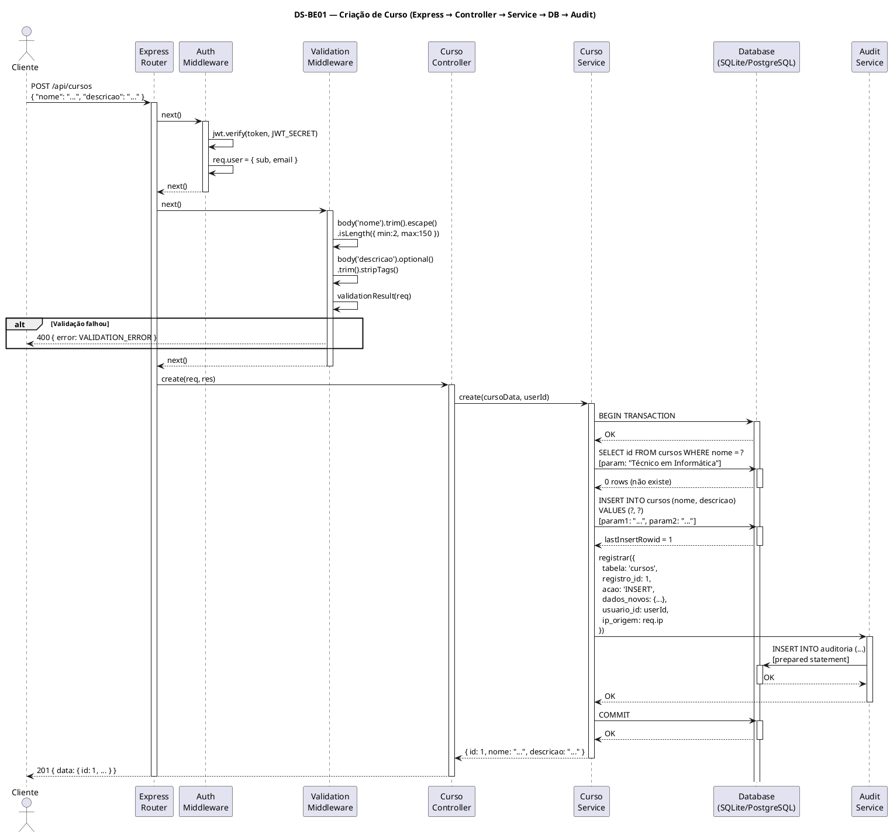
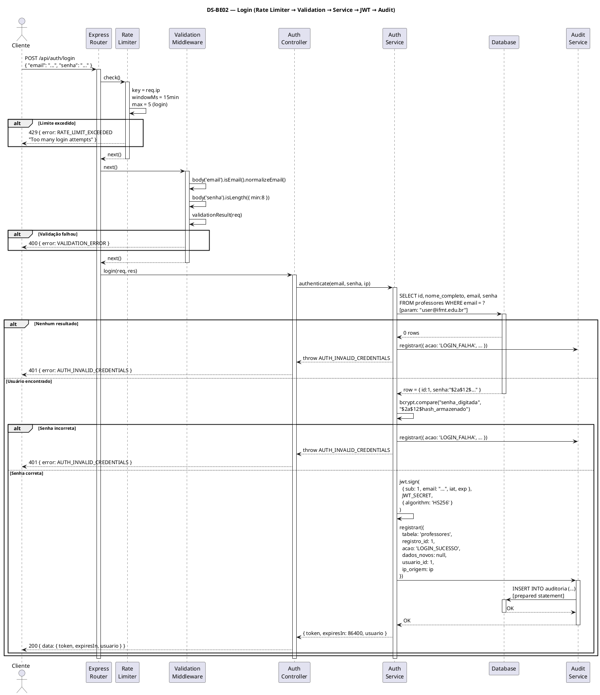
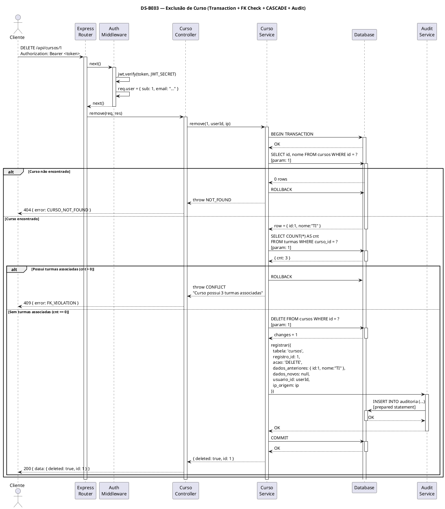

# Requisitos de Sistema — Sistema de Gestão de Horários Escolares

| Campo | Valor |
|---|---|
| **Projeto** | Sistema de Gestão de Horários Escolares — IFMT Campus Barra do Garças |
| **Versão** | 1.0.0 |
| **Data** | 10/09/2026 |
| **Padrões** | OMG UML 2.5.1, ISO/IEC/IEEE 29148:2018, FURPS+/ISO 25010 |
| **Classificação** | Documento Técnico de Requisitos de Sistema |

---

## Sumário

1. [Introdução](#1-introdução)
2. [Requisitos Funcionais de Sistema (RSF)](#2-requisitos-funcionais-de-sistema-rsf)
3. [Requisitos Não Funcionais (RSNF)](#3-requisitos-não-funcionais-rsnf)
4. [Diagramas de Sequência de Backend](#4-diagramas-de-sequência-de-backend)
5. [Diagrama Estrutural de Classes](#5-diagrama-estrutural-de-classes)
6. [Dicionário Técnico de Dados (DDL)](#6-dicionário-técnico-de-dados-ddl)
7. [Contratos de API RESTful](#7-contratos-de-api-restful)
8. [Matriz Bidirecional de Rastreabilidade Técnica](#8-matriz-bidirecional-de-rastreabilidade-técnica)

---

## 1. Introdução

### 1.1 Propósito

Este documento especifica os requisitos técnicos do **Sistema de Gestão de Horários Escolares**, destinado ao campus Barra do Garças do Instituto Federal de Mato Grosso (IFMT). O sistema permite o cadastro, consulta, atualização e exclusão de entidades acadêmicas (cursos, turmas, professores, matérias, salas, horários), a alocação de horários aulas, a gestão de restrições operacionais, o controle de leads de marketing e a manutenção de trilhas de auditoria para todas as operações de escrita.

### 1.2 Stack Tecnológica

| Camada | Tecnologia | Versão / Detalhe |
|---|---|---|
| Frontend | HTML5, CSS3, JavaScript ES6+ | React 18+ via Vite, proxy reverso em dev |
| Backend | Node.js + Express.js | LTS (18+), rotas REST |
| Banco de Dados (dev) | SQLite | WAL mode, better-sqlite3 / sqlite3 |
| Banco de Dados (prod) | PostgreSQL | 14+ |
| Autenticação | JWT + bcrypt | jsonwebtoken, bcryptjs |
| Validação | express-validator | Sanitização + cadeia de validação |
| Segurança | helmet, CORS, express-rate-limit | Headers, origens, throttling |

### 1.3 Convenções

- **Código**: JavaScript ES6+ com `async/await`, módulos ESM (`import/export`).
- **Nomenclatura de tabelas/colunas**: `snake_case` (padrão SQL).
- **Nomenclatura de variáveis JS**: `camelCase`.
- **Endpoints**: `kebab-case` em URLs, `snake_case` em payloads JSON.
- **Respostas JSON**: sempre `{ "data": ..., "meta": ... }` ou `{ "error": ... }`.
- **Status HTTP**: códigos padronizados conforme contrato (seção 7).
- **Datas**: ISO 8601 (`YYYY-MM-DDTHH:mm:ss`) no fuso horário local (`America/Cuiaba`).

---

## 2. Requisitos Funcionais de Sistema (RSF)

### RSF-01 — Health Check

| Campo | Valor |
|---|---|
| **ID** | RSF-01 |
| **Rota** | `GET /api/health` |
| **Método HTTP** | GET |
| **Autenticação** | Não requer |

**Payload (resposta):**

```json
{
  "status": "ok",
  "timestamp": "2026-09-10T10:00:00-04:00",
  "uptime": 12345.67
}
```

**Códigos de status HTTP:**

| Código | Condição |
|---|---|
| 200 | Servidor operacional |

**Regras de validação:** Nenhuma. Rota pública sem parâmetros.

---

### RSF-02 — Login

| Campo | Valor |
|---|---|
| **ID** | RSF-02 |
| **Rota** | `POST /api/auth/login` |
| **Método HTTP** | POST |
| **Autenticação** | Não requer (rota pública) |

**Payload de requisição (JSON):**

```json
{
  "email": "usuario@ifmt.edu.br",
  "senha": "S3nh@F0rte!"
}
```

| Campo | Tipo | Obrigatório | Validação |
|---|---|---|---|
| `email` | string | sim | Formato de e-mail válido, max 255 chars |
| `senha` | string | sim | Mínimo 8 caracteres |

**Códigos de status HTTP:**

| Código | Condição |
|---|---|
| 200 | Login bem-sucedido |
| 400 | Payload inválido (campos ausentes ou formato incorreto) |
| 401 | Credenciais inválidas (e-mail não encontrado ou senha incorreta) |
| 429 | Rate limit excedido (múltiplas tentativas) |
| 500 | Erro interno do servidor |

**Formato de resposta (200):**

```json
{
  "data": {
    "token": "eyJhbGciOiJIUzI1NiIs...",
    "expiresIn": 86400,
    "usuario": {
      "id": 1,
      "email": "usuario@ifmt.edu.br",
      "nome": "Usuário Admin"
    }
  }
}
```

**Formato de resposta (erro):**

```json
{
  "error": {
    "code": "AUTH_INVALID_CREDENTIALS",
    "message": "E-mail ou senha inválidos."
  }
}
```

**Regras de validação:**
- O e-mail é normalizado para `trim()` + `toLowerCase()` antes da busca.
- A senha é comparada via `bcrypt.compare()`.
- Em caso de sucesso, assina JWT com `HS256`, payload `{ sub: usuario.id, email: usuario.email, iat, exp }`.
- O token expira em 24 horas (86400 segundos).
- O registro de login (sucesso ou falha) é inserido na tabela `auditoria`.

---

### RSF-03 — Status de Autenticação

| Campo | Valor |
|---|---|
| **ID** | RSF-03 |
| **Rota** | `GET /api/auth/status` |
| **Método HTTP** | GET |
| **Autenticação** | Requer (Bearer JWT) |

**Códigos de status HTTP:**

| Código | Condição |
|---|---|
| 200 | Token válido |
| 401 | Token ausente, inválido ou expirado |

**Formato de resposta (200):**

```json
{
  "data": {
    "authenticated": true,
    "usuario": {
      "id": 1,
      "email": "usuario@ifmt.edu.br"
    }
  }
}
```

---

### RSF-04 — Cursos (CRUD Completo)

#### RSF-04a — Listar Cursos

| Campo | Valor |
|---|---|
| **ID** | RSF-04a |
| **Rota** | `GET /api/cursos` |
| **Método HTTP** | GET |
| **Autenticação** | Requer |

**Parâmetros de query:**

| Parâmetro | Tipo | Obrigatório | Descrição |
|---|---|---|---|
| `page` | integer | não | Página (padrão: 1) |
| `limit` | integer | não | Itens por página (padrão: 20, máx: 100) |
| `search` | string | não | Busca parcial por `nome` (case-insensitive) |

**Códigos de status HTTP:**

| Código | Condição |
|---|---|
| 200 | Listagem retornada |
| 401 | Não autenticado |

**Formato de resposta (200):**

```json
{
  "data": [
    {
      "id": 1,
      "nome": "Técnico em Informática",
      "descricao": "Curso técnico integrado ao ensino médio"
    }
  ],
  "meta": {
    "total": 15,
    "page": 1,
    "limit": 20,
    "totalPages": 1
  }
}
```

#### RSF-04b — Criar Curso

| Campo | Valor |
|---|---|
| **ID** | RSF-04b |
| **Rota** | `POST /api/cursos` |
| **Método HTTP** | POST |
| **Autenticação** | Requer |

**Payload de requisição (JSON):**

```json
{
  "nome": "Técnico em Informática",
  "descricao": "Curso técnico integrado ao ensino médio"
}
```

| Campo | Tipo | Obrigatório | Validação |
|---|---|---|---|
| `nome` | string | sim | 2–150 caracteres, único, sem caracteres especiais perigosos |
| `descricao` | string | não | Max 500 caracteres, sanitizado (strip HTML) |

**Códigos de status HTTP:**

| Código | Condição |
|---|---|
| 201 | Curso criado com sucesso |
| 400 | Validação falhou |
| 409 | Nome já existente (constraint UNIQUE) |
| 401 | Não autenticado |

**Formato de resposta (201):**

```json
{
  "data": {
    "id": 1,
    "nome": "Técnico em Informática",
    "descricao": "Curso técnico integrado ao ensino médio"
  }
}
```

**Regras de validação:**
- `nome` passa por `trim()`, `escape()`, e verificação de unicidade via query preparada.
- `descricao` passa por `trim()` e `stripTags()` do express-validator.
- Inserção dentro de transação `BEGIN`/`COMMIT` com registro de auditoria.

#### RSF-04c — Atualizar Curso

| Campo | Valor |
|---|---|
| **ID** | RSF-04c |
| **Rota** | `PUT /api/cursos/:id` |
| **Método HTTP** | PUT |
| **Autenticação** | Requer |

**Payload de requisição (JSON):**

```json
{
  "nome": "Técnico em Informática — Atualizado",
  "descricao": "Descrição atualizada"
}
```

| Campo | Tipo | Obrigatório | Validação |
|---|---|---|---|
| `nome` | string | sim | 2–150 caracteres, único (exceto o próprio registro) |
| `descricao` | string | não | Max 500 caracteres |

**Códigos de status HTTP:**

| Código | Condição |
|---|---|
| 200 | Atualizado com sucesso |
| 400 | Validação falhou |
| 404 | Curso não encontrado |
| 409 | Nome duplicado |
| 401 | Não autenticado |

#### RSF-04d — Deletar Curso

| Campo | Valor |
|---|---|
| **ID** | RSF-04d |
| **Rota** | `DELETE /api/cursos/:id` |
| **Método HTTP** | DELETE |
| **Autenticação** | Requer |

**Códigos de status HTTP:**

| Código | Condição |
|---|---|
| 200 | Deletado com sucesso |
| 404 | Curso não encontrado |
| 409 | Possui turmas associadas (violação FK) |
| 401 | Não autenticado |

**Formato de resposta (200):**

```json
{
  "data": {
    "deleted": true,
    "id": 1
  }
}
```

**Regras:**
- Executa dentro de transação com `PRAGMA foreign_keys = ON`.
- Verifica existência de turmas associadas antes de deletar (caso FK não esteja em CASCADE).
- Registra exclusão na tabela `auditoria`.

---

### RSF-05 — Turmas (CRUD Completo)

#### RSF-05a — Listar Turmas

| Campo | Valor |
|---|---|
| **ID** | RSF-05a |
| **Rota** | `GET /api/turmas` |
| **Método HTTP** | GET |
| **Autenticação** | Requer |

**Parâmetros de query:**

| Parâmetro | Tipo | Obrigatório | Descrição |
|---|---|---|---|
| `page` | integer | não | Página (padrão: 1) |
| `limit` | integer | não | Itens por página (padrão: 20, máx: 100) |
| `curso_id` | integer | não | Filtrar por curso |
| `ano_letivo` | integer | não | Filtrar por ano letivo |

**Formato de resposta (200):**

```json
{
  "data": [
    {
      "id": 1,
      "nome": "1° A",
      "curso_id": 1,
      "curso_nome": "Técnico em Informática",
      "ano_letivo": 2026,
      "periodo_letivo": "1"
    }
  ],
  "meta": {
    "total": 25,
    "page": 1,
    "limit": 20,
    "totalPages": 2
  }
}
```

#### RSF-05b — Criar Turma

| Campo | Valor |
|---|---|
| **ID** | RSF-05b |
| **Rota** | `POST /api/turmas` |
| **Método HTTP** | POST |
| **Autenticação** | Requer |

**Payload de requisição (JSON):**

```json
{
  "nome": "1° A",
  "curso_id": 1,
  "ano_letivo": 2026,
  "periodo_letivo": "1"
}
```

| Campo | Tipo | Obrigatório | Validação |
|---|---|---|---|
| `nome` | string | sim | 1–50 caracteres |
| `curso_id` | integer | sim | Deve existir na tabela `cursos` (FK) |
| `ano_letivo` | integer | sim | Entre 2020 e 2030 |
| `periodo_letivo` | string | não | Valores aceitos: `"1"`, `"2"`, `"anual"` |

**Códigos de status HTTP:**

| Código | Condição |
|---|---|
| 201 | Turma criada |
| 400 | Validação falhou |
| 404 | `curso_id` não encontrado |
| 401 | Não autenticado |

**Regras:**
- `curso_id` validado via query preparada `SELECT id FROM cursos WHERE id = ?`.
- Inserção em transação com auditoria.

#### RSF-05c — Atualizar Turma

| Campo | Valor |
|---|---|
| **ID** | RSF-05c |
| **Rota** | `PUT /api/turmas/:id` |
| **Método HTTP** | PUT |
| **Autenticação** | Requer |

Mesmo schema de RSF-05b. Todos os campos obrigatórios.

**Códigos de status HTTP:**

| Código | Condição |
|---|---|
| 200 | Atualizado |
| 400 | Validação falhou |
| 404 | Turma não encontrada |
| 401 | Não autenticado |

#### RSF-05d — Deletar Turma

| Campo | Valor |
|---|---|
| **ID** | RSF-05d |
| **Rota** | `DELETE /api/turmas/:id` |
| **Método HTTP** | DELETE |
| **Autenticação** | Requer |

**Códigos de status HTTP:**

| Código | Condição |
|---|---|
| 200 | Deletada |
| 404 | Não encontrada |
| 401 | Não autenticado |

**Regras:**
- CASCADE para `turma_materia` (turma_id).
- Auditoria registrada.

---

### RSF-06 — Professores (CRUD Completo)

#### RSF-06a — Listar Professores

| Campo | Valor |
|---|---|
| **ID** | RSF-06a |
| **Rota** | `GET /api/professores` |
| **Método HTTP** | GET |
| **Autenticação** | Requer |

**Parâmetros de query:**

| Parâmetro | Tipo | Obrigatório | Descrição |
|---|---|---|---|
| `page` | integer | não | Página (padrão: 1) |
| `limit` | integer | não | Itens por página (padrão: 20, máx: 100) |
| `search` | string | não | Busca parcial por `nome_completo` |

**Formato de resposta (200):**

```json
{
  "data": [
    {
      "id": 1,
      "nome_completo": "João da Silva",
      "email": "joao.silva@ifmt.edu.br",
      "disciplina_favorita": "Matemática"
    }
  ],
  "meta": {
    "total": 40,
    "page": 1,
    "limit": 20,
    "totalPages": 2
  }
}
```

#### RSF-06b — Criar Professor

| Campo | Valor |
|---|---|
| **ID** | RSF-06b |
| **Rota** | `POST /api/professores` |
| **Método HTTP** | POST |
| **Autenticação** | Requer |

**Payload de requisição (JSON):**

```json
{
  "nome_completo": "João da Silva",
  "email": "joao.silva@ifmt.edu.br",
  "disciplina_favorita": "Matemática"
}
```

| Campo | Tipo | Obrigatório | Validação |
|---|---|---|---|
| `nome_completo` | string | sim | 3–200 caracteres, `trim()` + `escape()` |
| `email` | string | sim | Formato de e-mail válido, único, max 255 |
| `disciplina_favorita` | string | não | Max 100 caracteres |

**Códigos de status HTTP:**

| Código | Condição |
|---|---|
| 201 | Professor criado |
| 400 | Validação falhou |
| 409 | E-mail já cadastrado |
| 401 | Não autenticado |

#### RSF-06c — Atualizar Professor

| Campo | Valor |
|---|---|
| **ID** | RSF-06c |
| **Rota** | `PUT /api/professores/:id` |
| **Método HTTP** | PUT |
| **Autenticação** | Requer |

Mesmo schema de RSF-06b.

**Códigos de status HTTP:**

| Código | Condição |
|---|---|
| 200 | Atualizado |
| 400 | Validação falhou |
| 404 | Não encontrado |
| 409 | E-mail duplicado |
| 401 | Não autenticado |

#### RSF-06d — Deletar Professor

| Campo | Valor |
|---|---|
| **ID** | RSF-06d |
| **Rota** | `DELETE /api/professores/:id` |
| **Método HTTP** | DELETE |
| **Autenticação** | Requer |

**Códigos de status HTTP:**

| Código | Condição |
|---|---|
| 200 | Deletado |
| 404 | Não encontrado |
| 401 | Não autenticado |

**Regras:**
- CASCADE em `professor_materia` (professor_id).
- `SET NULL` em `turma_materia` (professor_id).
- Auditoria registrada.

---

### RSF-07 — Matérias (CRUD Completo)

#### RSF-07a — Listar Matérias

| Campo | Valor |
|---|---|
| **ID** | RSF-07a |
| **Rota** | `GET /api/materias` |
| **Método HTTP** | GET |
| **Autenticação** | Requer |

**Parâmetros de query:**

| Parâmetro | Tipo | Obrigatório | Descrição |
|---|---|---|---|
| `page` | integer | não | Página (padrão: 1) |
| `limit` | integer | não | Itens por página (padrão: 20, máx: 100) |
| `search` | string | não | Busca parcial por `nome` |

**Formato de resposta (200):**

```json
{
  "data": [
    {
      "id": 1,
      "nome": "Matemática",
      "carga_horaria_semanal": 4,
      "descricao": "Álgebra, Geometria e Estatística"
    }
  ],
  "meta": {
    "total": 20,
    "page": 1,
    "limit": 20,
    "totalPages": 1
  }
}
```

#### RSF-07b — Criar Matéria

| Campo | Valor |
|---|---|
| **ID** | RSF-07b |
| **Rota** | `POST /api/materias` |
| **Método HTTP** | POST |
| **Autenticação** | Requer |

**Payload de requisição (JSON):**

```json
{
  "nome": "Matemática",
  "carga_horaria_semanal": 4,
  "descricao": "Álgebra, Geometria e Estatística"
}
```

| Campo | Tipo | Obrigatório | Validação |
|---|---|---|---|
| `nome` | string | sim | 2–150 caracteres, único |
| `carga_horaria_semanal` | integer | não | Padrão: 0, mínimo: 0, máximo: 40 |
| `descricao` | string | não | Max 500 caracteres, sanitizado |

**Códigos de status HTTP:**

| Código | Condição |
|---|---|
| 201 | Matéria criada |
| 400 | Validação falhou |
| 409 | Nome duplicado |
| 401 | Não autenticado |

#### RSF-07c — Atualizar Matéria

| Campo | Valor |
|---|---|
| **ID** | RSF-07c |
| **Rota** | `PUT /api/materias/:id` |
| **Método HTTP** | PUT |
| **Autenticação** | Requer |

Mesmo schema de RSF-07b.

**Códigos de status HTTP:**

| Código | Condição |
|---|---|
| 200 | Atualizado |
| 400 | Validação falhou |
| 404 | Não encontrado |
| 409 | Nome duplicado |
| 401 | Não autenticado |

#### RSF-07d — Deletar Matéria

| Campo | Valor |
|---|---|
| **ID** | RSF-07d |
| **Rota** | `DELETE /api/materias/:id` |
| **Método HTTP** | DELETE |
| **Autenticação** | Requer |

**Códigos de status HTTP:**

| Código | Condição |
|---|---|
| 200 | Deletada |
| 404 | Não encontrada |
| 401 | Não autenticado |

**Regras:**
- CASCADE em `professor_materia` (materia_id).
- CASCADE em `turma_materia` (materia_id).
- Auditoria registrada.

---

### RSF-08 — Salas (CRUD Completo)

#### RSF-08a — Listar Salas

| Campo | Valor |
|---|---|
| **ID** | RSF-08a |
| **Rota** | `GET /api/salas` |
| **Método HTTP** | GET |
| **Autenticação** | Requer |

**Parâmetros de query:**

| Parâmetro | Tipo | Obrigatório | Descrição |
|---|---|---|---|
| `page` | integer | não | Página (padrão: 1) |
| `limit` | integer | não | Itens por página (padrão: 20, máx: 100) |
| `tipo` | string | não | Filtrar por tipo (ex: `sala`, `laboratório`) |

**Formato de resposta (200):**

```json
{
  "data": [
    {
      "id": 1,
      "nome": "Sala 01",
      "capacidade": 50,
      "tipo": "sala"
    }
  ],
  "meta": {
    "total": 30,
    "page": 1,
    "limit": 20,
    "totalPages": 2
  }
}
```

#### RSF-08b — Criar Sala

| Campo | Valor |
|---|---|
| **ID** | RSF-08b |
| **Rota** | `POST /api/salas` |
| **Método HTTP** | POST |
| **Autenticação** | Requer |

**Payload de requisição (JSON):**

```json
{
  "nome": "Sala 01",
  "capacidade": 50,
  "tipo": "sala"
}
```

| Campo | Tipo | Obrigatório | Validação |
|---|---|---|---|
| `nome` | string | sim | 1–100 caracteres, único |
| `capacidade` | integer | não | Padrão: 50, mínimo: 1, máximo: 500 |
| `tipo` | string | não | Padrão: `"sala"`, max 50 caracteres |

**Códigos de status HTTP:**

| Código | Condição |
|---|---|
| 201 | Sala criada |
| 400 | Validação falhou |
| 409 | Nome duplicado |
| 401 | Não autenticado |

#### RSF-08c — Atualizar Sala

| Campo | Valor |
|---|---|
| **ID** | RSF-08c |
| **Rota** | `PUT /api/salas/:id` |
| **Método HTTP** | PUT |
| **Autenticação** | Requer |

Mesmo schema de RSF-08b.

**Códigos de status HTTP:**

| Código | Condição |
|---|---|
| 200 | Atualizada |
| 400 | Validação falhou |
| 404 | Não encontrada |
| 409 | Nome duplicado |
| 401 | Não autenticado |

#### RSF-08d — Deletar Sala

| Campo | Valor |
|---|---|
| **ID** | RSF-08d |
| **Rota** | `DELETE /api/salas/:id` |
| **Método HTTP** | DELETE |
| **Autenticação** | Requer |

**Códigos de status HTTP:**

| Código | Condição |
|---|---|
| 200 | Deletada |
| 404 | Não encontrada |
| 401 | Não autenticado |

**Regras:**
- `SET NULL` em `horarios_alocados` (sala_id).
- Auditoria registrada.

---

### RSF-09 — Horários (CRUD Completo)

#### RSF-09a — Listar Horários

| Campo | Valor |
|---|---|
| **ID** | RSF-09a |
| **Rota** | `GET /api/horarios` |
| **Método HTTP** | GET |
| **Autenticação** | Requer |

**Parâmetros de query:**

| Parâmetro | Tipo | Obrigatório | Descrição |
|---|---|---|---|
| `page` | integer | não | Página (padrão: 1) |
| `limit` | integer | não | Itens por página (padrão: 20, máx: 100) |
| `dia_semana` | string | não | Filtrar por dia (ex: `segunda`, `terça`) |

**Formato de resposta (200):**

```json
{
  "data": [
    {
      "id": 1,
      "dia_semana": "segunda",
      "hora_inicio": "07:30",
      "hora_fim": "08:20",
      "slot": "07:30-08:20"
    }
  ],
  "meta": {
    "total": 50,
    "page": 1,
    "limit": 20,
    "totalPages": 3
  }
}
```

> **Nota:** O campo `slot` é gerado automaticamente pela tabela (`GENERATED ALWAYS AS concat(hora_inicio,'-',hora_fim) STORED`). Não é aceito no payload de criação/atualização.

#### RSF-09b — Criar Horário

| Campo | Valor |
|---|---|
| **ID** | RSF-09b |
| **Rota** | `POST /api/horarios` |
| **Método HTTP** | POST |
| **Autenticação** | Requer |

**Payload de requisição (JSON):**

```json
{
  "dia_semana": "segunda",
  "hora_inicio": "07:30",
  "hora_fim": "08:20"
}
```

| Campo | Tipo | Obrigatório | Validação |
|---|---|---|---|
| `dia_semana` | string | sim | Valores aceitos: `segunda`, `terça`, `quarta`, `quinta`, `sexta`, `sábado` |
| `hora_inicio` | string | sim | Formato `HH:MM` (24h), deve ser anterior a `hora_fim` |
| `hora_fim` | string | sim | Formato `HH:MM` (24h), deve ser posterior a `hora_inicio` |

**Códigos de status HTTP:**

| Código | Condição |
|---|---|
| 201 | Horário criado |
| 400 | Validação falhou |
| 409 | Slot duplicado (mesmo dia + hora_inicio + hora_fim) |
| 401 | Não autenticado |

#### RSF-09c — Atualizar Horário

| Campo | Valor |
|---|---|
| **ID** | RSF-09c |
| **Rota** | `PUT /api/horarios/:id` |
| **Método HTTP** | PUT |
| **Autenticação** | Requer |

Mesmo schema de RSF-09b.

**Códigos de status HTTP:**

| Código | Condição |
|---|---|
| 200 | Atualizado |
| 400 | Validação falhou |
| 404 | Não encontrado |
| 409 | Slot duplicado |
| 401 | Não autenticado |

#### RSF-09d — Deletar Horário

| Campo | Valor |
|---|---|
| **ID** | RSF-09d |
| **Rota** | `DELETE /api/horarios/:id` |
| **Método HTTP** | DELETE |
| **Autenticação** | Requer |

**Códigos de status HTTP:**

| Código | Condição |
|---|---|
| 200 | Deletado |
| 404 | Não encontrado |
| 401 | Não autenticado |

**Regras:**
- `CASCADE` em `horarios_alocados` (horario_id).
- Auditoria registrada.

---

### RSF-10 — Professor × Matéria (N:N — CRUD Completo)

#### RSF-10a — Listar Vínculos

| Campo | Valor |
|---|---|
| **ID** | RSF-10a |
| **Rota** | `GET /api/professor_materia` |
| **Método HTTP** | GET |
| **Autenticação** | Requer |

**Parâmetros de query:**

| Parâmetro | Tipo | Obrigatório | Descrição |
|---|---|---|---|
| `professor_id` | integer | não | Filtrar por professor |
| `materia_id` | integer | não | Filtrar por matéria |

**Formato de resposta (200):**

```json
{
  "data": [
    {
      "professor_id": 1,
      "materia_id": 3,
      "professor_nome": "João da Silva",
      "materia_nome": "Matemática"
    }
  ],
  "meta": {
    "total": 35,
    "page": 1,
    "limit": 20,
    "totalPages": 2
  }
}
```

#### RSF-10b — Criar Vínculo

| Campo | Valor |
|---|---|
| **ID** | RSF-10b |
| **Rota** | `POST /api/professor_materia` |
| **Método HTTP** | POST |
| **Autenticação** | Requer |

**Payload de requisição (JSON):**

```json
{
  "professor_id": 1,
  "materia_id": 3
}
```

| Campo | Tipo | Obrigatório | Validação |
|---|---|---|---|
| `professor_id` | integer | sim | Deve existir em `professores` |
| `materia_id` | integer | sim | Deve existir em `materias` |

**Códigos de status HTTP:**

| Código | Condição |
|---|---|
| 201 | Vínculo criado |
| 400 | Validação falhou |
| 409 | Vínculo já existe (PK composta duplicada) |
| 404 | Professor ou matéria não encontrado |
| 401 | Não autenticado |

**Regras de validação:**
- FK `professor_id` validado via query preparada.
- FK `materia_id` validado via query preparada.
- Auditoria registrada.

#### RSF-10c — Deletar Vínculo

| Campo | Valor |
|---|---|
| **ID** | RSF-10c |
| **Rota** | `DELETE /api/professor_materia/:professor_id/:materia_id` |
| **Método HTTP** | DELETE |
| **Autenticação** | Requer |

**Códigos de status HTTP:**

| Código | Condição |
|---|---|
| 200 | Vínculo removido |
| 404 | Vínculo não encontrado |
| 401 | Não autenticado |

---

### RSF-11 — Turma × Matéria (N:N — CRUD Completo)

#### RSF-11a — Listar Vínculos

| Campo | Valor |
|---|---|
| **ID** | RSF-11a |
| **Rota** | `GET /api/turma_materia` |
| **Método HTTP** | GET |
| **Autenticação** | Requer |

**Parâmetros de query:**

| Parâmetro | Tipo | Obrigatório | Descrição |
|---|---|---|---|
| `turma_id` | integer | não | Filtrar por turma |
| `materia_id` | integer | não | Filtrar por matéria |

**Formato de resposta (200):**

```json
{
  "data": [
    {
      "turma_id": 1,
      "materia_id": 3,
      "professor_id": 1,
      "turma_nome": "1° A",
      "materia_nome": "Matemática",
      "professor_nome": "João da Silva"
    }
  ],
  "meta": {
    "total": 60,
    "page": 1,
    "limit": 20,
    "totalPages": 3
  }
}
```

#### RSF-11b — Criar Vínculo

| Campo | Valor |
|---|---|
| **ID** | RSF-11b |
| **Rota** | `POST /api/turma_materia` |
| **Método HTTP** | POST |
| **Autenticação** | Requer |

**Payload de requisição (JSON):**

```json
{
  "turma_id": 1,
  "materia_id": 3,
  "professor_id": 1
}
```

| Campo | Tipo | Obrigatório | Validação |
|---|---|---|---|
| `turma_id` | integer | sim | Deve existir em `turmas` |
| `materia_id` | integer | sim | Deve existir em `materias` |
| `professor_id` | integer | não | Deve existir em `professores` (aceita `null`) |

**Códigos de status HTTP:**

| Código | Condição |
|---|---|
| 201 | Vínculo criado |
| 400 | Validação falhou |
| 409 | Vínculo duplicado |
| 404 | Entidade referenciada não encontrada |
| 401 | Não autenticado |

**Regras de validação:**
- `turma_id` e `materia_id` validados via queries preparadas.
- `professor_id` (se fornecido) validado via query preparada.
- Auditoria registrada.

#### RSF-11c — Atualizar Vínculo

| Campo | Valor |
|---|---|
| **ID** | RSF-11c |
| **Rota** | `PUT /api/turma_materia/:turma_id/:materia_id` |
| **Método HTTP** | PUT |
| **Autenticação** | Requer |

**Payload de requisição (JSON):**

```json
{
  "professor_id": 2
}
```

| Campo | Tipo | Obrigatório | Validação |
|---|---|---|---|
| `professor_id` | integer | sim | Deve existir em `professores` ou `null` |

**Códigos de status HTTP:**

| Código | Condição |
|---|---|
| 200 | Atualizado |
| 400 | Validação falhou |
| 404 | Vínculo não encontrado |
| 401 | Não autenticado |

#### RSF-11d — Deletar Vínculo

| Campo | Valor |
|---|---|
| **ID** | RSF-11d |
| **Rota** | `DELETE /api/turma_materia/:turma_id/:materia_id` |
| **Método HTTP** | DELETE |
| **Autenticação** | Requer |

**Códigos de status HTTP:**

| Código | Condição |
|---|---|
| 200 | Vínculo removido |
| 404 | Não encontrado |
| 401 | Não autenticado |

**Regras:**
- `CASCADE` em `horarios_alocados` (turma_materia_id).
- Auditoria registrada.

---

### RSF-12 — Horários Alocados (CRUD Completo + PATCH de Status)

#### RSF-12a — Listar Alocações

| Campo | Valor |
|---|---|
| **ID** | RSF-12a |
| **Rota** | `GET /api/horarios_alocados` |
| **Método HTTP** | GET |
| **Autenticação** | Requer |

**Parâmetros de query:**

| Parâmetro | Tipo | Obrigatório | Descrição |
|---|---|---|---|
| `page` | integer | não | Página (padrão: 1) |
| `limit` | integer | não | Itens por página (padrão: 20, máx: 100) |
| `turma_materia_id` | integer | não | Filtrar por vínculo turma×matéria |
| `sala_id` | integer | não | Filtrar por sala |
| `dia_semana` | string | não | Filtrar por dia |
| `status` | string | não | Filtrar por status (`pendente`, `confirmado`, `cancelado`) |

**Formato de resposta (200):**

```json
{
  "data": [
    {
      "id": 1,
      "turma_materia_id": 1,
      "dia_semana": "segunda",
      "horario_id": 1,
      "sala_id": 5,
      "status": "pendente",
      "turma_nome": "1° A",
      "materia_nome": "Matemática",
      "sala_nome": "Sala 05",
      "slot": "07:30-08:20"
    }
  ],
  "meta": {
    "total": 200,
    "page": 1,
    "limit": 20,
    "totalPages": 10
  }
}
```

#### RSF-12b — Criar Alocação

| Campo | Valor |
|---|---|
| **ID** | RSF-12b |
| **Rota** | `POST /api/horarios_alocados` |
| **Método HTTP** | POST |
| **Autenticação** | Requer |

**Payload de requisição (JSON):**

```json
{
  "turma_materia_id": 1,
  "dia_semana": "segunda",
  "horario_id": 1,
  "sala_id": 5
}
```

| Campo | Tipo | Obrigatório | Validação |
|---|---|---|---|
| `turma_materia_id` | integer | sim | Deve existir em `turma_materia` |
| `dia_semana` | string | sim | Valores: `segunda`, `terça`, `quarta`, `quinta`, `sexta`, `sábado` |
| `horario_id` | integer | sim | Deve existir em `horarios` |
| `sala_id` | integer | não | Deve existir em `salas` (aceita `null`) |

**Códigos de status HTTP:**

| Código | Condição |
|---|---|
| 201 | Alocação criada |
| 400 | Validação falhou |
| 409 | Conflito (mesma sala + dia + horário já alocados e ativos) |
| 404 | Entidade referenciada não encontrada |
| 401 | Não autenticado |

**Regras de validação:**
- Todas as FKs validadas via queries preparadas.
- Verificação de conflito: `SELECT id FROM horarios_alocados WHERE sala_id = ? AND dia_semana = ? AND horario_id = ? AND status != 'cancelado'`.
- Status inicial é sempre `'pendente'` (DEFAULT).
- Auditoria registrada.

#### RSF-12c — Atualizar Alocação

| Campo | Valor |
|---|---|
| **ID** | RSF-12c |
| **Rota** | `PUT /api/horarios_alocados/:id` |
| **Método HTTP** | PUT |
| **Autenticação** | Requer |

**Payload de requisição (JSON):**

```json
{
  "turma_materia_id": 1,
  "dia_semana": "segunda",
  "horario_id": 1,
  "sala_id": 10
}
```

| Campo | Tipo | Obrigatório | Validação |
|---|---|---|---|
| `turma_materia_id` | integer | sim | Deve existir |
| `dia_semana` | string | sim | Valores válidos |
| `horario_id` | integer | sim | Deve existir |
| `sala_id` | integer | não | Deve existir ou `null` |

**Códigos de status HTTP:**

| Código | Condição |
|---|---|
| 200 | Atualizada |
| 400 | Validação falhou |
| 404 | Não encontrada |
| 409 | Conflito de sala |
| 401 | Não autenticado |

#### RSF-12d — Alterar Status (PATCH)

| Campo | Valor |
|---|---|
| **ID** | RSF-12d |
| **Rota** | `PATCH /api/horarios_alocados/:id/status` |
| **Método HTTP** | PATCH |
| **Autenticação** | Requer |

**Payload de requisição (JSON):**

```json
{
  "status": "confirmado"
}
```

| Campo | Tipo | Obrigatório | Validação |
|---|---|---|---|
| `status` | string | sim | Valores: `pendente`, `confirmado`, `cancelado` |

**Transições permitidas (OCL):**

| Status Atual | Status Destino | Permitido |
|---|---|---|
| `pendente` | `confirmado` | Sim |
| `pendente` | `cancelado` | Sim |
| `confirmado` | `cancelado` | Sim |
| `cancelado` | Qualquer | **Não** |
| `confirmado` | `pendente` | **Não** |

**Códigos de status HTTP:**

| Código | Condição |
|---|---|
| 200 | Status alterado |
| 400 | Validação falhou ou transição inválida |
| 404 | Alocação não encontrada |
| 401 | Não autenticado |

**Formato de resposta (200):**

```json
{
  "data": {
    "id": 1,
    "status_anterior": "pendente",
    "status_novo": "confirmado"
  }
}
```

**Regras:**
- Transição validada no controller antes de executar UPDATE.
- Auditoria registrada com `status_anterior` e `status_novo`.

#### RSF-12e — Deletar Alocação

| Campo | Valor |
|---|---|
| **ID** | RSF-12e |
| **Rota** | `DELETE /api/horarios_alocados/:id` |
| **Método HTTP** | DELETE |
| **Autenticação** | Requer |

**Códigos de status HTTP:**

| Código | Condição |
|---|---|
| 200 | Deletada |
| 404 | Não encontrada |
| 401 | Não autenticado |

**Regras:**
- Auditoria registrada.

---

### RSF-13 — Restrições (CRUD Completo)

#### RSF-13a — Listar Restrições

| Campo | Valor |
|---|---|
| **ID** | RSF-13a |
| **Rota** | `GET /api/restricoes` |
| **Método HTTP** | GET |
| **Autenticação** | Requer |

**Parâmetros de query:**

| Parâmetro | Tipo | Obrigatório | Descrição |
|---|---|---|---|
| `page` | integer | não | Página (padrão: 1) |
| `limit` | integer | não | Itens por página (padrão: 20, máx: 100) |
| `tipo` | string | não | Filtrar por tipo (`professor`, `sala`, `turma`) |
| `ativa` | integer | não | Filtrar por ativa (0 ou 1) |

**Formato de resposta (200):**

```json
{
  "data": [
    {
      "id": 1,
      "tipo": "professor",
      "descricao": "Professor não pode ministrar aulas às sextas após 18h",
      "valor": "professor_id=1;dia=sexta;hora>=18:00",
      "ativa": 1
    }
  ],
  "meta": {
    "total": 10,
    "page": 1,
    "limit": 20,
    "totalPages": 1
  }
}
```

#### RSF-13b — Criar Restrição

| Campo | Valor |
|---|---|
| **ID** | RSF-13b |
| **Rota** | `POST /api/restricoes` |
| **Método HTTP** | POST |
| **Autenticação** | Requer |

**Payload de requisição (JSON):**

```json
{
  "tipo": "professor",
  "descricao": "Professor não pode ministrar aulas às sextas após 18h",
  "valor": "professor_id=1;dia=sexta;hora>=18:00",
  "ativa": 1
}
```

| Campo | Tipo | Obrigatório | Validação |
|---|---|---|---|
| `tipo` | string | sim | Valores: `professor`, `sala`, `turma` |
| `descricao` | string | sim | 5–500 caracteres, sanitizado |
| `valor` | string | não | Max 500 caracteres, valor semântico livre |
| `ativa` | integer | não | Padrão: 1, valores: 0 ou 1 |

**Códigos de status HTTP:**

| Código | Condição |
|---|---|
| 201 | Restrição criada |
| 400 | Validação falhou |
| 401 | Não autenticado |

#### RSF-13c — Atualizar Restrição

| Campo | Valor |
|---|---|
| **ID** | RSF-13c |
| **Rota** | `PUT /api/restricoes/:id` |
| **Método HTTP** | PUT |
| **Autenticação** | Requer |

Mesmo schema de RSF-13b.

**Códigos de status HTTP:**

| Código | Condição |
|---|---|
| 200 | Atualizada |
| 400 | Validação falhou |
| 404 | Não encontrada |
| 401 | Não autenticado |

#### RSF-13d — Deletar Restrição

| Campo | Valor |
|---|---|
| **ID** | RSF-13d |
| **Rota** | `DELETE /api/restricoes/:id` |
| **Método HTTP** | DELETE |
| **Autenticação** | Requer |

**Códigos de status HTTP:**

| Código | Condição |
|---|---|
| 200 | Deletada |
| 404 | Não encontrada |
| 401 | Não autenticado |

**Regras:**
- Auditoria registrada.

---

### RSF-14 — Leads (CRUD Completo)

#### RSF-14a — Listar Leads (Protegido)

| Campo | Valor |
|---|---|
| **ID** | RSF-14a |
| **Rota** | `GET /api/leads` |
| **Método HTTP** | GET |
| **Autenticação** | Requer |

**Parâmetros de query:**

| Parâmetro | Tipo | Obrigatório | Descrição |
|---|---|---|---|
| `page` | integer | não | Página (padrão: 1) |
| `limit` | integer | não | Itens por página (padrão: 20, máx: 100) |
| `status_atendimento` | string | não | Filtrar por status (`novo`, `atendido`, `cancelado`) |

**Formato de resposta (200):**

```json
{
  "data": [
    {
      "id": 1,
      "nome_completo": "Maria Souza",
      "email": "maria@email.com",
      "telefone_whatsapp": "5566999887766",
      "mensagem": "Quero informações sobre o curso",
      "data_cadastro": "2026-09-10T08:30:00-04:00",
      "status_atendimento": "novo"
    }
  ],
  "meta": {
    "total": 5,
    "page": 1,
    "limit": 20,
    "totalPages": 1
  }
}
```

#### RSF-14b — Criar Lead (Público — formulário de contato)

| Campo | Valor |
|---|---|
| **ID** | RSF-14b |
| **Rota** | `POST /api/leads` |
| **Método HTTP** | POST |
| **Autenticação** | **Não requer** (rota pública) |

**Payload de requisição (JSON):**

```json
{
  "nome_completo": "Maria Souza",
  "email": "maria@email.com",
  "telefone_whatsapp": "5566999887766",
  "mensagem": "Quero informações sobre o curso de Informática"
}
```

| Campo | Tipo | Obrigatório | Validação |
|---|---|---|---|
| `nome_completo` | string | sim | 3–200 caracteres, sanitizado |
| `email` | string | sim | Formato de e-mail válido, único |
| `telefone_whatsapp` | string | sim | 10–15 dígitos, apenas numéricos |
| `mensagem` | string | não | Max 1000 caracteres, sanitizado (strip HTML) |

**Códigos de status HTTP:**

| Código | Condição |
|---|---|
| 201 | Lead cadastrado |
| 400 | Validação falhou |
| 409 | E-mail já cadastrado |
| 429 | Rate limit excedido |
| 500 | Erro interno |

**Formato de resposta (201):**

```json
{
  "data": {
    "id": 1,
    "mensagem": "Cadastro realizado com sucesso!"
  }
}
```

**Regras:**
- `status_atendimento` é sempre `'novo'` (DEFAULT).
- `data_cadastro` é `datetime('now','localtime')` (DEFAULT).
- Auditoria registrada.

#### RSF-14c — Atualizar Status do Lead

| Campo | Valor |
|---|---|
| **ID** | RSF-14c |
| **Rota** | `PATCH /api/leads/:id/status` |
| **Método HTTP** | PATCH |
| **Autenticação** | Requer |

**Payload de requisição (JSON):**

```json
{
  "status_atendimento": "atendido"
}
```

| Campo | Tipo | Obrigatório | Validação |
|---|---|---|---|
| `status_atendimento` | string | sim | Valores: `novo`, `atendido`, `cancelado` |

**Códigos de status HTTP:**

| Código | Condição |
|---|---|
| 200 | Status atualizado |
| 400 | Validação falhou |
| 404 | Lead não encontrado |
| 401 | Não autenticado |

#### RSF-14d — Deletar Lead

| Campo | Valor |
|---|---|
| **ID** | RSF-14d |
| **Rota** | `DELETE /api/leads/:id` |
| **Método HTTP** | DELETE |
| **Autenticação** | Requer |

**Códigos de status HTTP:**

| Código | Condição |
|---|---|
| 200 | Deletado |
| 404 | Não encontrado |
| 401 | Não autenticado |

**Regras:**
- Auditoria registrada.

---

### RSF-15 — Trilha de Auditoria

| Campo | Valor |
|---|---|
| **ID** | RSF-15 |
| **Rota** | `GET /api/auditoria` |
| **Método HTTP** | GET |
| **Autenticação** | Requer |

**Parâmetros de query:**

| Parâmetro | Tipo | Obrigatório | Descrição |
|---|---|---|---|
| `page` | integer | não | Página (padrão: 1) |
| `limit` | integer | não | Itens por página (padrão: 20, máx: 100) |
| `tabela` | string | não | Filtrar por tabela afetada |
| `acao` | string | não | Filtrar por ação (`INSERT`, `UPDATE`, `DELETE`) |
| `usuario_id` | integer | não | Filtrar por usuário |

> **Nota:** A tabela `auditoria` é somente leitura pela API. Os registros são inseridos automaticamente pelo service layer em todas as operações de escrita (INSERT, UPDATE, DELETE).

**Formato de resposta (200):**

```json
{
  "data": [
    {
      "id": 1,
      "tabela": "cursos",
      "registro_id": 1,
      "acao": "INSERT",
      "dados_novos": "{\"nome\":\"Técnico em Informática\"}",
      "dados_anteriores": null,
      "usuario_id": 1,
      "data_hora": "2026-09-10T10:15:00-04:00",
      "ip_origem": "192.168.1.100"
    }
  ],
  "meta": {
    "total": 500,
    "page": 1,
    "limit": 20,
    "totalPages": 25
  }
}
```

**Códigos de status HTTP:**

| Código | Condição |
|---|---|
| 200 | Listagem retornada |
| 401 | Não autenticado |

**Regras:**
- Apenas leitura. Sem POST, PUT ou DELETE neste endpoint.
- Campo `ip_origem` extraído de `req.ip` (considerando proxy reverso via `app.set('trust proxy', 1)`).
- Campo `usuario_id` extraído do JWT (`req.user.sub`).

---

### RSF-16 — Pipeline de Validação e Sanitização

| Campo | Valor |
|---|---|
| **ID** | RSF-16 |
| **Rota** | Aplicável a todas as rotas com body |
| **Método HTTP** | POST, PUT, PATCH |

**Regras gerais:**
- Todos os payloads passam pelo pipeline `express-validator` antes de chegar ao controller.
- `sanitize()` é aplicado para remover tags HTML (`stripTags`), normalizar espaços (`trim`), e escapar caracteres perigosos (`escape`).
- Validações de tipo (`isInt`, `isEmail`, `isLength`) são aplicadas antes das regras de negócio.
- Validações de existência de FK são feitas no service layer via queries preparadas.
- Erros de validação retornam `400` com corpo:

```json
{
  "error": {
    "code": "VALIDATION_ERROR",
    "message": "Erros de validação nos campos.",
    "details": [
      {
        "field": "email",
        "message": "Deve ser um e-mail válido."
      },
      {
        "field": "nome",
        "message": "Deve ter entre 2 e 150 caracteres."
      }
    ]
  }
}
```

---

### RSF-17 — Paginação

| Campo | Valor |
|---|---|
| **ID** | RSF-17 |
| **Rota** | Aplicável a todas as rotas GET de listagem |

**Parâmetros de query:**

| Parâmetro | Tipo | Padrão | Máximo | Descrição |
|---|---|---|---|---|
| `page` | integer | 1 | — | Número da página (mínimo: 1) |
| `limit` | integer | 20 | 100 | Itens por página |

**Cálculo de offset:** `offset = (page - 1) * limit`

**Meta de resposta:**

```json
{
  "meta": {
    "total": 150,
    "page": 3,
    "limit": 20,
    "totalPages": 8
  }
}
```

**Regras:**
- Se `page` ou `limit` forem não numéricos ou menores que 1, usa-se o padrão.
- Se `limit` > 100, usa-se 100.
- O campo `total` é contado via `SELECT COUNT(*)` com os mesmos filtros aplicados.
- Resposta `400` se `page` ou `limit` forem negativos.

---

## 3. Requisitos Não Funcionais (RSNF)

Classificação segundo **FURPS+/ISO 25010**.

### 3.1 Funcionalidade

| ID | Requisito | Descrição |
|---|---|---|
| RSNF-F01 | Integridade referencial | Todas as FKs são respeitadas no banco de dados. Operações que violariam integridade retornam `409 Conflict`. SQLite com `PRAGMA foreign_keys = ON`. |
| RSNF-F02 | Transações | Toda operação de escrita que envolve múltiplas tabelas (ex: criação com auditoria) é envolvida em `BEGIN`/`COMMIT` (ou `ROLLBACK` em caso de erro). |
| RSNF-F03 | Idempotência | Operações `PUT` e `DELETE` são idempotentes: executar duas vezes produz o mesmo estado final (200 na primeira, 404 na segunda se já deletado). |
| RSNF-F04 | Trilha de auditoria | Toda operação `INSERT`, `UPDATE`, `DELETE` gera um registro na tabela `auditoria` com dados antigos e novos, timestamp, usuario_id e IP. |

### 3.2 Usabilidade

| ID | Requisito | Descrição |
|---|---|---|
| RSNF-U01 | Mensagens de erro | Todas as respostas de erro incluem `code` (código legível), `message` (descrição amigável em pt-BR) e opcionalmente `details` (lista de campos com erro). |
| RSNF-U02 | Feedback toast | O frontend exibe toasts de sucesso (verde), erro (vermelho) e aviso (amarelo) para cada operação. |
| RSNF-U03 | Formatação de datas | Datas são exibidas no formato `DD/MM/YYYY` para o usuário, mas trafegam em ISO 8601 na API. |
| RSNF-U04 | Máscara de telefone | Campo `telefone_whatsapp` exibe máscara `(XX) XXXXX-XXXX` no frontend. |

### 3.3 Confiabilidade

| ID | Requisito | Descrição |
|---|---|---|
| RSNF-C01 | Disponibilidade | O serviço deve estar disponível 99% do horário comercial (seg–sex, 07h–18h). |
| RSNF-C02 | Tratamento de erros | Exceções não tratadas são capturadas pelo middleware de erro global e retornam `500` com mensagem genérica (sem vazar stack trace em produção). |
| RSNF-C03 | Graceful shutdown | O servidor escuta `SIGTERM` e `SIGINT`, fecha conexões de banco de dados e encerra processos pendentes antes de encerrar. |
| RSNF-C04 | WAL mode (SQLite) | Em desenvolvimento, o SQLite opera em WAL (Write-Ahead Logging) para concorrência de leitura/escrita: `PRAGMA journal_mode = WAL;`. |

### 3.4 Performance

| ID | Requisito | Descrição |
|---|---|---|
| RSNF-P01 | Tempo de resposta | 95% das requisições GET devem responder em < 200ms em condições normais de carga. |
| RSNF-P02 | Throughput | O sistema deve suportar pelo menos 50 requisições simultâneas sem degradação perceptível. |
| RSNF-P03 | Índices | Todos os campos de FK e campos frequentemente filtrados possuem índices criados explicitamente (9 índices conforme DDL). |
| RSNF-P04 | Paginação server-side | Listagens sempre utilizam paginação para evitar queries com milhões de linhas. |
| RSNF-P05 | I/O não bloqueante | O backend utiliza `async/await` com driver de banco assíncrono (better-sqlite3 síncrono aceito em dev; pg assíncrono em prod). Nenhuma operação bloqueia o Event Loop por mais de 50ms. |

### 3.5 Suportabilidade

| ID | Requisito | Descrição |
|---|---|---|
| RSNF-S01 | Portabilidade do banco | O código de acesso a banco abstrai dialetos SQL (SQLite/PostgreSQL) via camada de query builder ou ORM leve. DDLs mantidas separadas por dialeto. |
| RSNF-S02 | Configuração por ambiente | Variáveis de ambiente (`NODE_ENV`, `PORT`, `JWT_SECRET`, `DATABASE_URL`) configuráveis via `.env` (dev) e variáveis de sistema (produção). |

### 3.6 Segurança (+)

| ID | Requisito | Descrição |
|---|---|---|
| RSNF-SEG01 | Hashing de senhas | Senhas são hasheadas com `bcrypt` com salt rounds ≥ 12. A senha **nunca** é retornada em nenhuma resposta da API. |
| RSNF-SEG02 | Autenticação JWT | Tokens JWT assinados com `HS256`, expiração de 24h (86400s). Payload: `{ sub, email, iat, exp }`. |
| RSNF-SEG03 | RBAC | Controle de acesso baseado em papéis (extensível). Apenas autenticados acessam rotas protegidas. Rota de leads (POST) é pública. |
| RSNF-SEG04 | Prevenção XSS | Todos os inputs são sanitizados via `express-validator` (`stripTags`, `escape`). Headers `Content-Security-Policy` via `helmet`. |
| RSNF-SEG05 | Prevenção SQL Injection | Todas as queries utilizam **prepared statements** com placeholders (`?` ou `$1`). Concatenação de strings SQL é estritamente proibida. |
| RSNF-SEG06 | Rate limiting | `express-rate-limit` com janela de 15 minutos e max 100 requests por IP (rotas gerais) e 5 requests por IP para `/api/auth/login` e `/api/leads`. |
| RSNF-SEG07 | Helmet headers | `helmet()` aplicado com todas as configs padrão: `X-Content-Type-Options: nosniff`, `X-Frame-Options: DENY`, `Strict-Transport-Security`, etc. |
| RSNF-SEG08 | CORS | Configuração de origens permitidas via variável `CORS_ORIGIN` (padrão: `http://localhost:5173`). Métodos permitidos: `GET, POST, PUT, PATCH, DELETE`. Headers permitidos: `Content-Type, Authorization`. |
| RSNF-SEG09 | Validação de token | Middleware de auth extrai o token do header `Authorization: Bearer <token>`, valida assinatura, expiração e existence do `sub` no banco. |
| RSNF-SEG10 | Senha nunca na resposta | Nenhum endpoint retorna o campo `senha`. O select de login retorna apenas `id`, `email`, `nome`. |

#### 3.6.1 Fluxo de Criptografia de Senha

```
┌─────────────┐     ┌─────────────┐     ┌─────────────┐     ┌─────────────┐
│  Frontend    │────▶│   API POST  │────▶│  bcrypt     │────▶│   SQLite /  │
│  (senha     │     │  /register  │     │  hash(senha,│     │  PostgreSQL │
│   em claro)  │     │             │     │  saltRounds)│     │  (hash salvo│
└─────────────┘     └─────────────┘     └─────────────┘     └─────────────┘

┌─────────────┐     ┌─────────────┐     ┌─────────────┐     ┌─────────────┐
│  Frontend    │────▶│   API POST  │────▶│  bcrypt     │────▶│  JWT        │
│  (senha      │     │  /login     │     │  .compare(  │     │  assinado   │
│   em claro)  │     │             │     │  senha,hash)│     │  retornado  │
└─────────────┘     └─────────────┘     └─────────────┘     └─────────────┘
```

**Parâmetros bcrypt:**
- `saltRounds`: 12 (configurável via variável `BCRYPT_SALT_ROUNDS`).
- Tempo máximo aceitável de hash: 300ms em hardware padrão.
- A senha em texto claro **nunca** é armazenada.

#### 3.6.2 Estrutura e Validação de JWT

**Estrutura do token:**

```
Header:    { "alg": "HS256", "typ": "JWT" }
Payload:   { "sub": 1, "email": "user@ifmt.edu.br", "iat": 1757529600, "exp": 1757616000 }
Signature: HMACSHA256(base64UrlEncode(header) + "." + base64UrlEncode(payload), JWT_SECRET)
```

**Fluxo de validação (middleware `authMiddleware`):**

1. Extrair header `Authorization`.
2. Verificar se formato é `Bearer <token>`.
3. Chamar `jwt.verify(token, JWT_SECRET)`.
4. Se `jwt.verify` lançar `TokenExpiredError` → retornar `401` com code `TOKEN_EXPIRED`.
5. Se lançar `JsonWebTokenError` → retornar `401` com code `TOKEN_INVALID`.
6. Extrair `payload.sub` (usuario_id).
7. (Opcional) Consultar banco para confirmar existence do usuário.
8. Anexar `req.user = { sub: payload.sub, email: payload.email }`.
9. Chamar `next()`.

**Constantes:**

| Parâmetro | Valor |
|---|---|
| Algoritmo | `HS256` |
| Expiração | `24h` (86400s) |
| Secret | Variável `JWT_SECRET` (mínimo 32 caracteres, gerada via `crypto.randomBytes(64).toString('hex')`) |

#### 3.6.3 Regras de Concorrência do Event Loop

O Node.js utiliza um modelo de concurrency baseado em Event Loop de um único thread. As seguintes regras são obrigatórias no desenvolvimento:

| Regra | Descrição |
|---|---|
| **Sem operações síncronas pesadas** | Nunca utilizar `fs.readFileSync`, `child_process.execSync` ou operações CPU-intensivas dentro de handlers HTTP. |
| **Async/Await obrigatório** | Todas as operações de I/O (banco, rede, arquivo) devem ser `async/await` ou retornar Promises. |
| **Regra dos 50ms** | Nenhum bloco de código síncrono deve tomar mais de 50ms do Event Loop. Operações pesadas devem ser delegadas a `worker_threads`. |
| **Pool de conexões** | Em PostgreSQL, utilizar pool de conexões (`pg.Pool`) com `max: 10` para não esgotar recursos do banco. |
| **Backpressure** | Em fluxos de streaming (uploads), respeitar `drain` events para evitar consumo excessivo de memória. |
| **Graceful degradation** | Em caso de erro de banco de dados, o middleware de erro deve retornar `503` (Service Unavailable) com `Retry-After` header. |

---

## 4. Diagramas de Sequência de Backend

### DS-BE01 — Criação de Curso (Transação + Auditoria)



### DS-BE02 — Login (Rate Limiter + Validação + JWT)



### DS-BE03 — Exclusão de Curso (Transaction CASCADE + Audit)



---

## 5. Diagrama Estrutural de Classes

```plantuml
@startuml DS-CLASS
title Diagrama de Classes — Sistema de Gestão de Horários Escolares

skinparam classAttributeIconSize 0
skinparam classFontSize 12
hide empty methods

' ============================================
' DOMÍNIO
' ============================================

package "Domínio" {

  class Curso {
    +id : Integer <<PK>>
    +nome : String <<NOT NULL, UNIQUE>>
    +descricao : String
  }

  class Turma {
    +id : Integer <<PK>>
    +nome : String <<NOT NULL>>
    +curso_id : Integer <<FK>>
    +ano_letivo : Integer
    +periodo_letivo : String
  }

  class Professor {
    +id : Integer <<PK>>
    +nome_completo : String <<NOT NULL>>
    +email : String <<NOT NULL, UNIQUE>>
    +disciplina_favorita : String
  }

  class Materia {
    +id : Integer <<PK>>
    +nome : String <<NOT NULL, UNIQUE>>
    +carga_horaria_semanal : Integer <<DEFAULT 0>>
    +descricao : String
  }

  class ProfessorMateria {
    +professor_id : Integer <<PK, FK>>
    +materia_id : Integer <<PK, FK>>
  }

  class Sala {
    +id : Integer <<PK>>
    +nome : String <<NOT NULL, UNIQUE>>
    +capacidade : Integer <<DEFAULT 50>>
    +tipo : String <<DEFAULT 'sala'>>
  }

  class Horario {
    +id : Integer <<PK>>
    +dia_semana : String <<NOT NULL>>
    +hora_inicio : String <<NOT NULL>>
    +hora_fim : String <<NOT NULL>>
    +slot : String <<GENERATED, STORED>>
  }

  class TurmaMateria {
    +turma_id : Integer <<PK, FK>>
    +materia_id : Integer <<PK, FK>>
    +professor_id : Integer <<FK, SET NULL>>
  }

  class HorarioAlocado {
    +id : Integer <<PK>>
    +turma_materia_id : Integer <<NOT NULL, FK>>
    +dia_semana : String <<NOT NULL>>
    +horario_id : Integer <<NOT NULL, FK>>
    +sala_id : Integer <<FK, SET NULL>>
    +status : String <<DEFAULT 'pendente'>>
    --
    .. CHECK: status IN ('pendente','confirmado','cancelado') ..
    .. OCL: transições permitidas ..\n.. pendente→confirmado, pendente→cancelado, confirmado→cancelado ..
  }

  class Restricao {
    +id : Integer <<PK>>
    +tipo : String <<NOT NULL>>
    +descricao : String <<NOT NULL>>
    +valor : String
    +ativa : Integer <<DEFAULT 1>>
    --
    .. CHECK: tipo IN ('professor','sala','turma') ..
  }

  class Lead {
    +id : Integer <<PK>>
    +nome_completo : String <<NOT NULL>>
    +email : String <<NOT NULL, UNIQUE>>
    +telefone_whatsapp : String <<NOT NULL>>
    +mensagem : String
    +data_cadastro : DateTime <<DEFAULT datetime('now','localtime')>>
    +status_atendimento : String <<DEFAULT 'novo'>>
    --
    .. CHECK: status_atendimento IN ('novo','atendido','cancelado') ..
  }

  class Auditoria {
    +id : Integer <<PK>>
    +tabela : String <<NOT NULL>>
    +registro_id : Integer
    +acao : String <<NOT NULL>>
    +dados_novos : Text
    +dados_anteriores : Text
    +usuario_id : Integer
    +data_hora : DateTime
    +ip_origem : String
  }
}

' ============================================
' CONTROLLERS
' ============================================

package "Controllers" {

  class CursoController {
    +list(req, res) : Response
    +create(req, res) : Response
    +update(req, res) : Response
    +remove(req, res) : Response
  }

  class TurmaController {
    +list(req, res) : Response
    +create(req, res) : Response
    +update(req, res) : Response
    +remove(req, res) : Response
  }

  class ProfessorController {
    +list(req, res) : Response
    +create(req, res) : Response
    +update(req, res) : Response
    +remove(req, res) : Response
  }

  class MateriaController {
    +list(req, res) : Response
    +create(req, res) : Response
    +update(req, res) : Response
    +remove(req, res) : Response
  }

  class SalaController {
    +list(req, res) : Response
    +create(req, res) : Response
    +update(req, res) : Response
    +remove(req, res) : Response
  }

  class HorarioController {
    +list(req, res) : Response
    +create(req, res) : Response
    +update(req, res) : Response
    +remove(req, res) : Response
  }

  class ProfessorMateriaController {
    +list(req, res) : Response
    +create(req, res) : Response
    +remove(req, res) : Response
  }

  class TurmaMateriaController {
    +list(req, res) : Response
    +create(req, res) : Response
    +update(req, res) : Response
    +remove(req, res) : Response
  }

  class HorarioAlocadoController {
    +list(req, res) : Response
    +create(req, res) : Response
    +update(req, res) : Response
    +changeStatus(req, res) : Response
    +remove(req, res) : Response
  }

  class RestricaoController {
    +list(req, res) : Response
    +create(req, res) : Response
    +update(req, res) : Response
    +remove(req, res) : Response
  }

  class LeadController {
    +list(req, res) : Response
    +create(req, res) : Response
    +changeStatus(req, res) : Response
    +remove(req, res) : Response
  }

  class AuditoriaController {
    +list(req, res) : Response
  }

  class AuthController {
    +login(req, res) : Response
    +status(req, res) : Response
  }
}

' ============================================
' RELACIONAMENTOS DE DOMÍNIO
' ============================================

Curso "1" -- "0..*" Turma : curso_id →
Professor "1" -- "0..*" ProfessorMateria : professor_id →
Materia "1" -- "0..*" ProfessorMateria : materia_id →
Turma "1" -- "0..*" TurmaMateria : turma_id →
Materia "1" -- "0..*" TurmaMateria : materia_id →
Professor "0..1" -- "0..*" TurmaMateria : professor_id →
TurmaMateria "1" -- "0..*" HorarioAlocado : turma_materia_id →
Horario "1" -- "0..*" HorarioAlocado : horario_id →
Sala "1" -- "0..*" HorarioAlocado : sala_id →

' ============================================
' RELACIONAMENTOS CONTROLLER → DOMÍNIO
' ============================================

CursoController ..> Curso
TurmaController ..> Turma
TurmaController ..> Curso : valida FK
ProfessorController ..> Professor
MateriaController ..> Materia
SalaController ..> Sala
HorarioController ..> Horario
ProfessorMateriaController ..> ProfessorMateria
ProfessorMateriaController ..> Professor : valida FK
ProfessorMateriaController ..> Materia : valida FK
TurmaMateriaController ..> TurmaMateria
TurmaMateriaController ..> Turma : valida FK
TurmaMateriaController ..> Materia : valida FK
TurmaMateriaController ..> Professor : valida FK
HorarioAlocadoController ..> HorarioAlocado
HorarioAlocadoController ..> TurmaMateria : valida FK
HorarioAlocadoController ..> Horario : valida FK
HorarioAlocadoController ..> Sala : valida FK
RestricaoController ..> Restricao
LeadController ..> Lead
AuditoriaController ..> Auditoria
AuthController ..> Auditoria : registra login

' ============================================
' INVARIANTES OCL
' ============================================

note bottom of HorarioAlocado
  **Invariantes OCL — Transições de Status:**

  context HorarioAlocado
  inv TransicaoPermitida:
    (self.status = 'pendente' and novoStatus = 'confirmado') or
    (self.status = 'pendente' and novoStatus = 'cancelado') or
    (self.status = 'confirmado' and novoStatus = 'cancelado')

  inv StatusFinal:
    self.status = 'cancelado' implies
      not self.status->changed()

  inv StatusInicial:
    self.status = 'pendente' and
    self.status->changed() implies
      self.status = 'confirmado' or self.status = 'cancelado'
end note

@enduml
```



---

## 6. Dicionário Técnico de Dados (DDL)

### 6.1 Configurações Iniciais

```sql
PRAGMA journal_mode = WAL;
PRAGMA foreign_keys = ON;
PRAGMA encoding = 'UTF-8';
```

### 6.2 Tabela `cursos`

```sql
CREATE TABLE IF NOT EXISTS cursos (
  id INTEGER PRIMARY KEY AUTOINCREMENT,
  nome TEXT NOT NULL UNIQUE,
  descricao TEXT
);

CREATE INDEX IF NOT EXISTS idx_cursos_nome ON cursos (nome);
```

### 6.3 Tabela `turmas`

```sql
CREATE TABLE IF NOT EXISTS turmas (
  id INTEGER PRIMARY KEY AUTOINCREMENT,
  nome TEXT NOT NULL,
  curso_id INTEGER NOT NULL,
  ano_letivo INTEGER,
  periodo_letivo TEXT,
  CONSTRAINT fk_turmas_curso
    FOREIGN KEY (curso_id) REFERENCES cursos (id)
    ON UPDATE CASCADE ON DELETE CASCADE
);

CREATE INDEX IF NOT EXISTS idx_turmas_curso ON turmas (curso_id);
```

### 6.4 Tabela `professores`

```sql
CREATE TABLE IF NOT EXISTS professores (
  id INTEGER PRIMARY KEY AUTOINCREMENT,
  nome_completo TEXT NOT NULL,
  email TEXT NOT NULL UNIQUE,
  disciplina_favorita TEXT
);
```

### 6.5 Tabela `materias`

```sql
CREATE TABLE IF NOT EXISTS materias (
  id INTEGER PRIMARY KEY AUTOINCREMENT,
  nome TEXT NOT NULL UNIQUE,
  carga_horaria_semanal INTEGER DEFAULT 0,
  descricao TEXT
);
```

### 6.6 Tabela `professor_materia`

```sql
CREATE TABLE IF NOT EXISTS professor_materia (
  professor_id INTEGER NOT NULL,
  materia_id INTEGER NOT NULL,
  PRIMARY KEY (professor_id, materia_id),
  CONSTRAINT fk_pm_professor
    FOREIGN KEY (professor_id) REFERENCES professores (id)
    ON UPDATE CASCADE ON DELETE CASCADE,
  CONSTRAINT fk_pm_materia
    FOREIGN KEY (materia_id) REFERENCES materias (id)
    ON UPDATE CASCADE ON DELETE CASCADE
);

CREATE INDEX IF NOT EXISTS idx_professor_materia_prof ON professor_materia (professor_id);
CREATE INDEX IF NOT EXISTS idx_professor_materia_materia ON professor_materia (materia_id);
```

### 6.7 Tabela `salas`

```sql
CREATE TABLE IF NOT EXISTS salas (
  id INTEGER PRIMARY KEY AUTOINCREMENT,
  nome TEXT NOT NULL UNIQUE,
  capacidade INTEGER DEFAULT 50,
  tipo TEXT DEFAULT 'sala'
);
```

### 6.8 Tabela `horarios`

```sql
CREATE TABLE IF NOT EXISTS horarios (
  id INTEGER PRIMARY KEY AUTOINCREMENT,
  dia_semana TEXT NOT NULL,
  hora_inicio TEXT NOT NULL,
  hora_fim TEXT NOT NULL,
  slot TEXT GENERATED ALWAYS AS (hora_inicio || '-' || hora_fim) STORED
);
```

### 6.9 Tabela `turma_materia`

```sql
CREATE TABLE IF NOT EXISTS turma_materia (
  turma_id INTEGER NOT NULL,
  materia_id INTEGER NOT NULL,
  professor_id INTEGER,
  PRIMARY KEY (turma_id, materia_id),
  CONSTRAINT fk_tm_turma
    FOREIGN KEY (turma_id) REFERENCES turmas (id)
    ON UPDATE CASCADE ON DELETE CASCADE,
  CONSTRAINT fk_tm_materia
    FOREIGN KEY (materia_id) REFERENCES materias (id)
    ON UPDATE CASCADE ON DELETE CASCADE,
  CONSTRAINT fk_tm_professor
    FOREIGN KEY (professor_id) REFERENCES professores (id)
    ON UPDATE SET NULL ON DELETE SET NULL
);

CREATE INDEX IF NOT EXISTS idx_turma_materia_turma ON turma_materia (turma_id);
CREATE INDEX IF NOT EXISTS idx_turma_materia_materia ON turma_materia (materia_id);
```

### 6.10 Tabela `horarios_alocados`

```sql
CREATE TABLE IF NOT EXISTS horarios_alocados (
  id INTEGER PRIMARY KEY AUTOINCREMENT,
  turma_materia_id INTEGER NOT NULL,
  dia_semana TEXT NOT NULL,
  horario_id INTEGER NOT NULL,
  sala_id INTEGER,
  status TEXT DEFAULT 'pendente'
    CHECK (status IN ('pendente', 'confirmado', 'cancelado')),
  CONSTRAINT fk_ha_turma_materia
    FOREIGN KEY (turma_materia_id) REFERENCES turma_materia (turma_id, materia_id)
    ON UPDATE CASCADE ON DELETE CASCADE,
  CONSTRAINT fk_ha_horario
    FOREIGN KEY (horario_id) REFERENCES horarios (id)
    ON UPDATE CASCADE ON DELETE CASCADE,
  CONSTRAINT fk_ha_sala
    FOREIGN KEY (sala_id) REFERENCES salas (id)
    ON UPDATE SET NULL ON DELETE SET NULL
);

CREATE INDEX IF NOT EXISTS idx_horarios_alocados_turma_materia ON horarios_alocados (turma_materia_id);
CREATE INDEX IF NOT EXISTS idx_horarios_alocados_sala ON horarios_alocados (sala_id);
CREATE INDEX IF NOT EXISTS idx_horarios_alocados_status ON horarios_alocados (status);
```

### 6.11 Tabela `restricoes`

```sql
CREATE TABLE IF NOT EXISTS restricoes (
  id INTEGER PRIMARY KEY AUTOINCREMENT,
  tipo TEXT NOT NULL
    CHECK (tipo IN ('professor', 'sala', 'turma')),
  descricao TEXT NOT NULL,
  valor TEXT,
  ativa INTEGER DEFAULT 1
);
```

### 6.12 Tabela `leads`

```sql
CREATE TABLE IF NOT EXISTS leads (
  id INTEGER PRIMARY KEY AUTOINCREMENT,
  nome_completo TEXT NOT NULL,
  email TEXT NOT NULL UNIQUE,
  telefone_whatsapp TEXT NOT NULL,
  mensagem TEXT,
  data_cadastro TEXT DEFAULT (datetime('now', 'localtime')),
  status_atendimento TEXT DEFAULT 'novo'
    CHECK (status_atendimento IN ('novo', 'atendido', 'cancelado'))
);
```

### 6.13 Tabela `auditoria`

```sql
CREATE TABLE IF NOT EXISTS auditoria (
  id INTEGER PRIMARY KEY AUTOINCREMENT,
  tabela TEXT NOT NULL,
  registro_id INTEGER,
  acao TEXT NOT NULL,
  dados_novos TEXT,
  dados_anteriores TEXT,
  usuario_id INTEGER,
  data_hora TEXT DEFAULT (datetime('now', 'localtime')),
  ip_origem TEXT
);
```

### 6.14 Índices (Resumo)

| # | Nome do Índice | Tabela | Coluna(s) |
|---|---|---|---|
| 1 | `idx_cursos_nome` | `cursos` | `nome` |
| 2 | `idx_turmas_curso` | `turmas` | `curso_id` |
| 3 | `idx_professor_materia_prof` | `professor_materia` | `professor_id` |
| 4 | `idx_professor_materia_materia` | `professor_materia` | `materia_id` |
| 5 | `idx_turma_materia_turma` | `turma_materia` | `turma_id` |
| 6 | `idx_turma_materia_materia` | `turma_materia` | `materia_id` |
| 7 | `idx_horarios_alocados_turma_materia` | `horarios_alocados` | `turma_materia_id` |
| 8 | `idx_horarios_alocados_sala` | `horarios_alocados` | `sala_id` |
| 9 | `idx_horarios_alocados_status` | `horarios_alocados` | `status` |

---

## 7. Contratos de API RESTful

### 7.1 Rotas Públicas (Sem Autenticação)

| Método | Rota | Descrição | Request Body | Sucesso | Erros |
|---|---|---|---|---|---|
| `GET` | `/api/health` | Health check do servidor | — | `200` | — |
| `POST` | `/api/auth/login` | Autenticar usuário e retornar JWT | `{ "email": string, "senha": string }` | `200` | `400`, `401`, `429`, `500` |
| `POST` | `/api/leads` | Cadastrar lead de marketing (formulário público) | `{ "nome_completo": string, "email": string, "telefone_whatsapp": string, "mensagem"?: string }` | `201` | `400`, `409`, `429`, `500` |

### 7.2 Rotas Protegidas (Requer JWT Bearer)

| Método | Rota | Descrição | Request Body | Auth | Sucesso | Erros |
|---|---|---|---|---|---|---|
| `GET` | `/api/auth/status` | Verificar status da autenticação | — | Sim | `200` | `401` |
| `GET` | `/api/cursos` | Listar cursos (paginado) | — | Sim | `200` | `401` |
| `POST` | `/api/cursos` | Criar curso | `{ "nome": string, "descricao"?: string }` | Sim | `201` | `400`, `401`, `409` |
| `PUT` | `/api/cursos/:id` | Atualizar curso | `{ "nome": string, "descricao"?: string }` | Sim | `200` | `400`, `401`, `404`, `409` |
| `DELETE` | `/api/cursos/:id` | Deletar curso | — | Sim | `200` | `401`, `404`, `409` |
| `GET` | `/api/turmas` | Listar turmas (paginado) | — | Sim | `200` | `401` |
| `POST` | `/api/turmas` | Criar turma | `{ "nome": string, "curso_id": int, "ano_letivo": int, "periodo_letivo"?: string }` | Sim | `201` | `400`, `401`, `404` |
| `PUT` | `/api/turmas/:id` | Atualizar turma | `{ "nome": string, "curso_id": int, "ano_letivo": int, "periodo_letivo"?: string }` | Sim | `200` | `400`, `401`, `404` |
| `DELETE` | `/api/turmas/:id` | Deletar turma | — | Sim | `200` | `401`, `404` |
| `GET` | `/api/professores` | Listar professores (paginado) | — | Sim | `200` | `401` |
| `POST` | `/api/professores` | Criar professor | `{ "nome_completo": string, "email": string, "disciplina_favorita"?: string }` | Sim | `201` | `400`, `401`, `409` |
| `PUT` | `/api/professores/:id` | Atualizar professor | `{ "nome_completo": string, "email": string, "disciplina_favorita"?: string }` | Sim | `200` | `400`, `401`, `404`, `409` |
| `DELETE` | `/api/professores/:id` | Deletar professor | — | Sim | `200` | `401`, `404` |
| `GET` | `/api/materias` | Listar matérias (paginado) | — | Sim | `200` | `401` |
| `POST` | `/api/materias` | Criar matéria | `{ "nome": string, "carga_horaria_semanal"?: int, "descricao"?: string }` | Sim | `201` | `400`, `401`, `409` |
| `PUT` | `/api/materias/:id` | Atualizar matéria | `{ "nome": string, "carga_horaria_semanal"?: int, "descricao"?: string }` | Sim | `200` | `400`, `401`, `404`, `409` |
| `DELETE` | `/api/materias/:id` | Deletar matéria | — | Sim | `200` | `401`, `404` |
| `GET` | `/api/salas` | Listar salas (paginado) | — | Sim | `200` | `401` |
| `POST` | `/api/salas` | Criar sala | `{ "nome": string, "capacidade"?: int, "tipo"?: string }` | Sim | `201` | `400`, `401`, `409` |
| `PUT` | `/api/salas/:id` | Atualizar sala | `{ "nome": string, "capacidade"?: int, "tipo"?: string }` | Sim | `200` | `400`, `401`, `404`, `409` |
| `DELETE` | `/api/salas/:id` | Deletar sala | — | Sim | `200` | `401`, `404` |
| `GET` | `/api/horarios` | Listar horários (paginado) | — | Sim | `200` | `401` |
| `POST` | `/api/horarios` | Criar horário | `{ "dia_semana": string, "hora_inicio": string, "hora_fim": string }` | Sim | `201` | `400`, `401`, `409` |
| `PUT` | `/api/horarios/:id` | Atualizar horário | `{ "dia_semana": string, "hora_inicio": string, "hora_fim": string }` | Sim | `200` | `400`, `401`, `404`, `409` |
| `DELETE` | `/api/horarios/:id` | Deletar horário | — | Sim | `200` | `401`, `404` |
| `GET` | `/api/professor_materia` | Listar vínculos professor×matéria | — | Sim | `200` | `401` |
| `POST` | `/api/professor_materia` | Criar vínculo | `{ "professor_id": int, "materia_id": int }` | Sim | `201` | `400`, `401`, `404`, `409` |
| `DELETE` | `/api/professor_materia/:professor_id/:materia_id` | Deletar vínculo | — | Sim | `200` | `401`, `404` |
| `GET` | `/api/turma_materia` | Listar vínculos turma×matéria | — | Sim | `200` | `401` |
| `POST` | `/api/turma_materia` | Criar vínculo | `{ "turma_id": int, "materia_id": int, "professor_id"?: int }` | Sim | `201` | `400`, `401`, `404`, `409` |
| `PUT` | `/api/turma_materia/:turma_id/:materia_id` | Atualizar vínculo | `{ "professor_id"?: int }` | Sim | `200` | `400`, `401`, `404` |
| `DELETE` | `/api/turma_materia/:turma_id/:materia_id` | Deletar vínculo | — | Sim | `200` | `401`, `404` |
| `GET` | `/api/horarios_alocados` | Listar alocações (paginado) | — | Sim | `200` | `401` |
| `POST` | `/api/horarios_alocados` | Criar alocação | `{ "turma_materia_id": int, "dia_semana": string, "horario_id": int, "sala_id"?: int }` | Sim | `201` | `400`, `401`, `404`, `409` |
| `PUT` | `/api/horarios_alocados/:id` | Atualizar alocação | `{ "turma_materia_id": int, "dia_semana": string, "horario_id": int, "sala_id"?: int }` | Sim | `200` | `400`, `401`, `404`, `409` |
| `PATCH` | `/api/horarios_alocados/:id/status` | Alterar status da alocação | `{ "status": string }` | Sim | `200` | `400`, `401`, `404` |
| `DELETE` | `/api/horarios_alocados/:id` | Deletar alocação | — | Sim | `200` | `401`, `404` |
| `GET` | `/api/restricoes` | Listar restrições (paginado) | — | Sim | `200` | `401` |
| `POST` | `/api/restricoes` | Criar restrição | `{ "tipo": string, "descricao": string, "valor"?: string, "ativa"?: int }` | Sim | `201` | `400`, `401` |
| `PUT` | `/api/restricoes/:id` | Atualizar restrição | `{ "tipo": string, "descricao": string, "valor"?: string, "ativa"?: int }` | Sim | `200` | `400`, `401`, `404` |
| `DELETE` | `/api/restricoes/:id` | Deletar restrição | — | Sim | `200` | `401`, `404` |
| `GET` | `/api/leads` | Listar leads (paginado) | — | Sim | `200` | `401` |
| `PATCH` | `/api/leads/:id/status` | Atualizar status do lead | `{ "status_atendimento": string }` | Sim | `200` | `400`, `401`, `404` |
| `DELETE` | `/api/leads/:id` | Deletar lead | — | Sim | `200` | `401`, `404` |
| `GET` | `/api/auditoria` | Listar registros de auditoria (paginado) | — | Sim | `200` | `401` |

---

## 8. Matriz Bidirecional de Rastreabilidade Técnica

A matriz a seguir mapeia cada **Requisito Funcional (RSF)** com seus respectivos **Requisitos Não Funcionais (RSNF)**, a **Rota HTTP** utilizada e a **Entidade** de domínio afetada.

| RSF | RSNF | Rota HTTP | Entidade |
|---|---|---|---|
| RSF-01 | RSNF-C01, RSNF-P01 | `GET /api/health` | — (infra) |
| RSF-02 | RSNF-SEG01, RSNF-SEG02, RSNF-SEG06, RSNF-SEG10, RSNF-F04 | `POST /api/auth/login` | `professores`, `auditoria` |
| RSF-03 | RSNF-SEG02, RSNF-SEG09 | `GET /api/auth/status` | — (JWT) |
| RSF-04a | RSNF-P04, RSNF-U01, RSNF-F04 | `GET /api/cursos` | `cursos` |
| RSF-04b | RSNF-F01, RSNF-F02, RSNF-F04, RSNF-P03, RSNF-SEG05, RSNF-SEG10, RSNF-U01 | `POST /api/cursos` | `cursos`, `auditoria` |
| RSF-04c | RSNF-F01, RSNF-F02, RSNF-F03, RSNF-F04, RSNF-P03, RSNF-SEG05, RSNF-U01 | `PUT /api/cursos/:id` | `cursos`, `auditoria` |
| RSF-04d | RSNF-F01, RSNF-F02, RSNF-F03, RSNF-F04, RSNF-SEG05, RSNF-U01 | `DELETE /api/cursos/:id` | `cursos`, `turmas`, `auditoria` |
| RSF-05a | RSNF-P04, RSNF-U01, RSNF-F04 | `GET /api/turmas` | `turmas` |
| RSF-05b | RSNF-F01, RSNF-F02, RSNF-F04, RSNF-P03, RSNF-SEG05, RSNF-U01 | `POST /api/turmas` | `turmas`, `cursos`, `auditoria` |
| RSF-05c | RSNF-F01, RSNF-F02, RSNF-F03, RSNF-F04, RSNF-SEG05, RSNF-U01 | `PUT /api/turmas/:id` | `turmas`, `cursos`, `auditoria` |
| RSF-05d | RSNF-F01, RSNF-F02, RSNF-F03, RSNF-F04, RSNF-SEG05, RSNF-U01 | `DELETE /api/turmas/:id` | `turmas`, `turma_materia`, `auditoria` |
| RSF-06a | RSNF-P04, RSNF-U01, RSNF-F04 | `GET /api/professores` | `professores` |
| RSF-06b | RSNF-F01, RSNF-F02, RSNF-F04, RSNF-P03, RSNF-SEG05, RSNF-SEG10, RSNF-U01 | `POST /api/professores` | `professores`, `auditoria` |
| RSF-06c | RSNF-F01, RSNF-F02, RSNF-F03, RSNF-F04, RSNF-SEG05, RSNF-U01 | `PUT /api/professores/:id` | `professores`, `auditoria` |
| RSF-06d | RSNF-F01, RSNF-F02, RSNF-F03, RSNF-F04, RSNF-SEG05, RSNF-U01 | `DELETE /api/professores/:id` | `professores`, `professor_materia`, `turma_materia`, `auditoria` |
| RSF-07a | RSNF-P04, RSNF-U01, RSNF-F04 | `GET /api/materias` | `materias` |
| RSF-07b | RSNF-F01, RSNF-F02, RSNF-F04, RSNF-P03, RSNF-SEG05, RSNF-U01 | `POST /api/materias` | `materias`, `auditoria` |
| RSF-07c | RSNF-F01, RSNF-F02, RSNF-F03, RSNF-F04, RSNF-SEG05, RSNF-U01 | `PUT /api/materias/:id` | `materias`, `auditoria` |
| RSF-07d | RSNF-F01, RSNF-F02, RSNF-F03, RSNF-F04, RSNF-SEG05, RSNF-U01 | `DELETE /api/materias/:id` | `materias`, `professor_materia`, `turma_materia`, `auditoria` |
| RSF-08a | RSNF-P04, RSNF-U01, RSNF-F04 | `GET /api/salas` | `salas` |
| RSF-08b | RSNF-F01, RSNF-F02, RSNF-F04, RSNF-P03, RSNF-SEG05, RSNF-U01 | `POST /api/salas` | `salas`, `auditoria` |
| RSF-08c | RSNF-F01, RSNF-F02, RSNF-F03, RSNF-F04, RSNF-SEG05, RSNF-U01 | `PUT /api/salas/:id` | `salas`, `auditoria` |
| RSF-08d | RSNF-F01, RSNF-F02, RSNF-F03, RSNF-F04, RSNF-SEG05, RSNF-U01 | `DELETE /api/salas/:id` | `salas`, `horarios_alocados`, `auditoria` |
| RSF-09a | RSNF-P04, RSNF-U01, RSNF-F04 | `GET /api/horarios` | `horarios` |
| RSF-09b | RSNF-F01, RSNF-F02, RSNF-F04, RSNF-P03, RSNF-SEG05, RSNF-U01 | `POST /api/horarios` | `horarios`, `auditoria` |
| RSF-09c | RSNF-F01, RSNF-F02, RSNF-F03, RSNF-F04, RSNF-SEG05, RSNF-U01 | `PUT /api/horarios/:id` | `horarios`, `auditoria` |
| RSF-09d | RSNF-F01, RSNF-F02, RSNF-F03, RSNF-F04, RSNF-SEG05, RSNF-U01 | `DELETE /api/horarios/:id` | `horarios`, `horarios_alocados`, `auditoria` |
| RSF-10a | RSNF-P04, RSNF-U01, RSNF-F04 | `GET /api/professor_materia` | `professor_materia` |
| RSF-10b | RSNF-F01, RSNF-F02, RSNF-F04, RSNF-P03, RSNF-SEG05, RSNF-U01 | `POST /api/professor_materia` | `professor_materia`, `professores`, `materias`, `auditoria` |
| RSF-10c | RSNF-F01, RSNF-F02, RSNF-F03, RSNF-F04, RSNF-SEG05, RSNF-U01 | `DELETE /api/professor_materia/:professor_id/:materia_id` | `professor_materia`, `auditoria` |
| RSF-11a | RSNF-P04, RSNF-U01, RSNF-F04 | `GET /api/turma_materia` | `turma_materia` |
| RSF-11b | RSNF-F01, RSNF-F02, RSNF-F04, RSNF-P03, RSNF-SEG05, RSNF-U01 | `POST /api/turma_materia` | `turma_materia`, `turmas`, `materias`, `professores`, `auditoria` |
| RSF-11c | RSNF-F01, RSNF-F02, RSNF-F03, RSNF-F04, RSNF-SEG05, RSNF-U01 | `PUT /api/turma_materia/:turma_id/:materia_id` | `turma_materia`, `professores`, `auditoria` |
| RSF-11d | RSNF-F01, RSNF-F02, RSNF-F03, RSNF-F04, RSNF-SEG05, RSNF-U01 | `DELETE /api/turma_materia/:turma_id/:materia_id` | `turma_materia`, `horarios_alocados`, `auditoria` |
| RSF-12a | RSNF-P04, RSNF-U01, RSNF-F04 | `GET /api/horarios_alocados` | `horarios_alocados` |
| RSF-12b | RSNF-F01, RSNF-F02, RSNF-F04, RSNF-P03, RSNF-SEG05, RSNF-U01 | `POST /api/horarios_alocados` | `horarios_alocados`, `turma_materia`, `horarios`, `salas`, `auditoria` |
| RSF-12c | RSNF-F01, RSNF-F02, RSNF-F03, RSNF-F04, RSNF-SEG05, RSNF-U01 | `PUT /api/horarios_alocados/:id` | `horarios_alocados`, `auditoria` |
| RSF-12d | RSNF-F01, RSNF-F02, RSNF-F03, RSNF-F04, RSNF-SEG05, RSNF-U01 | `PATCH /api/horarios_alocados/:id/status` | `horarios_alocados`, `auditoria` |
| RSF-12e | RSNF-F01, RSNF-F02, RSNF-F03, RSNF-F04, RSNF-SEG05, RSNF-U01 | `DELETE /api/horarios_alocados/:id` | `horarios_alocados`, `auditoria` |
| RSF-13a | RSNF-P04, RSNF-U01, RSNF-F04 | `GET /api/restricoes` | `restricoes` |
| RSF-13b | RSNF-F01, RSNF-F02, RSNF-F04, RSNF-P03, RSNF-SEG05, RSNF-U01 | `POST /api/restricoes` | `restricoes`, `auditoria` |
| RSF-13c | RSNF-F01, RSNF-F02, RSNF-F03, RSNF-F04, RSNF-SEG05, RSNF-U01 | `PUT /api/restricoes/:id` | `restricoes`, `auditoria` |
| RSF-13d | RSNF-F01, RSNF-F02, RSNF-F03, RSNF-F04, RSNF-SEG05, RSNF-U01 | `DELETE /api/restricoes/:id` | `restricoes`, `auditoria` |
| RSF-14a | RSNF-P04, RSNF-U01, RSNF-F04, RSNF-SEG09 | `GET /api/leads` | `leads` |
| RSF-14b | RSNF-F01, RSNF-F02, RSNF-F04, RSNF-P03, RSNF-SEG04, RSNF-SEG05, RSNF-SEG06, RSNF-U01 | `POST /api/leads` | `leads`, `auditoria` |
| RSF-14c | RSNF-F01, RSNF-F02, RSNF-F03, RSNF-F04, RSNF-SEG05, RSNF-U01 | `PATCH /api/leads/:id/status` | `leads`, `auditoria` |
| RSF-14d | RSNF-F01, RSNF-F02, RSNF-F03, RSNF-F04, RSNF-SEG05, RSNF-U01 | `DELETE /api/leads/:id` | `leads`, `auditoria` |
| RSF-15 | RSNF-F04, RSNF-P04, RSNF-SEG09 | `GET /api/auditoria` | `auditoria` |
| RSF-16 | RSNF-SEG04, RSNF-SEG05, RSNF-U01 | Todas as rotas com body | Todas |
| RSF-17 | RSNF-P04, RSNF-P01 | Todas as rotas GET de listagem | Todas |

---

*Fim do documento — Requisitos de Sistema v1.0.0*
