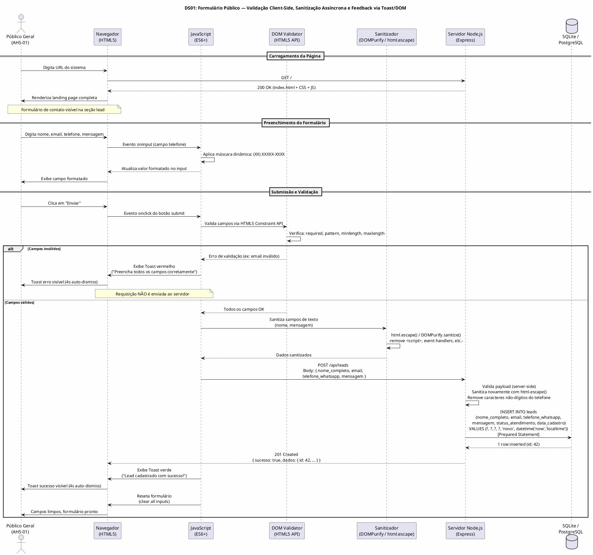
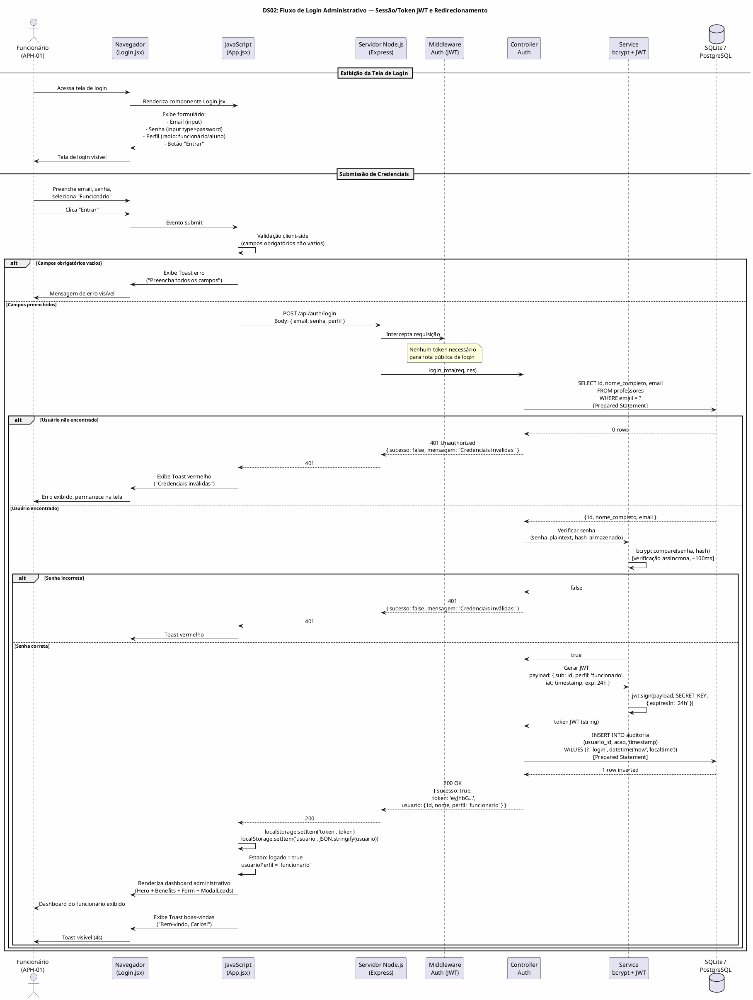
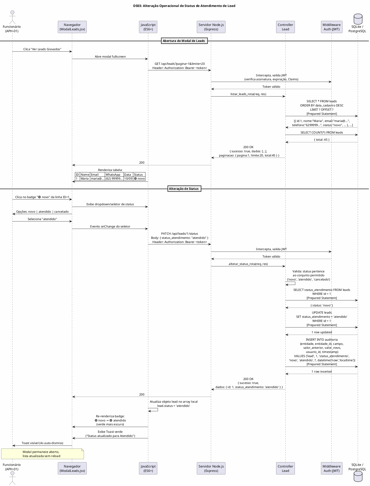
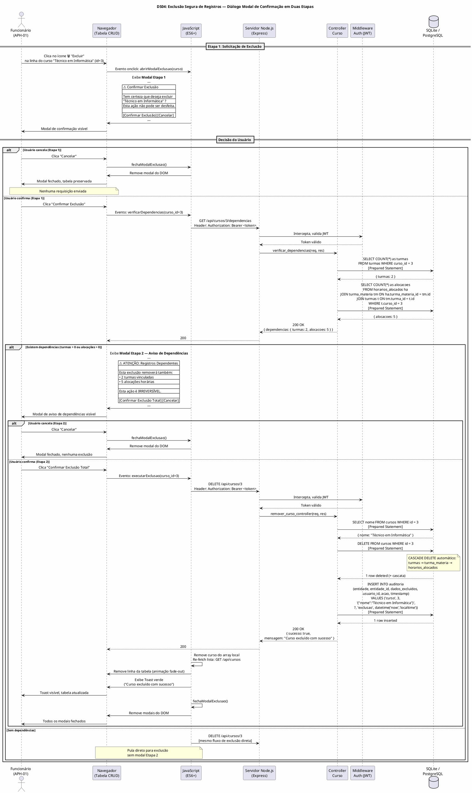

# Requisitos de Usuário — Sistema de Gestão de Horários Escolares

**Projeto:** Projeto Horário — IFMT Campus Barra do Garças  
**Versão do Documento:** 1.0.0  
**Data de Emissão:** 10/09/2026  
**Autor(es):** Carlos Alexandre Dias da Silva, Lara Guida Carvalho  
**Revisor Técnico:** Prof. Carlos David Rocha de Souza  
**Padrões de Referência:** OMG UML 2.5.1, ISO/IEC/IEEE 29148:2018, FURPS+ / ISO/IEC 25010  
**Status:** Para Revisão  

---

## Sumário

1. [Introdução](#1-introdução)
2. [Identificação e Caracterização de Atores](#2-identificação-e-caracterização-de-atores)
3. [Diagrama de Casos de Uso](#3-diagrama-de-casos-de-uso)
4. [Catálogo Detalhado de Requisitos de Usuário](#4-catálogo-detalhado-de-requisitos-de-usuário)
5. [Histórias de Usuário e Critérios de Aceite BDD/Gherkin](#5-histórias-de-usuário-e-critérios-de-aceite-bddgherkin)
6. [Diagramas de Sequência — Visão do Usuário](#6-diagramas-de-sequência--visão-do-usuário)

---

## 1. Introdução

### 1.1 Propósito

Este documento especifica, de forma exaustiva e formal, os requisitos de usuário do **Sistema de Gestão de Horários Escolares** — plataforma full-stack destinada à gestão acadêmica do Instituto Federal de Mato Grosso (IFMT), Campus Barra do Garças. O documento atende aos padrões ISO/IEC/IEEE 29148:2018 e utiliza a notação UML 2.5.1 da OMG para diagramação.

### 1.2 Escopo

O escopo abrange a perspectiva de negócio, experiência do usuário (UX) e critérios funcionais externos, incluindo:

- Atores humanos e sistêmicos que interagem com o sistema
- Casos de uso com diagramas UML e estereótipos canônicos
- Requisitos de usuário estruturados e priorizados
- Histórias de usuário com critérios de aceite em formato BDD/Gherkin
- Diagramas de sequência focando na interação do usuário com a interface

### 1.3 Definições e Abreviações

| Termo | Definição |
|-------|-----------|
| **RU** | Requisito de Usuário |
| **UC** | Caso de Uso (Use Case) |
| **IFMT** | Instituto Federal de Mato Grosso |
| **FET** | Free Timetabling Software — ferramenta externa de geração automática de horários |
| **MoSCoW** | Método de priorização Must/Should/Could/Won't |
| **BDD** | Behavior Driven Development |
| **Toast** | Notificação flutuante de feedback visual no frontend |

---

## 2. Identificação e Caracterização de Atores

### 2.1 Taxonomia de Atores (UML 2.5.1, Seção 18.2.1)

Conforme a especificação UML 2.5.1, um **ator** (Actor) representa uma entidade externa que interage com o sistema desempenhando um papel (role) específico. Atores são classificados em:

- **Ator Humano Primário (APH):** Inicia interações com o sistema para atingir um objetivo de negócio.
- **Ator Humano Secundário (AHS):** Participa de cenários auxiliando o ator primário ou realizando tarefas de suporte.
- **Ator Sistêmico (AS):** Sistema externo que interage eletronicamente com o sistema em estudo via APIs, protocolos ou integrações.

### 2.2 Catálogo de Atores

#### 2.2.1 Atores Humanos Primários

| ID | Ator | Descrição | Perfil | Objetivo Principal |
|----|------|-----------|--------|-------------------|
| **APH-01** | **Funcionário Administrativo** | Servidor do IFMT responsável pela gestão operacional de horários, cadastros de turmas, disciplinas, professores, salas, alocações e restrições. Possui credenciais de acesso administrativo. | `funcionario` | Gerenciar todo o ciclo de vida dos horários escolares |
| **APH-02** | **Aluno** | Estudante matriculado no IFMT que acessa o sistema para consultar horários de aula, verificar disponibilidade de salas e acompanhar o status de atendimento de suas solicitações. | `aluno` | Consultar horários e acompanhar solicitações |

#### 2.2.2 Atores Humanos Secundários

| ID | Ator | Descrição | Objetivo Principal |
|----|------|-----------|-------------------|
| **AHS-01** | **Público Geral (Visitante)** | Qualquer pessoa que acessa a landing page pública do sistema sem autenticação, podendo preencher o formulário de contato (lead) para envio de mensagens institucionais. | Enviar mensagem de contato/interesse via formulário público |

#### 2.2.3 Atores Sistêmicos

| ID | Ator | Descrição | Protocolo | Objetivo Principal |
|----|------|-----------|-----------|-------------------|
| **AS-01** | **Banco de Dados SQLite/PostgreSQL** | Sistema de gerenciamento de banco de dados relacional que persiste todos os dados do sistema via prepared statements. | SQLite PRAGMA / SQL parametrizado | Persistir, recuperar e manter integridade referencial dos dados |
| **AS-02** | **FET (Free Timetabling Software)** | Aplicação desktop open-source para geração automática de horários. O sistema gera XML no formato FET como saída para importação futura. | Exportação XML | Receber dados estruturados para geração automática de grade horária |

### 2.3 Diagrama de Atores (Representação UML)

```
                          ┌─────────────────────────────────┐
                          │    SISTEMA DE GESTÃO DE         │
                          │       HORÁRIOS ESCOLARES        │
                          └─────────────────────────────────┘

  ╔═══════════════════╗
  ║  Funcionário      ║
  ║  Administrativo   ║───────────────(APH-01)──────▶│
  ╚═══════════════════╝                                │
                                                       │
  ╔═══════════════════╗                                │
  ║  Aluno            ║───────────────(APH-02)──────▶│
  ╚═══════════════════╝                                │
                                                       │
  ╔═══════════════════╗                                │
  ║  Público Geral    ║───────────────(AHS-01)──────▶│
  ║  (Visitante)      ║                                │
  ╚═══════════════════╝                                │
                                                       │
                          │◀──────(AS-01)──────╚══════════════════╗
                          │                           ║ Banco de  ║
                          │                           ║ Dados     ║
                          │                           ╚═══════════╝
                          │◀──────(AS-02)──────╚══════════════════╗
                          │                           ║ FET       ║
                          │                           ║ Software  ║
                          │                           ╚═══════════╝
```

---

## 3. Diagrama de Casos de Uso

### 3.1 Diagrama de Casos de Uso — PlantUML

```plantuml
@startuml
left to right direction
skinparam packageStyle rectangle
skinparam actorStyle awesome
skinparam usecase {
  BackgroundColor #FEFECE
  BorderColor #A80036
  ArrowColor #585858
}
skinparam rectangle {
  BackgroundColor #E8F5E9
  BorderColor #2E7D32
}

title Diagrama de Casos de Uso — Sistema de Gestão de Horários Escolares

rectangle "Sistema de Gestão de Horários Escolares" as SYSTEM {

  ' ============================================
  ' CASOS DE USO PÚBLICOS (SEM AUTENTICAÇÃO)
  ' ============================================

  usecase "UC01: Acessar Landing Page" as UC01
  usecase "UC02: Preencher Formulário de Contato" as UC02
  usecase "UC03: Visualizar Leads (Modal)" as UC03

  ' ============================================
  ' CASOS DE USO DE AUTENTICAÇÃO
  ' ============================================

  usecase "UC04: Autenticar Usuário\n(Login)" as UC04
  usecase "UC05: Verificar Status de Sessão" as UC05
  usecase "UC06: Encerrar Sessão\n(Logout)" as UC06

  ' ============================================
  ' CASOS DE USO — FUNCIONÁRIO
  ' ============================================

  usecase "UC07: Gerenciar Cursos" as UC07
  usecase "UC08: Gerenciar Turmas" as UC08
  usecase "UC09: Gerenciar Professores" as UC09
  usecase "UC10: Gerenciar Matérias" as UC10
  usecase "UC11: Gerenciar Salas" as UC11
  usecase "UC12: Gerenciar Horários\n(Turnos)" as UC12
  usecase "UC13: Gerenciar Alocações\nHorárias" as UC13
  usecase "UC14: Gerenciar Restrições" as UC14
  usecase "UC15: Alterar Status de\nAtendimento de Lead" as UC15
  usecase "UC16: Excluir Registro" as UC16
  usecase "UC17: Exportar XML para FET" as UC17
  usecase "UC18: Listar Leads com\nPaginação" as UC18

  ' ============================================
  ' CASOS DE USO — ALUNO
  ' ============================================

  usecase "UC19: Consultar Grade Horária" as UC19
  usecase "UC20: Ver Status da Solicitação" as UC20

  ' ============================================
  ' INCLUSÕES E EXTENSÕES
  ' ============================================

  usecase "Validar Formulário\n(HTML5 + JS)" as I_VALIDAR <<include>>
  usecase "Sanitizar Entrada\n(XSS Prevention)" as I_SANITIZAR <<include>>
  usecase "Persistir Dados\n(Prepared Statement)" as I_PERSISTIR <<include>>
  usecase "Confirmar Exclusão\n(Dialog 2 Etapas)" as I_CONFIRMAR <<include>>
  usecase "Gerar Token JWT" as I_JWT <<include>>
  usecase "Criptografar Senha\n(bcrypt)" as I_CRIPTO <<include>>
  usecase "Registrar Auditoria" as I_AUDIT <<include>>

  usecase "Exportar Grade\ncomo PDF" as E_PDF <<extend>>
  usecase "Filtrar por Turno/\nDia/Semana" as E_FILTRAR <<extend>>
}

' ============================================
' ATORES
' ============================================

actor "Funcionário\nAdministrativo" as APH01
actor "Aluno" as APH02
actor "Público Geral\n(Visitante)" as AHS01
actor "Banco de\nDados" as AS01
actor "FET Software" as AS02

' ============================================
' RELACIONAMENTOS — FUNCIONÁRIO
' ============================================

APH01 --> UC04
APH01 --> UC05
APH01 --> UC06
APH01 --> UC07
APH01 --> UC08
APH01 --> UC09
APH01 --> UC10
APH01 --> UC11
APH01 --> UC12
APH01 --> UC13
APH01 --> UC14
APH01 --> UC15
APH01 --> UC16
APH01 --> UC17
APH01 --> UC18

' ============================================
' RELACIONAMENTOS — ALUNO
' ============================================

APH02 --> UC04
APH02 --> UC05
APH02 --> UC06
APH02 --> UC19
APH02 --> UC20

' ============================================
' RELACIONAMENTOS — PÚBLICO GERAL
' ============================================

AHS01 --> UC01
AHS01 --> UC02
AHS01 --> UC03

' ============================================
' RELACIONAMENTOS — ATORES SISTÊMICOS
' ============================================

AS01 --> UC07 : <<include>>
AS01 --> UC08 : <<include>>
AS01 --> UC09 : <<include>>
AS01 --> UC10 : <<include>>
AS01 --> UC11 : <<include>>
AS01 --> UC12 : <<include>>
AS01 --> UC13 : <<include>>
AS01 --> UC14 : <<include>>
AS01 --> UC15 : <<include>>
AS01 --> UC18 : <<include>>
AS01 --> UC19 : <<include>>
AS02 --> UC17 : <<include>>

' ============================================
' INCLUSÕES E EXTENSÕES
' ============================================

UC02 ..> I_VALIDAR : <<include>>
UC02 ..> I_SANITIZAR : <<include>>
UC02 ..> I_PERSISTIR : <<include>>
UC02 ..> I_AUDIT : <<include>>

UC04 ..> I_CRIPTO : <<include>>
UC04 ..> I_JWT : <<include>>
UC04 ..> I_AUDIT : <<include>>

UC16 ..> I_CONFIRMAR : <<include>>
UC16 ..> I_AUDIT : <<include>>

UC13 ..> E_FILTRAR : <<extend>>
UC17 ..> E_PDF : <<extend>>

UC18 ..> E_FILTRAR : <<extend>>

UC19 ..> E_FILTRAR : <<extend>>

UC15 ..> I_AUDIT : <<include>>

UC07 ..> I_PERSISTIR : <<include>>
UC08 ..> I_PERSISTIR : <<include>>
UC09 ..> I_PERSISTIR : <<include>>
UC10 ..> I_PERSISTIR : <<include>>
UC11 ..> I_PERSISTIR : <<include>>
UC12 ..> I_PERSISTIR : <<include>>
UC13 ..> I_PERSISTIR : <<include>>
UC14 ..> I_PERSISTIR : <<include>>

@enduml
```



### 3.2 Legenda de Estereótipos

| Estereótipo | Definição (UML 2.5.1 §18.3.4) | Aplicação |
|-------------|-------------------------------|-----------|
| `<<include>>` | Relacionamento de inclusão obrigatória: o caso base sempre executa o comportamento do caso incluído. | Validação de formulário, sanitização, persistência, JWT, criptografia, auditoria e confirmação de exclusão. |
| `<<extend>>` | Relacionamento de extensão opcional: o caso de extensão só é executado quando a condição de extensão é satisfeita. | Exportação PDF, filtragem por turno/dia/semana — funcionalidades opcionais acionadas sob demanda. |

---

## 4. Catálogo Detalhado de Requisitos de Usuário

### 4.1 Estrutura Padronizada de cada RU

Cada requisito de usuário segue o template:

- **Identificador:** RU-XX
- **Caso de Uso Associado:** UC-XX
- **Ator Principal:** (ator humano primário ou secundário)
- **Prioridade (MoSCoW):** Must / Should / Could / Won't
- **Pré-condições:** Estado do sistema antes da execução
- **Fluxo Operacional:** Passos numerados do fluxo principal
- **Pós-condições:** Estado do sistema após a execução bem-sucedida

---

### RU-01: Acessar Landing Page Pública

| Campo | Valor |
|-------|-------|
| **Identificador** | RU-01 |
| **Caso de Uso** | UC01: Acessar Landing Page |
| **Ator Principal** | AHS-01 (Público Geral / Visitante) |
| **Prioridade MoSCoW** | **Must** |
| **Pré-condições** | 1. O navegador do usuário está aberto e possui acesso à internet. 2. O servidor Node.js/Express está em execução na porta configurada. 3. O domínio ou endereço IP do servidor é acessível. |
| **Fluxo Operacional** | 1. O visitante digita a URL do sistema no navegador ou acessa via link. 2. O navegador envia uma requisição `GET /` ao servidor. 3. O servidor retorna o arquivo `index.html` (HTML5 semântico) com os recursos CSS3 e JavaScript referenciados. 4. O navegador renderiza a página de landing contendo: cabeçalho com logo e navegação, hero section com apresentação do projeto, seção de benefícios/arquitetura, formulário de contato e rodapé. 5. Recursos estáticos (CSS, JS, fontes) são carregados via CDN ou servidos localmente. 6. Animações de background (orbs), efeitos glassmorphism e transições CSS são ativados automaticamente. |
| **Pós-condições** | A landing page é renderizada integralmente no navegador do visitante, com todos os componentes visuais e funcionais carregados. |

### RU-02: Preencher e Enviar Formulário de Contato (Lead)

| Campo | Valor |
|-------|-------|
| **Identificador** | RU-02 |
| **Caso de Uso** | UC02: Preencher Formulário de Contato |
| **Ator Principal** | AHS-01 (Público Geral / Visitante) |
| **Prioridade MoSCoW** | **Must** |
| **Pré-condições** | 1. A landing page está completamente carregada (RU-01 concluído). 2. A seção de formulário de contato está visível na página (scroll ou seção direta). 3. O backend está respondendo na rota `POST /api/leads`. |
| **Fluxo Operacional** | 1. O visitante localiza a seção de formulário na landing page. 2. O visitante preenche o campo **Nome Completo** (obrigatório, 3–150 caracteres). 3. O visitante preenche o campo **E-mail** (obrigatório, formato válido). 4. O visitante preenche o campo **Telefone/WhatsApp** (obrigatório, 10–15 dígitos). Máscara dinâmica formata automaticamente como `(XX) XXXXX-XXXX` à medida que digita. 5. O visitante opcionalmente preenche o campo **Mensagem** (opcional, até 500 caracteres). 6. Ao clicar no botão "Enviar", o frontend executa **validação client-side** via constraint API do HTML5 (`required`, `pattern`, `minlength`, `maxlength`) e validação JavaScript adicional. 7. Se houver erro de validação, um **Toast** de erro (vermelho) é exibido no canto superior direito com mensagem descritiva, e o formulário não é submetido. 8. Se a validação client-side passar, o JavaScript faz a **sanitização assíncrona** dos campos de texto (escape HTML via `DOMPurify` ou equivalente) para prevenir XSS. 9. O frontend envia uma requisição `POST /api/leads` com payload JSON: `{ nome_completo, email, telefone_whatsapp, mensagem }`. 10. O backend valida os dados novamente (servidor-side), sanitiza contra XSS via `html.escape()`, aplica prepared statement para inserção no SQLite. 11. O backend retorna HTTP 201 Created com `{ sucesso: true, dados: { id, nome_completo, email, ... } }`. 12. O frontend recebe a resposta e exibe um **Toast** de sucesso (verde) com a mensagem "Lead cadastrado com sucesso!". 13. Os campos do formulário são limpos automaticamente (reset). |
| **Pós-condições** | 1. Um novo registro é inserido na tabela `leads` do banco de dados com `status_atendimento = 'novo'` e `data_cadastro` = data/hora atual. 2. O Toast de sucesso é exibido por 4 segundos e então removido do DOM. 3. O formulário é resetado para o estado inicial. |

### RU-03: Visualizar Leads Cadastrados (Modal)

| Campo | Valor |
|-------|-------|
| **Identificador** | RU-03 |
| **Caso de Uso** | UC03 / UC18: Visualizar Leads (Modal) / Listar Leads com Paginação |
| **Ator Principal** | APH-01 (Funcionário Administrativo) |
| **Prioridade MoSCoW** | **Must** |
| **Pré-condições** | 1. O funcionário está autenticado no sistema. 2. Pelo menos um lead foi previamente cadastrado. 3. O backend está respondendo na rota `GET /api/leads?pagina=1&limite=20`. |
| **Fluxo Operacional** | 1. O funcionário clica no botão "Ver Leads Gravados" no cabeçalho ou rodapé. 2. O frontend abre um **modal fullscreen** (ModalLeads.jsx) com efeito de sobreposição escura. 3. O frontend envia `GET /api/leads?pagina=1&limite=20` ao backend. 4. O backend consulta a tabela `leads` com paginação e retorna JSON `{ sucesso: true, dados: [...], paginacao: { pagina, limite, total } }`. 5. O modal renderiza uma tabela HTML com colunas: ID, Nome, E-mail, WhatsApp, Data Cadastro, Status. 6. O funcionário pode navegar entre páginas usando controles de paginação. 7. O funcionário fecha o modal clicando no botão "✕" ou pressionando Escape. |
| **Pós-condições** | O modal é fechado e o estado da página anterior é restaurado sem perda de dados. |

### RU-04: Autenticar Usuário (Login)

| Campo | Valor |
|-------|-------|
| **Identificador** | RU-04 |
| **Caso de Uso** | UC04: Autenticar Usuário (Login) |
| **Ator Principal** | APH-01 (Funcionário Administrativo) ou APH-02 (Aluno) |
| **Prioridade MoSCoW** | **Must** |
| **Pré-condições** | 1. O usuário não está autenticado (sessão inexistente ou expirada). 2. O backend está respondendo na rota `POST /api/auth/login`. 3. O usuário possui credenciais válidas cadastradas no sistema. |
| **Fluxo Operacional** | 1. O usuário é redirecionado para a tela de login ou clica em botão de autenticação. 2. O formulário de login é exibido com campos: E-mail (obrigatório), Senha (obrigatório), Perfil (funcionário/aluno — seleção via radio button). 3. O usuário preenche o e-mail e a senha. 4. O usuário seleciona o perfil de acesso: **Funcionário** ou **Aluno**. 5. Ao clicar em "Entrar", o frontend valida client-side os campos obrigatórios. 6. O frontend envia `POST /api/auth/login` com payload `{ email, senha, perfil }`. 7. O backend busca o usuário na tabela `professores` (ou tabela de autenticação) pelo e-mail. 8. O backend compara a senha fornecida com o hash armazenado usando **bcrypt** (verificação assíncrona). 9. Se as credenciais forem válidas, o backend gera um **JSON Web Token (JWT)** com payload: `{ sub: usuarioId, perfil: 'funcionario'|'aluno', iat, exp }`. 10. O backend retorna HTTP 200 OK com `{ sucesso: true, token: 'eyJhbG...', usuario: { id, nome, perfil } }`. 11. O frontend armazena o token em `localStorage` ou cookie HTTP-Only. 12. O frontend atualiza o estado de autenticação: `logado = true`, `usuarioPerfil = 'funcionario'` ou `'aluno'`. 13. O frontend renderiza a view correspondente ao perfil (funcionário vê dashboard completo; aluno vê painel de consulta). 14. Um Toast de boas-vindas é exibido. |
| **Pós-condições** | 1. O usuário está autenticado com um token JWT válido. 2. A interface do usuário é renderizada conforme o perfil autorizado. 3. Todas as requisições subsequentes incluem o header `Authorization: Bearer <token>`. |

### RU-05: Verificar Status de Sessão

| Campo | Valor |
|-------|-------|
| **Identificador** | RU-05 |
| **Caso de Uso** | UC05: Verificar Status de Sessão |
| **Ator Principal** | APH-01 / APH-02 (Usuário Autenticado) |
| **Prioridade MoSCoW** | **Should** |
| **Pré-condições** | 1. A aplicação frontend está sendo carregada (refresh da página ou abertura inicial). |
| **Fluxo Operacional** | 1. Ao montar o componente raiz (`App.jsx`), o frontend verifica se existe token armazenado. 2. Se existir token, envia `GET /api/auth/status` com header `Authorization: Bearer <token>`. 3. O backend valida o JWT (verificação de assinatura, expiração e Claims). 4. Se válido, retorna HTTP 200 OK com `{ autenticado: true, perfil: 'funcionario', usuario: { id, nome } }`. 5. O frontend restaura o estado de autenticação e renderiza a view correspondente. 6. Se o token for inválido ou expirado, retorna HTTP 401. 7. O frontend limpa o token armazenado e exibe a tela de login. |
| **Pós-condições** | O estado de autenticado/desautenticado é restaurado corretamente, mantendo a experiência do usuário entre recarregamentos da página. |

### RU-06: Encerrar Sessão (Logout)

| Campo | Valor |
|-------|-------|
| **Identificador** | RU-06 |
| **Caso de Uso** | UC06: Encerrar Sessão (Logout) |
| **Ator Principal** | APH-01 / APH-02 |
| **Prioridade MoSCoW** | **Must** |
| **Pré-condições** | 1. O usuário está autenticado no sistema. |
| **Fluxo Operacional** | 1. O usuário clica no botão "Sair" / "Logout" na interface. 2. O frontend remove o token JWT do `localStorage` ou cookie. 3. O frontend limpa o estado de autenticação: `logado = false`, `usuarioPerfil = null`. 4. O frontend redireciona o usuário para a landing page pública (sem autenticação). 5. Toast informativo: "Sessão encerrada com sucesso." |
| **Pós-condições** | O token é invalidado no client-side. O usuário retorna ao estado não autenticado. A landing page pública é renderizada. |

### RU-07: Gerenciar Cursos (CRUD)

| Campo | Valor |
|-------|-------|
| **Identificador** | RU-07 |
| **Caso de Uso** | UC07: Gerenciar Cursos |
| **Ator Principal** | APH-01 (Funcionário Administrativo) |
| **Prioridade MoSCoW** | **Must** |
| **Pré-condições** | 1. O funcionário está autenticado com perfil `funcionario`. 2. A view de gestão de cursos está acessível no painel administrativo. |
| **Fluxo Operacional** | **Cadastrar Curso:** 1. O funcionário acessa a seção "Cursos". 2. Clica em "Novo Curso". 3. Preenche: Nome do Curso (obrigatório, 3–150 caracteres, único) e Descrição (opcional). 4. Submete o formulário. 5. Frontend valida e envia `POST /api/cursos` com `{ nome, descricao }`. 6. Backend valida, sanitiza e persiste com prepared statement. 7. Toast de sucesso. Tabela atualiza. **Listar Cursos:** 1. Frontend envia `GET /api/cursos`. 2. Backend retorna lista de cursos. 3. Tabela renderiza dados. **Editar Curso:** 1. Funcionário clica em "Editar" na linha do curso. 2. Formulário pré-preenchido é exibido. 3. Alterações são submetidas via `PUT /api/cursos/:id`. **Excluir Curso:** 1. Funcionário clica em "Excluir". 2. Diálogo modal de confirmação em duas etapas é exibido. 3. Funcionário confirma. 4. `DELETE /api/cursos/:id` é enviado. Cascade delete remove turmas associadas. |
| **Pós-condições** | 1. O curso é persistido na tabela `cursos`. 2. Índice `idx_cursos_nome` mantém unicidade. 3. Exclusão em cascade remove registros dependentes em `turmas`. |

### RU-08: Gerenciar Turmas (CRUD)

| Campo | Valor |
|-------|-------|
| **Identificador** | RU-08 |
| **Caso de Uso** | UC08: Gerenciar Turmas |
| **Ator Principal** | APH-01 |
| **Prioridade MoSCoW** | **Must** |
| **Pré-condições** | 1. Autenticado como funcionário. 2. Pelo menos um curso existe no sistema (FK obrigatória). |
| **Fluxo Operacional** | **Cadastrar Turma:** 1. Acessa seção "Turmas". 2. Clica em "Nova Turma". 3. Preenche: Nome da Turma (obrigatório), Curso (select com cursos existentes), Ano Letivo (opcional), Período Letivo (opcional). 4. Submete via `POST /api/turmas` com `{ nome, curso_id, ano_letivo, periodo_letivo }`. 5. Backend valida integridade referencial (curso_id deve existir em `cursos`). 6. Persiste com prepared statement. **Listar Turmas:** `GET /api/turmas` retorna lista com JOIN em `cursos` para exibir nome do curso. **Excluir Turma:** `DELETE /api/turmas/:id` com cascade em `turma_materia` e `horarios_alocados`. Diálogo modal de confirmação obrigatório. |
| **Pós-condições** | 1. Turma persistida com FK para curso. 2. Índice `idx_turmas_curso` otimiza consultas por curso. 3. Cascade delete em tabelas dependentes. |

### RU-09: Gerenciar Professores (CRUD)

| Campo | Valor |
|-------|-------|
| **Identificador** | RU-09 |
| **Caso de Uso** | UC09: Gerenciar Professores |
| **Ator Principal** | APH-01 |
| **Prioridade MoSCoW** | **Must** |
| **Pré-condições** | 1. Autenticado como funcionário. |
| **Fluxo Operacional** | **Cadastrar Professor:** 1. Acessa seção "Professores". 2. Preenche: Nome Completo (obrigatório, 3–150 caracteres), E-mail (obrigatório, único, formato válido), Disciplina Favorita (opcional). 3. Submete via `POST /api/professores` com `{ nome_completo, email, disciplina_favorita }`. 4. Backend valida unicidade do e-mail. 5. Persiste com prepared statement. **Listar Professores:** `GET /api/professores`. **Excluir Professor:** `DELETE /api/professores/:id` com cascade em `professor_materia`. |
| **Pós-condições** | 1. Professor persistido com e-mail único. 2. Índice implícito via UNIQUE constraint no email. |

### RU-10: Gerenciar Matérias (CRUD)

| Campo | Valor |
|-------|-------|
| **Identificador** | RU-10 |
| **Caso de Uso** | UC10: Gerenciar Matérias |
| **Ator Principal** | APH-01 |
| **Prioridade MoSCoW** | **Must** |
| **Pré-condições** | 1. Autenticado como funcionário. |
| **Fluxo Operacional** | **Cadastrar Matéria:** 1. Acessa seção "Matérias". 2. Preenche: Nome (obrigatório, único), Carga Horária Semanal (obrigatória, inteiro ≥ 0), Descrição (opcional). 3. Submete via `POST /api/materias` com `{ nome, carga_horaria_semanal, descricao }`. 4. Backend valida: nome único, carga horária não-negativa. 5. Persiste. **Listar Matérias:** `GET /api/materias`. **Excluir Matéria:** `DELETE /api/materias/:id` com cascade. |
| **Pós-condições** | 1. Matéria persistida. 2. Índice implícito via UNIQUE constraint no nome. |

### RU-11: Gerenciar Salas (CRUD)

| Campo | Valor |
|-------|-------|
| **Identificador** | RU-11 |
| **Caso de Uso** | UC11: Gerenciar Salas |
| **Ator Principal** | APH-01 |
| **Prioridade MoSCoW** | **Must** |
| **Pré-condições** | 1. Autenticado como funcionário. |
| **Fluxo Operacional** | **Cadastrar Sala:** 1. Preenche: Nome (obrigatório, único), Capacidade (padrão 50), Tipo (padrão 'sala', opções: sala, laboratório, auditório, quadra). 2. Submete via `POST /api/salas` com `{ nome, capacidade, tipo }`. 3. Persiste. **Listar Salas:** `GET /api/salas`. **Excluir Sala:** `DELETE /api/salas/:id` com `ON DELETE SET NULL` em `horarios_alocados`. |
| **Pós-condições** | 1. Sala persistida. 2. Alocações existentes perdem referência (sala_id = NULL) ao invés de serem removidas. |

### RU-12: Gerenciar Horários/Turnos (CRUD)

| Campo | Valor |
|-------|-------|
| **Identificador** | RU-12 |
| **Caso de Uso** | UC12: Gerenciar Horários (Turnos) |
| **Ator Principal** | APH-01 |
| **Prioridade MoSCoW** | **Must** |
| **Pré-condições** | 1. Autenticado como funcionário. |
| **Fluxo Operacional** | **Cadastrar Horário:** 1. Preenche: Dia da Semana (select: Segunda a Domingo), Hora Início (formato HH:MM 24h), Hora Fim (formato HH:MM 24h). 2. Submete via `POST /api/horarios` com `{ dia_semana, hora_inicio, hora_fim }`. 3. Backend valida: dia da semana pertence à lista válida, horários no formato HH:MM, hora_fim > hora_inicio. 4. Coluna gerada `slot` é calculada automaticamente como `hora_inicio-hora_fim`. **Listar Horários:** `GET /api/horarios`. **Excluir Horário:** `DELETE /api/horarios/:id` com cascade. |
| **Pós-condições** | 1. Horário persistido com coluna `slot` auto-gerada. 2. Validação garante integridade temporal. |

### RU-13: Gerenciar Alocações Horárias (CRUD)

| Campo | Valor |
|-------|-------|
| **Identificador** | RU-13 |
| **Caso de Uso** | UC13: Gerenciar Alocações Horárias |
| **Ator Principal** | APH-01 |
| **Prioridade MoSCoW** | **Must** |
| **Pré-condições** | 1. Autenticado como funcionário. 2. Pelo menos uma turma_matéria, horário e sala existem no sistema. |
| **Fluxo Operacional** | **Cadastrar Alocação:** 1. Acessa seção "Alocações Horárias". 2. Seleciona: Turma_matéria (select com JOIN de turma+matéria+professor), Dia da Semana, Horário (select da tabela `horarios`), Sala (select da tabela `salas`). 3. Submete via `POST /api/horarios_alocados` com `{ turma_materia_id, dia_semana, horario_id, sala_id }`. 4. Backend valida: não há conflito de horário (mesma sala no mesmo dia/horário), não há conflito de professor (mesmo professor em dois locais simultaneamente), não há conflito de turma. 5. Status inicial: `pendente`. **Alterar Status:** Conforme RU-15. **Excluir Alocação:** `DELETE /api/horarios_alocados/:id` com diálago modal. |
| **Pós-condições** | 1. Alocação persistida com status `pendente`. 2. Índices `idx_horarios_alocados_turma_materia`, `idx_horarios_alocados_sala`, `idx_horarios_alocados_status` otimizam consultas. |

### RU-14: Gerenciar Restrições (CRUD)

| Campo | Valor |
|-------|-------|
| **Identificador** | RU-14 |
| **Caso de Uso** | UC14: Gerenciar Restrições |
| **Ator Principal** | APH-01 |
| **Prioridade MoSCoW** | **Should** |
| **Pré-condições** | 1. Autenticado como funcionário. |
| **Fluxo Operacional** | **Cadastrar Restrição:** 1. Preenche: Tipo (select: professor, sala, turma), Descrição (obrigatória), Valor (opcional), Ativa (toggle, padrão true). 2. Submete via `POST /api/restricoes` com `{ tipo, descricao, valor, ativa }`. 3. Backend valida: tipo pertence à lista permitida. **Listar Restrições:** `GET /api/restricoes`. **Ativar/Desativar:** Toggle envia `PATCH /api/restricoes/:id` com `{ ativa: true/false }`. **Excluir Restrição:** `DELETE /api/restricoes/:id` com diálago modal. |
| **Pós-condições** | 1. Restrição persistida. 2. Restrições ativas são consideradas na validação de alocações futuras. |

### RU-15: Alterar Status de Atendimento de Lead

| Campo | Valor |
|-------|-------|
| **Identificador** | RU-15 |
| **Caso de Uso** | UC15: Alterar Status de Atendimento de Lead |
| **Ator Principal** | APH-01 (Funcionário Administrativo) |
| **Prioridade MoSCoW** | **Must** |
| **Pré-condições** | 1. Autenticado como funcionário. 2. Pelo menos um lead existe com status inicial `'novo'`. |
| **Fluxo Operacional** | 1. O funcionário abre o modal de visualização de leads (RU-03). 2. Localiza o lead desejado na tabela. 3. Clica no status atual do lead (badge/campo interativo). 4. Um seletor de status é exibido com opções: `novo`, `atendido`, `cancelado`. 5. O funcionário seleciona o novo status. 6. O frontend envia `PATCH /api/leads/:id/status` com `{ status_atendimento: 'atendido' }`. 7. O backend valida: o novo status pertence ao conjunto permitido `CHECK IN ('novo','atendido','cancelado')`. 8. O backend atualiza o registro usando prepared statement. 9. Trilha de auditoria é registrada (quem, quando, de qual status para qual status). 10. Backend retorna HTTP 200 OK com `{ sucesso: true, dados: { id, status_atendimento: 'atendido' } }`. 11. O frontend atualiza o badge de status na tabela (muda cor: novo=azul, atendido=verde, cancelado=vermelho). 12. Toast de confirmação: "Status atualizado para Atendido". |
| **Pós-condições** | 1. O campo `status_atendimento` do lead é atualizado na tabela `leads`. 2. A trilha de auditoria registra a transição. 3. O badge visual é atualizado sem necessidade de recarregar a lista. |

### RU-16: Excluir Registro com Confirmação em Duas Etapas

| Campo | Valor |
|-------|-------|
| **Identificador** | RU-16 |
| **Caso de Uso** | UC16: Excluir Registro |
| **Ator Principal** | APH-01 |
| **Prioridade MoSCoW** | **Must** |
| **Pré-condições** | 1. Autenticado como funcionário. 2. Um registro existe em qualquer entidade gerenciável (curso, turma, professor, matéria, sala, horário, alocação, restrição). |
| **Fluxo Operacional** | 1. O funcionário clica no botão "Excluir" (ícone de lixeira) na linha do registro desejado. 2. **Primeira etapa — Diálogo Modal:** Um modal de confirmação é exibido com: título "Confirmar Exclusão", mensagem descritiva "Tem certeza que deseja excluir [Nome do Registro]? Esta ação não pode ser desfeita.", botão "Confirmar Exclusão" (vermelho) e botão "Cancelar" (cinza). 3. Se o funcionário clica em "Cancelar", o modal é fechado e nenhuma ação é tomada. 4. Se o funcionário clica em "Confirmar Exclusão", o sistema verifica se há registros dependentes (FK cascade). 5. **Segunda etapa — Aviso de Dependências (se aplicável):** Se houver registros dependentes que serão afetados, um segundo modal é exibido: "ATENÇÃO: Esta exclusão removerá também [X] turmas, [Y] alocações vinculadas. Deseja prosseguir?". 6. O funcionário confirma a segunda etapa. 7. O frontend envia `DELETE /api/[entidade]/:id` com header `Authorization: Bearer <token>`. 8. O backend executa a exclusão com prepared statement e cascade delete. 9. Trilha de auditoria registra: entidade, id, dados do registro excluído, data/hora, usuário responsável. 10. Backend retorna HTTP 200 OK com `{ sucesso: true, mensagem: "Registro excluído com sucesso" }`. 11. Toast de sucesso. A tabela é atualizada (linha removida). |
| **Pós-condições** | 1. O registro e todos os dependentes cascade são removidos permanentemente. 2. A trilha de auditoria mantém o registro histórico da exclusão. 3. A interface é atualizada sem recarregamento completo. |

### RU-17: Exportar Grade Horária como XML (FET)

| Campo | Valor |
|-------|-------|
| **Identificador** | RU-17 |
| **Caso de Uso** | UC17: Exportar XML para FET |
| **Ator Principal** | APH-01 |
| **Prioridade MoSCoW** | **Could** |
| **Pré-condições** | 1. Autenticado como funcionário. 2. Pelo menos uma alocação horária com status `confirmado` existe. 3. O backend possui o módulo de exportação XML ativo. |
| **Fluxo Operacional** | 1. Funcionário clica em "Exportar para FET". 2. Backend gera XML no formato FET com: timetable (professores, turmas, matérias, salas, horários, alocações). 3. Arquivo `.fet` é disponibilizado para download. |
| **Pós-condições** | Arquivo XML válido é gerado e baixado pelo navegador. |

### RU-18: Consultar Grade Horária (Aluno)

| Campo | Valor |
|-------|-------|
| **Identificador** | RU-18 |
| **Caso de Uso** | UC19: Consultar Grade Horária |
| **Ator Principal** | APH-02 (Aluno) |
| **Prioridade MoSCoW** | **Should** |
| **Pré-condições** | 1. Autenticado como aluno. 2. Alocações horárias existem no sistema. |
| **Fluxo Operacional** | 1. Aluno acessa "Minha Grade Horária". 2. Seleciona turma (se múltiplas turmas disponíveis). 3. Backend retorna alocações filtradas por turma. 4. Grade é renderizada em formato tabela/semanal. 5. Aluno pode filtrar por dia da semana. |
| **Pós-condições** | A grade horária do aluno é exibida com disciplina, professor, sala, dia e horário. |

### RU-19: Ver Status da Solicitação (Aluno)

| Campo | Valor |
|-------|-------|
| **Identificador** | RU-19 |
| **Caso de Uso** | UC20: Ver Status da Solicitação |
| **Ator Principal** | APH-02 (Aluno) |
| **Prioridade MoSCoW** | **Could** |
| **Pré-condições** | 1. Autenticado como aluno. 2. O aluno enviou previamente um lead/formulário de contato. |
| **Fluxo Operacional** | 1. Aluno acessa "Minhas Solicitações". 2. Backend filtra leads pelo e-mail do aluno autenticado. 3. Lista exibe: data, mensagem e status atual (novo/atendido/cancelado). |
| **Pós-condições** | O aluno visualiza o status de suas solicitações sem necessidade de contato adicional. |

---

## 5. Histórias de Usuário e Critérios de Aceite BDD/Gherkin

### HU-01: Acessar a Landing Page

**Como** visitante do sistema,  
**Eu quero** acessar a página inicial do projeto,  
**Para que eu** possa conhecer o sistema de gestão de horários do IFMT.

| Critério de Aceite | Cenário Gherkin |
|---------------------|-----------------|
| CA-01.1 | **Dado** que o visitante possui um navegador web atualizado<br>**Quando** ele digita a URL do sistema na barra de endereços<br>**Então** a landing page é carregada completamente com cabeçalho, hero, benefícios, formulário e rodapé visíveis |
| CA-01.2 | **Dado** que a landing page está sendo carregada<br>**Quando** o navegador renderiza o HTML5 semântico<br>**Então** os elementos de animação (orbs) e glassmorphism são ativados corretamente |
| CA-01.3 | **Dado** que o servidor backend está indisponível<br>**Quando** o visitante tenta acessar a URL<br>**Então** uma página de erro amigável é exibida com mensagem descritiva |

### HU-02: Enviar Mensagem de Contato (Lead)

**Como** visitante interesado no sistema,  
**Eu quero** preencher um formulário de contato,  
**Para que eu** possa enviar uma mensagem para a equipe do projeto.

| Critério de Aceite | Cenário Gherkin |
|---------------------|-----------------|
| CA-02.1 | **Dado** que o visitante está na landing page<br>**Quando** ele preenche todos os campos obrigatórios (nome, email, telefone) corretamente e clica em "Enviar"<br>**Então** um Toast verde "Lead cadastrado com sucesso!" é exibido por 4 segundos e os campos são limpos |
| CA-02.2 | **Dado** que o visitante preenche o campo e-mail com formato inválido (ex: "abc@")<br>**Quando** ele clica em "Enviar"<br>**Então** um Toast vermelho com mensagem de erro de validação é exibido e o formulário não é submetido |
| CA-02.3 | **Dado** que o visitante digita caracteres especiais no campo nome (ex: `<script>alert('xss')</script>`)<br>**Quando** o formulário é submetido<br>**Então** os dados são sanitizados (escape HTML) antes do envio e nenhum script é executado |
| CA-02.4 | **Dado** que o visitante digita um número de telefone<br>**Quando** ele digita os dígitos<br>**Então** a máscara formata automaticamente como `(XX) XXXXX-XXXX` |
| CA-02.5 | **Dado** que o visitante envia o formulário com sucesso<br>**Quando** o backend processa a requisição<br>**Então** um registro é inserido na tabela `leads` com `status_atendimento = 'novo'` e `data_cadastro` = data/hora atual |

### HU-03: Visualizar Leads Cadastrados

**Como** funcionário administrativo,  
**Eu quero** visualizar todos os leads capturados pelo formulário,  
**Para que eu** possa acompanhar as solicitações de contato.

| Critério de Aceite | Cenário Gherkin |
|---------------------|-----------------|
| CA-03.1 | **Dado** que o funcionário está autenticado e existem leads cadastrados<br>**Quando** ele clica em "Ver Leads Gravados"<br>**Então** um modal fullscreen é aberto exibindo uma tabela com: ID, Nome, E-mail, WhatsApp, Data Cadastro e Status |
| CA-03.2 | **Dado** que existem mais de 20 leads cadastrados<br>**Quando** o modal é aberto<br>**Então** apenas os primeiros 20 são exibidos e controles de paginação estão disponíveis |
| CA-03.3 | **Dado** que o modal de leads está aberto<br>**Quando** o funcionário clica no botão "✕" ou pressiona Escape<br>**Então** o modal é fechado e a página anterior é restaurada |

### HU-04: Fazer Login no Sistema

**Como** funcionário ou aluno,  
**Eu quero** autenticar-me no sistema com minhas credenciais,  
**Para que eu** possa acessar as funcionalidades do meu perfil.

| Critério de Aceite | Cenário Gherkin |
|---------------------|-----------------|
| CA-04.1 | **Dado** que o usuário está na tela de login<br>**Quando** ele insere e-mail e senha válidos, seleciona perfil "funcionario" e clica "Entrar"<br>**Então** um token JWT é gerado, armazenado e o dashboard do funcionário é renderizado |
| CA-04.2 | **Dado** que o usuário insere senha incorreta<br>**Quando** ele tenta autenticar<br>**Então** um Toast vermelho "Credenciais inválidas" é exibido e o usuário permanece na tela de login |
| CA-04.3 | **Dado** que o usuário seleciona perfil "aluno"<br>**Quando** a autenticação é bem-sucedida<br>**Então** o painel do aluno (grade horária) é renderizado em vez do dashboard administrativo |
| CA-04.4 | **Dado** que o usuário recarrega a página (F5) com token válido armazenado<br>**Quando** a aplicação inicia<br>**Então** a sessão é restaurada automaticamente via `GET /api/auth/status` sem necessidade de novo login |

### HU-05: Gerenciar Cursos

**Como** funcionário administrativo,  
**Eu quero** cadastrar, listar, editar e excluir cursos,  
**Para que eu** mantenha o catálogo de cursos atualizado no sistema.

| Critério de Aceite | Cenário Gherkin |
|---------------------|-----------------|
| CA-05.1 | **Dado** que o funcionário está no painel de cursos<br>**Quando** ele preenche nome e descrição e submete<br>**Então** o curso é persistido, Toast de sucesso exibido e a tabela atualizada |
| CA-05.2 | **Dado** que um curso "Técnico em Informática" já existe<br>**Quando** o funcionário tenta cadastrar outro curso com o mesmo nome<br>**Então** um Toast de erro "Curso já cadastrado" é exibido |
| CA-05.3 | **Dado** que um curso possui 3 turmas vinculadas<br>**Quando** o funcionário exclui o curso com confirmação em duas etapas<br>**Então** o curso e as 3 turmas associadas são removidos (cascade delete) |

### HU-06: Gerenciar Turmas

**Como** funcionário administrativo,  
**Eu quero** cadastrar e gerenciar turmas vinculadas a cursos,  
**Para que eu** organize as turmas por curso e período letivo.

| Critério de Aceite | Cenário Gherkin |
|---------------------|-----------------|
| CA-06.1 | **Dado** que existem 2 cursos cadastrados<br>**Quando** o funcionário cadastra uma nova turma selecionando um curso<br>**Então** a turma é vinculada ao curso via FK `curso_id` |
| CA-06.2 | **Dado** que o funcionário tenta cadastrar turma sem selecionar curso<br>**Quando** ele submete o formulário<br>**Então** validação client-side impede o envio com mensagem de campo obrigatório |

### HU-07: Gerenciar Professores

**Como** funcionário administrativo,  
**Eu quero** cadastrar e gerenciar professores com seus dados e disciplinas favoritas,  
**Para que eu** mantenha o corpo docente organizado.

| Critério de Aceite | Cenário Gherkin |
|---------------------|-----------------|
| CA-07.1 | **Dado** que o funcionário preenche nome, email único e disciplina favorita<br>**Quando** submete o formulário<br>**Então** o professor é cadastrado com sucesso |
| CA-07.2 | **Dado** que o email "prof@escola.edu" já está cadastrado<br>**Quando** tenta-se cadastrar outro professor com o mesmo email<br>**Então** erro de unicidade é retornado |

### HU-08: Gerenciar Matérias

**Como** funcionário administrativo,  
**Eu quero** cadastrar matérias com carga horária semanal,  
**Para que eu** defina o currículo de cada curso.

| Critério de Aceite | Cenário Gherkin |
|---------------------|-----------------|
| CA-08.1 | **Dado** que o funcionário cadastra uma matéria com carga horária 4h<br>**Quando** a matéria é persistida<br>**Então** o campo `carga_horaria_semanal` armazena o valor 4 |
| CA-08.2 | **Dado** que o funcionário tenta cadastrar matéria com carga horária negativa<br>**Quando** submete o formulário<br>**Então** validação rejeita com mensagem "Carga horária deve ser ≥ 0" |

### HU-09: Gerenciar Salas

**Como** funcionário administrativo,  
**Eu quero** cadastrar salas com capacidade e tipo,  
**Para que eu** disponibilize os ambientes para alocação horária.

| Critério de Aceite | Cenário Gherkin |
|---------------------|-----------------|
| CA-09.1 | **Dado** que o funcionário cadastra uma sala "Lab Info 01" com capacidade 30 e tipo "laboratório"<br>**Quando** a sala é persistida<br>**Então** os dados são armazenados corretamente com os valores informados |

### HU-10: Gerenciar Horários/Turnos

**Como** funcionário administrativo,  
**Eu quero** cadastrar faixas de horário por dia da semana,  
**Para que eu** defina os slots temporais disponíveis para alocação.

| Critério de Aceite | Cenário Gherkin |
|---------------------|-----------------|
| CA-10.1 | **Dado** que o funcionário cadastra horário "Segunda" de "07:30" a "08:20"<br>**Quando** o registro é persistido<br>**Então** a coluna gerada `slot` armazena automaticamente "07:30-08:20" |
| CA-10.2 | **Dado** que o funcionário tenta cadastrar horário com hora_fim anterior à hora_inicio<br>**Quando** submete o formulário<br>**Então** erro de validação "Hora fim deve ser posterior à hora início" é retornado |

### HU-11: Gerenciar Alocações Horárias

**Como** funcionário administrativo,  
**Eu quero** alocar disciplinas em salas e horários para cada turma,  
**Para que eu** monte a grade horária completa do semestre.

| Critério de Aceite | Cenário Gherkin |
|---------------------|-----------------|
| CA-11.1 | **Dado** que o funcionário seleciona turma_matéria, dia, horário e sala<br>**Quando** submete a alocação<br>**Então** ela é persistida com status `pendente` |
| CA-11.2 | **Dado** que a sala "Lab Info 01" já está alocada para "Segunda 07:30-08:20"<br>**Quando** tenta-se alocar outra turma na mesma sala, dia e horário<br>**Então** erro de conflito "Sala já ocupada neste horário" é retornado |

### HU-12: Gerenciar Restrições

**Como** funcionário administrativo,  
**Eu quero** definir restrições para professores, salas e turmas,  
**Para que eu** o sistema considere essas limitações na validação de alocações.

| Critério de Aceite | Cenário Gherkin |
|---------------------|-----------------|
| CA-12.1 | **Dado** que o funcionário cadastra uma restrição do tipo "professor" com descrição "Prof. João não pode ter aula após 18h"<br>**Quando** a restrição é persistida com `ativa = 1`<br>**Então** futuras alocações que violem esta restrição devem gerar alerta |

### HU-13: Alterar Status de Atendimento de Lead

**Como** funcionário administrativo,  
**Eu quero** alterar o status de atendimento de um lead entre "novo", "atendido" e "cancelado",  
**Para que eu** acompanhe o fluxo de atendimento das solicitações.

| Critério de Aceite | Cenário Gherkin |
|---------------------|-----------------|
| CA-13.1 | **Dado** que um lead está com status "novo"<br>**Quando** o funcionário seleciona "atendido" no seletor de status<br>**Então** o campo `status_atendimento` é atualizado, badge muda para verde e toast de confirmação é exibido |
| CA-13.2 | **Dado** que um lead foi atendido<br>**Quando** o funcionário tenta alterar status para "cancelado"<br>**Então** a transição é permitida e registrada na trilha de auditoria |
| CA-13.3 | **Dado** que o backend processa a alteração de status<br>**Quando** a atualização é concluída<br>**Então** um registro de auditoria contendo: id do lead, status anterior, status novo, timestamp e id do funcionário é inserido |

### HU-14: Excluir Registro com Confirmação em Duas Etapas

**Como** funcionário administrativo,  
**Eu quero** excluir registros com uma confirmação de segurança em duas etapas,  
**Para que eu** evite exclusões acidentais de dados importantes.

| Critério de Aceite | Cenário Gherkin |
|---------------------|-----------------|
| CA-14.1 | **Dado** que o funcionário clica em "Excluir" em um registro<br>**Quando** o primeiro modal de confirmação é exibido<br>**Então** ele contém o nome do registro, aviso "ação não pode ser desfeita" e botões "Confirmar" e "Cancelar" |
| CA-14.2 | **Dado** que o funcionário confirma exclusão de um curso com turmas vinculadas<br>**Quando** o sistema detecta dependências<br>**Então** um segundo modal avisa sobre os registros dependentes que serão removidos |
| CA-14.3 | **Dado** que o funcionário cancela em qualquer etapa<br>**Quando** clica "Cancelar"<br>**Então** o modal é fechado e nenhuma exclusão é realizada |
| CA-14.4 | **Dado** que a exclusão é confirmada<br>**Quando** o backend processa<br>**Então** o registro e dependentes são removidos, trilha de auditoria registrada e toast de sucesso exibido |

### HU-15: Consultar Grade Horária (Aluno)

**Como** aluno do IFMT,  
**Eu quero** consultar minha grade horária completa,  
**Para que eu** saiba os horários das minhas aulas, disciplinas, professores e salas.

| Critério de Aceite | Cenário Gherkin |
|---------------------|-----------------|
| CA-15.1 | **Dado** que o aluno está autenticado<br>**Quando** acessa "Minha Grade Horária"<br>**Então** uma tabela semanal é exibida com disciplina, professor, sala, dia e horário |
| CA-15.2 | **Dado** que o aluno filtra por "Segunda-feira"<br>**Quando** aplica o filtro<br>**Então** apenas as aulas de segunda são exibidas |

---

## 6. Diagramas de Sequência — Visão do Usuário

### 6.1 Diagrama de Sequência: Formulário Público com Validação, Sanitização e Feedback



### 6.2 Diagrama de Sequência: Fluxo de Login Administrativo



### 6.3 Diagrama de Sequência: Alteração de Status de Atendimento



### 6.4 Diagrama de Sequência: Exclusão Segura com Diálogo Modal de Confirmação em Duas Etapas



---

## Tabela de Rastreabilidade: Requisitos de Usuário × Casos de Uso × Ator

| RU | Caso de Uso | Ator | MoSCoW | DS de Referência |
|----|-------------|------|--------|-------------------|
| RU-01 | UC01 | AHS-01 | Must | — |
| RU-02 | UC02 | AHS-01 | Must | DS01 |
| RU-03 | UC03/UC18 | APH-01 | Must | DS03 (abertura) |
| RU-04 | UC04 | APH-01/APH-02 | Must | DS02 |
| RU-05 | UC05 | APH-01/APH-02 | Should | — |
| RU-06 | UC06 | APH-01/APH-02 | Must | — |
| RU-07 | UC07 | APH-01 | Must | DS04 |
| RU-08 | UC08 | APH-01 | Must | DS04 |
| RU-09 | UC09 | APH-01 | Must | DS04 |
| RU-10 | UC10 | APH-01 | Must | DS04 |
| RU-11 | UC11 | APH-01 | Must | DS04 |
| RU-12 | UC12 | APH-01 | Must | DS04 |
| RU-13 | UC13 | APH-01 | Must | DS04 |
| RU-14 | UC14 | APH-01 | Should | — |
| RU-15 | UC15 | APH-01 | Must | DS03 |
| RU-16 | UC16 | APH-01 | Must | DS04 |
| RU-17 | UC17 | APH-01 | Could | — |
| RU-18 | UC19 | APH-02 | Should | — |
| RU-19 | UC20 | APH-02 | Could | — |

---

**Fim do Documento — Requisitos de Usuário**
